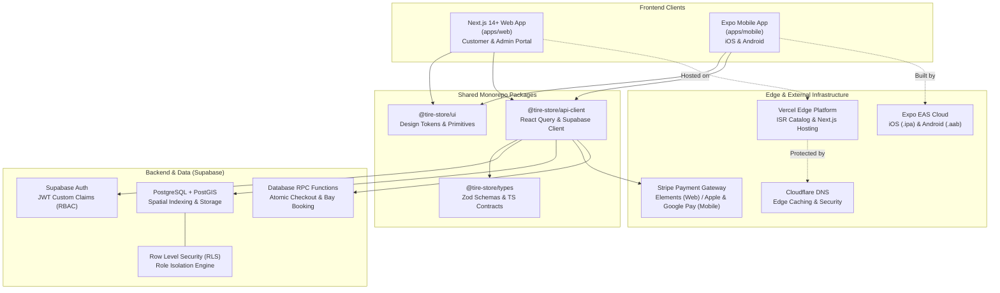
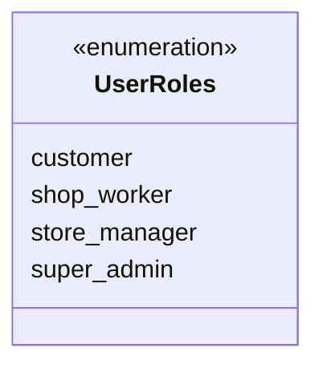
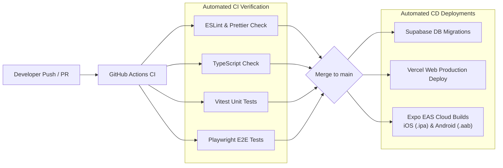

# 🛞 Tire Store App

[](https://turbo.build/repo)
[](https://pnpm.io/)
[](https://nextjs.org/)
[](https://expo.dev/)
[](https://supabase.com/)
[](https://stripe.com/)
[](#license)

> **Cross-Platform Tire E-Commerce, Vehicle Fitment Engine, Store Locator & Service Bay Scheduling Platform** across Web, iOS, and Android.

---

## 📌 Quick Links

- **Repository**: [github.com/basic-app-dev/tire-store-app](https://github.com/basic-app-dev/tire-store-app.git)
- **Jira Project**: [TIRE Board & Summary (Atlassian)](https://pql7227.atlassian.net/jira/software/projects/TIRE/summary)
- **Agent Rulebase & Orchestration**: [AGENTS.md](./AGENTS.md)
- **Local Path**: `/home/phu/dev/tire-store-app`

---

## 📖 1. Project Overview & Mission

The **Tire Store App** is a mission-critical, enterprise-grade e-commerce and automotive service management solution. Designed for performance, scalability, and seamless user experience, the system bridges digital commerce with physical automotive service bays.

### Core Capabilities

1. **Vehicle Fitment Lookup**:
   - Deterministic matching: `Year` ➔ `Make` ➔ `Model` ➔ `Trim` ➔ `Tire Dimensions` (e.g., `225/45R17 91W`).
   - Staggered fitment support (distinct front and rear sizes for performance vehicles).
   - User vehicle garage saving for frictionless one-click re-ordering.
2. **Dynamic Tire Catalog & High-Performance Search**:
   - Comprehensive multi-attribute filtering (brand, season, speed rating, load index, treadwear, run-flat, terrain type).
   - **Incremental Static Regeneration (ISR)** in Next.js for high-ranking SEO catalog pages.
3. **Geospatial Store Locator**:
   - Instant discovery of nearest service centers powered by **PostgreSQL PostGIS** spatial indexing (`ST_DWithin`, `ST_Distance`).
   - Real-time inventory status per retail location.
4. **Service Bay Appointment Booking**:
   - Slot reservation for tire installation, wheel balancing, alignment, and seasonal changeover.
   - Atomic checkout: Bundled tire purchases and appointment slot reservations executed in a single atomic database RPC call.
   - Multi-bay conflict detection preventing double bookings.

---

## 🏗️ 2. Monorepo Architecture

The repository is organized as a high-performance monorepo powered by **`pnpm` workspaces** and **Turborepo** build orchestration.

```text
tire-store-app/
├── apps/
│   ├── web/               # Next.js 14+ (App Router) — Customer Storefront & Admin Portal
│   └── mobile/            # Expo (React Native) — Unified iOS and Android Mobile App
├── packages/
│   ├── db/                # Supabase PostgreSQL migrations, Drizzle ORM schemas, RLS & seed data
│   ├── types/             # Shared Zod validation schemas and TypeScript contracts
│   ├── api-client/        # Shared React Query hooks and Supabase client abstractions
│   └── ui/                # Shared cross-platform design tokens, primitives, and Tailwind theme
├── docs/                  # Architecture Decision Records (ADRs) and technical specifications
├── AGENTS.md              # Antigravity Sub-Agent Orchestration & Development Rules
├── turbo.json             # Turborepo task pipeline configuration
├── pnpm-workspace.yaml    # Workspace package definitions
└── package.json           # Root package scripts and dependencies
```

### Monorepo Workspaces

| Workspace | Technology | Responsibility |
| :--- | :--- | :--- |
| **`apps/web`** | Next.js 14+ (App Router), Tailwind CSS | Customer storefront, tire catalog with ISR, checkout, and admin/manager portal. |
| **`apps/mobile`** | Expo (React Native), Expo Router | Cross-platform mobile app (iOS/Android), camera barcode scanner for technicians, native push notifications. |
| **`packages/db`** | Supabase, Drizzle ORM, PostGIS | Database schema migrations, spatial functions, RLS policies, RPC procedures, and seed datasets. |
| **`packages/types`** | TypeScript, Zod | Central type contracts, API request/response validation schemas, and domain types. |
| **`packages/api-client`** | TanStack Query (React Query), Supabase JS | Unified data-fetching hooks, mutation handlers, and authentication helpers. |
| **`packages/ui`** | React, React Native, Tailwind | Reusable primitives, design tokens, color palettes, and accessible component library. |

### Strict Architectural Boundaries

1. **No Direct Database Access in Client Apps**: `apps/web` and `apps/mobile` must **never** import `@tire-store/db` directly or execute raw SQL. All data interactions occur strictly via Supabase JS client and `@tire-store/api-client`.
2. **End-to-End Type Safety**: All form inputs, API payloads, and query filters validate against Zod schemas in `packages/types`. Unchecked `any` types are strictly forbidden.
3. **Shared Business Logic**: Fitment calculations, cart arithmetic, tire sizing parsing, and appointment validation logic reside in shared packages, never duplicated between Web and Mobile.

---

## 📐 3. System Architecture



---

## 💻 4. Tech Stack & Infrastructure

| Layer | Technology | Specification & Purpose |
| :--- | :--- | :--- |
| **Web Storefront** | Next.js 14+ (App Router) | Incremental Static Regeneration (ISR) for high-performance tire catalog SEO; hosted on **Vercel**. |
| **Mobile App** | Expo (React Native) | Expo Router, native gestures, barcode scanner integration; builds via **EAS Cloud** (`.ipa` and `.aab`). |
| **Database & Auth** | Supabase (PostgreSQL 15+) | Relational storage, Supabase Auth with JWT claims, realtime subscriptions, and automated migrations. |
| **Spatial Engine** | PostGIS | Geographic points (`geography(Point, 4326)`), `ST_DWithin` and `ST_Distance` indexing for store location queries. |
| **ORM & Migrations** | Drizzle ORM | Type-safe SQL schema definitions, typed relations, and predictable migration scripts in `packages/db`. |
| **State & API Client** | TanStack Query (React Query) | Server state management, optimistic UI mutations, and caching in `@tire-store/api-client`. |
| **Payment Gateway** | Stripe | Stripe Elements on Web; native Apple Pay & Google Pay via `@stripe/stripe-react-native` on mobile. |
| **Edge & Security** | Cloudflare & Vercel Edge | Global CDN caching, DDoS mitigation, DNS routing, and edge API runtimes. |
| **Monorepo Tooling** | Turborepo & pnpm | Parallel task orchestration, build caching, workspace dependency link management. |

---

## 🔐 5. User Roles & Access Control (RBAC)

Access control is enforced at the database level using **Supabase Auth Custom Claims** and **PostgreSQL Row Level Security (RLS)**.



### Role Permissions Matrix

| Role | Scope | Permissions & RLS Policy Boundary |
| :--- | :--- | :--- |
| **`customer`** | User Account | • Search catalog, vehicle fitments, and store locations.<br>• Manage own profile, saved vehicles garage, and shopping cart.<br>• Create orders and book service bay slots.<br>• Read *only* own orders and appointments. |
| **`shop_worker`** (Technician) | Assigned Store (`store_id`) | • Inspect daily and weekly bay schedules for assigned store.<br>• Perform customer vehicle check-in via VIN / barcode scan.<br>• Create and update digital vehicle inspection notes.<br>• Read inventory counts for assigned store location. |
| **`store_manager`** | Assigned Store (`store_id`) | • Full schedule management for technicians and service bays.<br>• Perform store-level inventory adjustments and overrides.<br>• Manage store operating hours and blackout dates.<br>• Access store revenue and fulfillment reports. |
| **`super_admin`** | Global System | • Global catalog management (tires, brands, pricing tiers).<br>• Vehicle fitment matrix configuration (`Year/Make/Model/Trim`).<br>• Onboard new retail stores, bays, and manager assignments.<br>• Unrestricted platform audit and administration. |

### Security & RLS Standards

- **Mandatory RLS**: Every table executes `ALTER TABLE <table_name> ENABLE ROW LEVEL SECURITY;`.
- **JWT Verification**: Tenant and role claims are read directly from `auth.jwt() ->> 'user_role'` and `auth.jwt() ->> 'store_id'`.
- **Atomic Booking Transactions**: Cart checkout combined with appointment reservation runs via Supabase RPC procedures to guarantee zero double bookings.

---

## 🤖 6. Antigravity Agent Orchestration

This project is actively maintained and developed using **Google Antigravity** multi-agent orchestration. Agent rules and boundary constraints are defined in [AGENTS.md](./AGENTS.md).

| Agent Handle | Assigned Model | Primary Responsibility & Assigned Skills |
| :--- | :--- | :--- |
| **`@architect`** | **Claude Opus 4.6** | **Database & Systems Architecture**: Supabase schema design, PostGIS spatial queries, RLS security policies, and Zod data contracts.<br>*Skills*: `Superpowers`, `SQL-Optimizer` |
| **`@builder`** | **Flash 3.8** | **Full-Stack Implementation**: Next.js App Router, Expo mobile screens, Stripe payments, Supabase client hooks, and API routes.<br>*Skills*: `Superpowers`, `Ponytail`, `Refactor-Wizard` |
| **`@ui-designer`** | **Flash 3.8** | **UI/UX & Design System**: `@tire-store/ui` primitives, Tailwind CSS theme, responsive layouts, mobile gestures, and WCAG 2.1 AA accessibility.<br>*Skills*: `Impeccable`, `Tailwind-Master`, `Accessibility-Audit` |
| **`@qa-tester`** | **GPT OSS 120B** | **Test Automation & Quality Assurance**: Vitest unit/integration tests, Playwright cross-browser E2E flows, RLS test assertions, and CI pipelines.<br>*Skills*: `Playwright`, `Vitest-Runner`, `CI-Validator` |
| **`@scout`** | **Flash 3.8** | **Repository Maintenance & Operations**: Workspace inspection, linting/formatting fixes, docs maintenance, and Jira commit traceability (`TIRE-xxx`).<br>*Skills*: `Ponytail`, `Fast-Search`, `Jira-Linker` |

---

## 🚀 7. Developer Getting Started

### Prerequisites

- **Node.js**: `20.x` LTS or newer
- **Package Manager**: `pnpm` `9.x` (`corepack enable && corepack prepare pnpm@latest --activate`)
- **Docker**: Required for local Supabase emulator
- **Supabase CLI**: `npm install -g supabase`
- **Mobile Development**:
  - macOS with Xcode (for iOS simulator)
  - Android Studio with Android SDK & emulator
  - EAS CLI: `npm install -g eas-cli`

### 1. Clone & Install

```bash
# Clone the repository
git clone https://github.com/basic-app-dev/tire-store-app.git
cd tire-store-app

# Install all monorepo dependencies
pnpm install
```

### 2. Environment Configuration

Copy the example environment files for each application and package:

```bash
# Web application environment
cp apps/web/.env.example apps/web/.env.local

# Mobile application environment
cp apps/mobile/.env.example apps/mobile/.env

# Database package environment
cp packages/db/.env.example packages/db/.env
```

Ensure the following core variables are configured:

```env
# Supabase
NEXT_PUBLIC_SUPABASE_URL=http://127.0.0.1:54321
NEXT_PUBLIC_SUPABASE_ANON_KEY=your-local-anon-key
SUPABASE_SERVICE_ROLE_KEY=your-local-service-role-key

# Stripe
NEXT_PUBLIC_STRIPE_PUBLISHABLE_KEY=pk_test_...
STRIPE_SECRET_KEY=sk_test_...
STRIPE_WEBHOOK_SECRET=whsec_...
```

### 3. Local Supabase Initialization

```bash
# Start local Supabase containers (PostgreSQL, PostGIS, Auth, Storage)
supabase start

# Apply local database migrations and seed data
pnpm --filter @tire-store/db run db:migrate
pnpm --filter @tire-store/db run db:seed
```

### 4. Run Development Servers

```bash
# Run all workspace apps concurrently (Web + Mobile + Packages)
pnpm dev

# Or run individual applications:
pnpm --filter @tire-store/web dev      # Next.js at http://localhost:3000
pnpm --filter @tire-store/mobile start  # Expo development server
```

### 5. Mobile App Workflow (Expo Development Builds)

We utilize **Expo Development Builds** to ensure full fidelity with native modules (Stripe, Camera Scanner, GPS):

```bash
cd apps/mobile

# Run on iOS simulator (macOS required)
npx expo run:ios

# Run on Android emulator / connected device
npx expo run:android

# Trigger cloud build via Expo Application Services
eas build --profile development --platform all
```

---

## 🌿 8. Git & Jira Traceability Workflow

We follow **GitHub Flow** with mandatory Jira ticket association.

### Branch Naming Convention

```text
feat/TIRE-<ticket-number>-<short-description>
fix/TIRE-<ticket-number>-<short-description>
chore/TIRE-<ticket-number>-<short-description>
```

*Example*: `feat/TIRE-104-vehicle-fitment-selector`

### Commit Message Standard

Every commit message and pull request title must prefix the corresponding Jira ticket ID:

```text
TIRE-<ticket-number>: <imperative description>
```

*Examples*:
- `TIRE-104: Add year-make-model-trim fitment dropdown with Zod validation`
- `TIRE-112: Implement PostGIS ST_DWithin query for nearest store search`
- `TIRE-125: Fix double-booking race condition in bay reservation RPC`

---

## 🔄 9. CI/CD & Deployment Pipeline



1. **Pull Request Validation**:
   - Executes `pnpm lint`, `pnpm typecheck`, `pnpm test` (Vitest), and `pnpm test:e2e` (Playwright).
   - Validates RLS assertions and schema integrity.
2. **Database Migration**:
   - On merge to `main`, GitHub Actions applies migrations directly to production Supabase via Supabase CLI.
3. **Web Deployment**:
   - Vercel automatically deploys `apps/web` with edge ISR caching.
4. **Mobile Release**:
   - Expo Application Services (EAS) generates release builds (`.ipa` for TestFlight / App Store, `.aab` for Google Play Console).

---

## 🛠️ 10. Common Monorepo Commands

```bash
# Build all apps and packages
pnpm build

# Run linting across all workspaces
pnpm lint

# Format code with Prettier
pnpm format

# Run all unit tests with Vitest
pnpm test

# Run end-to-end integration tests with Playwright
pnpm test:e2e

# Generate fresh TypeScript types from Supabase schema
pnpm --filter @tire-store/db run generate:types
```

---

<a id="license"></a>
## 📄 License

Proprietary and Confidential. Copyright © 2026 **basic-app-dev**. All rights reserved.  
Unauthorized copying, modification, distribution, or public display of this software is strictly prohibited.
