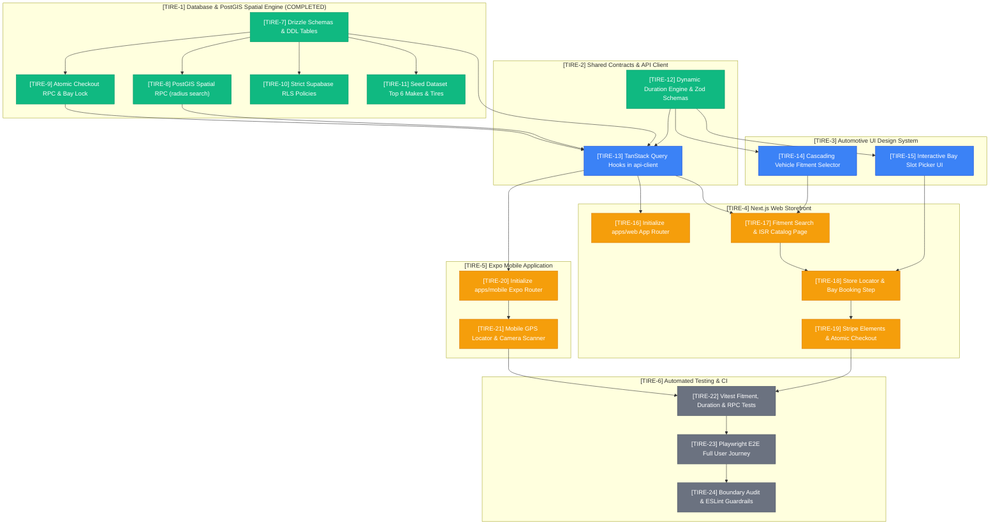

# 📋 Sprint 1: End-to-End Vertical Slice Task Board

> **Maintained by**: [`@manager`](./agents/manager.md)  
> **Jira Project**: [TIRE Summary Board](https://pql7227.atlassian.net/jira/software/projects/TIRE/summary)  
> **Milestone**: Complete Vertical Slice (Fitment Selector ➔ Filtered Catalog ➔ PostGIS Store Locator ➔ Bay Booking ➔ Stripe Atomic Checkout)  
> **Status**: Tracked in Jira & Ready for Swarm Execution

---

## 1. Visual Dependency Graph (Mermaid DAG)

---

## 2. Jira Sprint 1 Execution Matrix

| Jira Key                                                      | Epic     | Agent          | Issue Title                                                               |       Status       | Deliverable & Acceptance Criteria                                                    |
| :------------------------------------------------------------ | :------- | :------------- | :------------------------------------------------------------------------ | :----------------: | :----------------------------------------------------------------------------------- |
| [**`TIRE-7`**](https://pql7227.atlassian.net/browse/TIRE-7)   | `TIRE-1` | `@architect`   | Implement Core Drizzle Schema Tables & Supabase DDL Migrations            |  🟢 **COMPLETED**  | Tables for stores, bays, tires, vehicles, fitments, appointments, orders, users.     |
| [**`TIRE-8`**](https://pql7227.atlassian.net/browse/TIRE-8)   | `TIRE-1` | `@architect`   | Implement PostGIS Store Locator Spatial RPC (`find_stores_within_radius`) |  🟢 **COMPLETED**  | PostGIS spatial RPC querying stores within radius with distance in meters.           |
| [**`TIRE-9`**](https://pql7227.atlassian.net/browse/TIRE-9)   | `TIRE-1` | `@architect`   | Implement Atomic Checkout RPC with Bay Conflict Prevention                |  🟢 **COMPLETED**  | PL/pgSQL `complete_atomic_checkout` with `tstzrange` bay slot lock.                  |
| [**`TIRE-10`**](https://pql7227.atlassian.net/browse/TIRE-10) | `TIRE-1` | `@architect`   | Configure Strict Supabase Row Level Security (RLS) Policies               |  🟢 **COMPLETED**  | Mandatory RLS on all tables enforcing user role isolation via JWT claims.            |
| [**`TIRE-11`**](https://pql7227.atlassian.net/browse/TIRE-11) | `TIRE-1` | `@architect`   | Build Realistic Seed Dataset for Top Makes (NHTSA Top 6) & Tire Catalog   |  🟢 **COMPLETED**  | Seeds for Toyota, Tesla, Honda, Ford, BMW, Chevy with staggered tire setups.         |
| [**`TIRE-12`**](https://pql7227.atlassian.net/browse/TIRE-12) | `TIRE-2` | `@architect`   | Implement Dynamic Bay Duration Calculation Engine & Zod Contracts         |  🟢 **COMPLETED**  | Pure function `calculateBayDuration` (4 tires=60m, 2=35m, align=+30m, TPMS=+15m).    |
| [**`TIRE-13`**](https://pql7227.atlassian.net/browse/TIRE-13) | `TIRE-2` | `@builder`     | Implement TanStack Query Hooks in `@tire-store/api-client`                | 🔵 **IN PROGRESS** | Hooks for `useTires`, `useFitment`, `useStores`, `useSlots`, `useAtomicCheckout`.    |
| [**`TIRE-14`**](https://pql7227.atlassian.net/browse/TIRE-14) | `TIRE-3` | `@ui-designer` | Build Cascading Vehicle Fitment Selector Component                        | 🔵 **IN PROGRESS** | Cascading `Year/Make/Model/Trim` dropdown with staggered badges and garage save.     |
| [**`TIRE-15`**](https://pql7227.atlassian.net/browse/TIRE-15) | `TIRE-3` | `@ui-designer` | Build Interactive Service Bay Slot Picker Component                       | 🔵 **IN PROGRESS** | Timeline calendar displaying dynamically sized slots based on cart services.         |
| [**`TIRE-16`**](https://pql7227.atlassian.net/browse/TIRE-16) | `TIRE-4` | `@builder`     | Initialize Next.js 14+ App Router Workspace (`apps/web`)                  |   ⏳ **WAITING**   | App Router setup with Tailwind CSS and shared monorepo packages.                     |
| [**`TIRE-17`**](https://pql7227.atlassian.net/browse/TIRE-17) | `TIRE-4` | `@builder`     | Implement Vehicle Fitment Search Bar & ISR Compatible Tire Catalog        |   ⏳ **WAITING**   | Hero search bar and SEO-optimized ISR tire catalog with filter sidebar.              |
| [**`TIRE-18`**](https://pql7227.atlassian.net/browse/TIRE-18) | `TIRE-4` | `@builder`     | Implement PostGIS Store Locator & Bay Appointment Booking Flow            |   ⏳ **WAITING**   | Geolocation store search and bay reservation integrating `BaySlotPicker`.            |
| [**`TIRE-19`**](https://pql7227.atlassian.net/browse/TIRE-19) | `TIRE-4` | `@builder`     | Integrate Stripe Elements Checkout Form with Atomic Checkout RPC          |   ⏳ **WAITING**   | Stripe PaymentIntent route, Elements form, guest support, and atomic order RPC.      |
| [**`TIRE-20`**](https://pql7227.atlassian.net/browse/TIRE-20) | `TIRE-5` | `@builder`     | Initialize Expo Mobile App Workspace (`apps/mobile`) with Expo Router     |   ⏳ **WAITING**   | Expo Router mobile app with NativeWind styling and shared `@tire-store/api-client`.  |
| [**`TIRE-21`**](https://pql7227.atlassian.net/browse/TIRE-21) | `TIRE-5` | `@builder`     | Implement Native Mobile GPS Store Locator & Camera VIN/Barcode Scanner    |   ⏳ **WAITING**   | GPS store locator with `expo-location` and camera scanner with `expo-camera`.        |
| [**`TIRE-22`**](https://pql7227.atlassian.net/browse/TIRE-22) | `TIRE-6` | `@qa-tester`   | Implement Vitest Unit Tests for Fitment Math, Duration & RPCs             |   ⚪ **QUEUED**    | Unit test suites covering duration calculation, Zod parsing, and DB RPC mocks.       |
| [**`TIRE-23`**](https://pql7227.atlassian.net/browse/TIRE-23) | `TIRE-6` | `@qa-tester`   | Implement Playwright E2E Suite for Complete Customer Purchase Journey     |   ⚪ **QUEUED**    | Automated browser E2E test verifying full user journey to order confirmation.        |
| [**`TIRE-24`**](https://pql7227.atlassian.net/browse/TIRE-24) | `TIRE-6` | `@scout`       | Enforce Monorepo Architectural Boundary Audit & ESLint Guardrails         |   ⚪ **QUEUED**    | Automated script blocking `@tire-store/db` client imports and Jira commit standards. |
