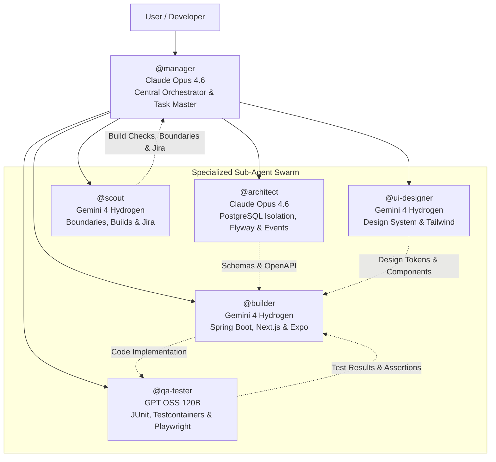

# 🤖 Antigravity Sub-Agent Orchestration System

> **Automotive Platform (Web, iOS, Android & 8 Spring Boot Microservices)**
> Comprehensive documentation for the multi-agent development swarm operating across the monorepo.

---

## 1. Overview & Operating Philosophy

The Automotive Platform monorepo uses specialized AI sub-agents configured in Antigravity to handle distinct technical domains. By dividing tasks across domain specialists, each sub-agent operates with targeted tools, specific models, and strict architectural constraints:

---

## 2. Agent Roster & Model Assignments

| Agent Handle                         | Native File                                                            | Model               | Primary Domain                                        | Core Skills                                                                    | Tool Scope                                     |
| :----------------------------------- | :--------------------------------------------------------------------- | :------------------ | :---------------------------------------------------- | :----------------------------------------------------------------------------- | :--------------------------------------------- |
| [**`@manager`**](manager.md)         | [`.agents/agents/manager.md`](../../.agents/agents/manager.md)         | **Claude Opus 4.6** | Central Orchestrator & Task Master                    | `superpowers`, `ponytail`, `fast-search`, `jira-linker`                        | File R/W/Edit, Shell, Task Manager, Web Search |
| [**`@architect`**](architect.md)     | [`.agents/agents/architect.md`](../../.agents/agents/architect.md)     | **Claude Opus 4.6** | PostgreSQL Isolation, Flyway, PostGIS, Events, OpenAPI| `superpowers`, `sql-optimizer`, `postgis-spatial`                              | File R/W/Edit, Shell, Web Search               |
| [**`@builder`**](builder.md)         | [`.agents/agents/builder.md`](../../.agents/agents/builder.md)         | **Gemini 4 Hydrogen** | Spring Boot, Next.js, Expo, Payments, Saga            | `superpowers`, `ponytail`, `refactor-wizard`, `stripe-payments`, `expo-native` | File R/W/Edit, Shell, Task Manager, Web Search |
| [**`@ui-designer`**](ui-designer.md) | [`.agents/agents/ui-designer.md`](../../.agents/agents/ui-designer.md) | **Gemini 4 Hydrogen** | Design System, Cross-Platform UI, Accessibility       | `impeccable`, `tailwind-master`, `accessibility-audit`, `expo-native`          | File R/W/Edit, Shell                           |
| [**`@qa-tester`**](qa-tester.md)     | [`.agents/agents/qa-tester.md`](../../.agents/agents/qa-tester.md)     | **GPT OSS 120B**      | Test Automation: JUnit 5, Testcontainers, Playwright  | `playwright`, `vitest-runner`, `ci-validator`                                  | File R/W/Edit, Shell, Task Manager             |
| [**`@scout`**](scout.md)             | [`.agents/agents/scout.md`](../../.agents/agents/scout.md)             | **Gemini 4 Hydrogen** | Boundaries, Standalone Builds, Lint, Jira Traceability| `ponytail`, `fast-search`, `jira-linker`                                       | File R/W/Edit, Shell                           |

---

## 3. Invocation & Collaboration Workflows

### How to Invoke

In Antigravity chat or prompts, invoke an agent using its handle:

- _"@architect please design the Flyway migration for appointment booking records."_
- _"@builder implement the automotive-operations checkout Saga participant."_
- _"@ui-designer create a responsive tire card component in packages/ui."_
- _"@qa-tester write Testcontainers integration tests for PostgreSQL persistence."_
- _"@scout verify that all commits follow the Jira TIRE-xxx naming standard."_

### Inter-Agent Collaboration Patterns

1. **Feature Implementation Cycle**:
   - `@architect` establishes service domain schemas, Flyway migrations, and OpenAPI specs.
   - `@ui-designer` creates visual primitives and Tailwind styles in `packages/ui`.
   - `@builder` implements the backend Spring Boot REST services, web/mobile screens, and Saga participants.
   - `@qa-tester` writes JUnit 5, Testcontainers, Vitest, and Playwright automation suites.
   - `@scout` lints the code, verifies independent builds, and checks Jira commit message syntax (`TIRE-xxx`).

---

## 4. Architectural Boundaries Enforced by Agents

All agents are instructed to strictly uphold these rules:

1. **Build & Runtime Independence**: Eight standalone Spring Boot applications under `backend/services/*`, each with its own independent Gradle Kotlin DSL build (`settings.gradle.kts`, `build.gradle.kts`, wrapper). No shared Gradle root project.
2. **Service Ownership & Data Isolation**:
   - Each service owns its dedicated PostgreSQL database and Flyway migrations. Zero cross-service database access.
   - Appointment owns appointment booking records and lifecycle.
   - Store Management owns physical resources, service capabilities, resource availability, and bay reservations.
   - Automotive Operations owns order, work order, billing, and checkout orchestration.
   - Automotive Product owns tire/parts catalog, inventory, and stock reservations.
3. **No Direct DB Access in Clients**: Client apps (`apps/web`, `apps/mobile`) access backend services through APISIX gateway or REST APIs.
4. **End-to-End Type Safety**: Forms validate with Zod schemas from `packages/types`; backend services expose versioned OpenAPI contracts.
5. **Jira Ticket Traceability**: Every git commit and PR must be prefixed with `TIRE-xxx`.
6. **Manual Approval Gates**: All file modifications, project initializations, commits, pushes, merges, and deployments require explicit user authorization.
