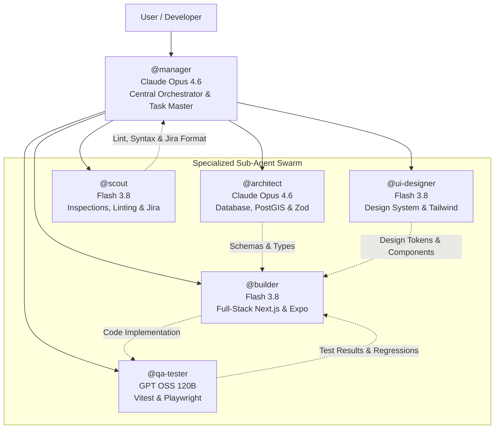

# 🤖 Antigravity Sub-Agent Orchestration System

> **Tire Store App (Web, iOS, and Android)**  
> Comprehensive documentation for the multi-agent development swarm operating across the monorepo.

---

## 1. Overview & Operating Philosophy

The Tire Store App monorepo uses specialized AI sub-agents configured in Antigravity to handle distinct technical domains. By dividing tasks across domain specialists, each sub-agent operates with targeted tools, specific models, and strict architectural constraints:

---

## 2. Agent Roster & Model Assignments

| Agent Handle                         | Native File                                                            | Model               | Primary Domain                                        | Core Skills                                                                    | Tool Scope                                     |
| :----------------------------------- | :--------------------------------------------------------------------- | :------------------ | :---------------------------------------------------- | :----------------------------------------------------------------------------- | :--------------------------------------------- |
| [**`@manager`**](manager.md)         | [`.agents/agents/manager.md`](../../.agents/agents/manager.md)         | **Claude Opus 4.6** | Central Orchestrator & Task Master                    | `superpowers`, `ponytail`, `fast-search`, `jira-linker`                        | File R/W/Edit, Shell, Task Manager, Web Search |
| [**`@architect`**](architect.md)     | [`.agents/agents/architect.md`](../../.agents/agents/architect.md)     | **Claude Opus 4.6** | Database, PostGIS, RLS, Zod Schemas                   | `superpowers`, `sql-optimizer`, `postgis-spatial`                              | File R/W/Edit, Shell, Web Search               |
| [**`@builder`**](builder.md)         | [`.agents/agents/builder.md`](../../.agents/agents/builder.md)         | **Flash 3.8**       | Full-Stack (Next.js, Expo, Stripe, API)               | `superpowers`, `ponytail`, `refactor-wizard`, `stripe-payments`, `expo-native` | File R/W/Edit, Shell, Task Manager, Web Search |
| [**`@ui-designer`**](ui-designer.md) | [`.agents/agents/ui-designer.md`](../../.agents/agents/ui-designer.md) | **Flash 3.8**       | Design System, Cross-Platform UI, Accessibility       | `impeccable`, `tailwind-master`, `accessibility-audit`, `expo-native`          | File R/W/Edit, Shell                           |
| [**`@qa-tester`**](qa-tester.md)     | [`.agents/agents/qa-tester.md`](../../.agents/agents/qa-tester.md)     | **GPT OSS 120B**    | Test Automation, Vitest, Playwright, CI/CD            | `playwright`, `vitest-runner`, `ci-validator`                                  | File R/W/Edit, Shell, Task Manager             |
| [**`@scout`**](scout.md)             | [`.agents/agents/scout.md`](../../.agents/agents/scout.md)             | **Flash 3.8**       | Repo Inspection, Lint/Format Fixes, Jira Traceability | `ponytail`, `fast-search`, `jira-linker`                                       | File R/W/Edit, Shell                           |

---

## 3. Invocation & Collaboration Workflows

### How to Invoke

In Antigravity chat or prompts, invoke an agent using its handle:

- _"@architect please design the vehicle fitment database tables with PostGIS indexing."_
- _"@builder implement the checkout flow in apps/web with Stripe Elements."_
- _"@ui-designer create a responsive tire card component in packages/ui."_
- _"@qa-tester write Playwright tests for customer store locator search."_
- _"@scout verify the formatting and Jira ticket references in the latest PR."_

### Inter-Agent Collaboration Patterns

1. **Feature Implementation Cycle**:
   - `@architect` establishes the database schema in `packages/db` and Zod types in `packages/types`.
   - `@ui-designer` creates visual primitives and Tailwind styles in `packages/ui`.
   - `@builder` implements the frontend screens and API routes connecting Supabase and Stripe.
   - `@qa-tester` writes unit tests and E2E automation specs to verify the user journey.
   - `@scout` lints the code, verifies markdown formatting, and checks Jira commit message syntax (`TIRE-xxx`).

---

## 4. Architectural Boundaries Enforced by Agents

All agents are instructed to strictly uphold these rules:

1. **No DB Access in Client Apps**: `apps/web` and `apps/mobile` never import `@tire-store/db` directly. All data access runs through `@tire-store/api-client` and Supabase client SDK.
2. **Mandatory Row Level Security (RLS)**: Every new table must enable RLS with policies for `customer`, `shop_worker`, `store_manager`, and `super_admin`.
3. **End-to-End Type Safety**: Forms and API requests must validate with Zod schemas from `packages/types`.
4. **Jira Ticket Traceability**: Every git commit and PR must be prefixed with `TIRE-xxx`.
