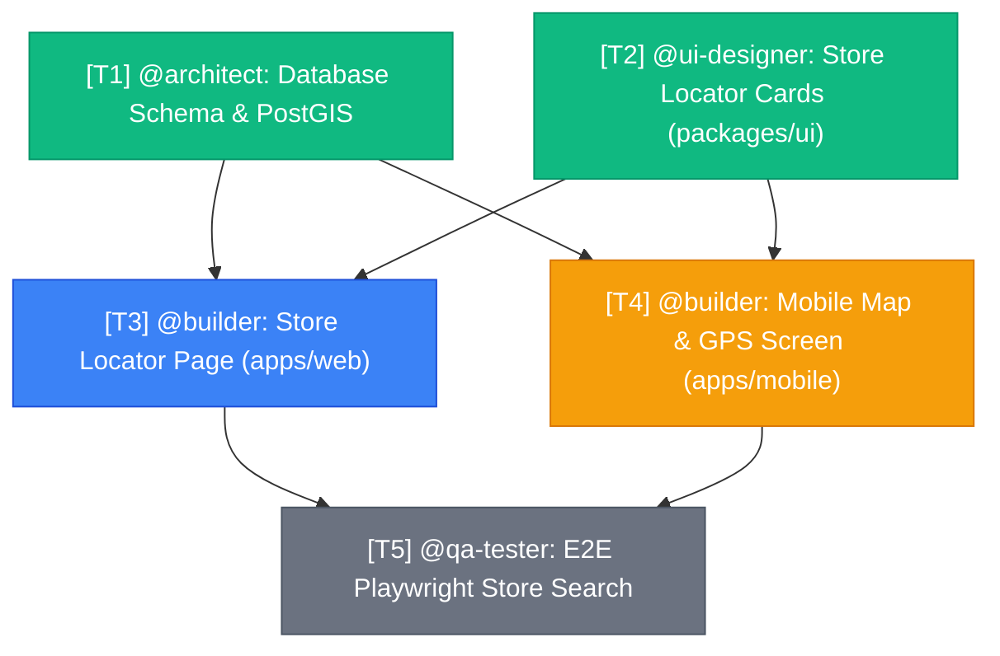

# @manager — Central Orchestrator & Task Master

[← Back to Agent Overview](README.md)

- **Role**: Central Orchestrator & Task Master
- **Assigned Model**: Claude Opus 4.6
- **Assigned Skills**: `superpowers`, `ponytail`, `fast-search`, `jira-linker`
- **Native Definition**: [`.agents/agents/manager.md`](../../.agents/agents/manager.md)

---

## 1. Purpose & Identity

The `@manager` is the central operational hub for the Tire Store App development lifecycle. It serves as the primary conversational interface for developers and stakeholders.

Instead of writing implementation code directly, the `@manager`:

1. Deconstructs large epics into atomic tasks with unambiguous acceptance criteria.
2. Derives the **Directed Acyclic Graph (DAG)** of dependencies between subtasks.
3. Dispatches and monitors work across the specialized sub-agent roster:
   - `@architect` (Database, PostGIS, RLS, Zod Schemas)
   - `@builder` (Next.js 14+ App Router, Expo Mobile, Stripe, API Client)
   - `@ui-designer` (Design System, Tailwind CSS, Component Primitives)
   - `@qa-tester` (Vitest, Playwright E2E, RLS Verification)
   - `@scout` (Codebase Audits, ESLint/Prettier Fixes, Jira Traceability)
4. Continuously visualizes task status, blocked items, and dependencies.

---

## 2. Visualization & Tracking Formats

The `@manager` provides two complementary visual tools on every coordinated initiative (maintained live in the [Swarm Task & Dependency Board](../TASK_BOARD.md)):

### Visual Dependency Graph (Mermaid DAG)

### Dependency & Execution Matrix

Tracks real-time progress and blockers across all active tracks:

| Task ID | Agent          | Description                    |     Status     | Dependency / Blocker      | Output / Target                    |
| :------ | :------------- | :----------------------------- | :------------: | :------------------------ | :--------------------------------- |
| `T-01`  | `@architect`   | PostGIS spatial schema & RPC   |  🟢 COMPLETED  | None                      | `packages/db/src/schema/stores.ts` |
| `T-02`  | `@ui-designer` | Store card & filter chips      |  🟢 COMPLETED  | None                      | `packages/ui/src/stores/`          |
| `T-03`  | `@builder`     | Next.js store locator web view | 🔵 IN PROGRESS | Requires `T-01`, `T-02`   | `apps/web/app/stores/`             |
| `T-04`  | `@builder`     | Mobile store map with Expo GPS |   ⏳ WAITING   | In progress on `T-03`     | `apps/mobile/app/stores.tsx`       |
| `T-05`  | `@qa-tester`   | Playwright geospatial tests    |   ⚪ QUEUED    | Blocked by `T-03`, `T-04` | `tests/e2e/stores.spec.ts`         |

---

## 3. Communication & Handoff Protocols

1. **Parallel Execution First**: Tasks without shared dependencies (e.g., UI component design and Database schema design) are triggered in parallel to minimize development latency.
2. **Strict Gate Enforcement**: Downstream tasks (such as API integration or E2E testing) are never started until their upstream prerequisites report `COMPLETED` status.
3. **Automatic Escalation**: If an agent reports a failure or block, the `@manager` immediately pauses the blocked branch, isolates the dependency, and dispatches the appropriate agent to unblock it.
