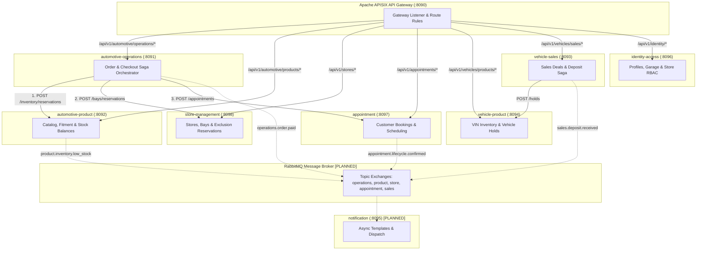

# System-Wide Capability Map & Architectural Index

> **Document Status**: `AUTHORITATIVE ARCHITECTURE SPECIFICATION` (Phase 2E-R Revised)  
> **Key Architecture Decisions**:
> - Exactly 8 Standalone Spring Boot Microservices (Strict System Boundary; Zero 9th Business Service).
> - Apache APISIX is strictly the ingress API gateway, **not** a Saga orchestrator (Approved Decision A).
> - `automotive-operations` owns the Tire Checkout Saga (Approved Decision B).
> - `vehicle-sales` owns the Used-Vehicle Sales Saga (Approved Decision C).
> - `appointment` coordinates standalone service appointments directly with `store-management` (Approved Decision D).
> - Persistence, Outbox, and RabbitMQ are `[PLANNED]`.

---

## 1. Executive Summary & Purpose

This document provides the high-level architecture blueprint and capability taxonomy for the Tire Store Platform monorepo. It maps the eight approved standalone Spring Boot microservices, defines internal module hierarchies, charts external actor interactions, documents critical business invariants, and outlines synchronous versus asynchronous boundaries across the distributed platform.

---

## 2. Microservice & Module Hierarchy

```
┌────────────────────────────────────────────────────────────────────────────────────────┐
│                        Automotive Platform Capability Hierarchy                        │
└────────────────────────────────────────────────────────────────────────────────────────┘
                                            │
    ┌───────────────────────────────────────┼───────────────────────────────────────┐
    ▼                                       ▼                                       ▼
Domain A: Automotive Services           Domain B: Used-Car Sales            Domain C: Shared Platform
  ├── automotive-operations (8091)        ├── vehicle-sales (8093)            ├── store-management (8098)
  │     ├── Order Module                  │     ├── Sales Pipeline Module     │     ├── Store Directory Module
  │     ├── Checkout Saga Orchestrator    │     ├── Vehicle Sales Saga Mod    │     ├── Operating Hours Module
  │     ├── Payment & Billing Module      │     ├── Deposit & Payment Module  │     ├── Service Capability Module
  │     ├── Work Order Module             │     ├── Contract & Document Module│     ├── Bay Registry Module
  │     └── Fulfillment Module            │     └── Handover & Delivery Module│     └── Exclusive Bay Resv Module
  │                                       │                                   ├── appointment (8097)
  └── automotive-product (8092)           └── vehicle-product (8094)          │     ├── Appointment Lifecycle Mod
        ├── Product Catalog Module              ├── Vehicle Inventory Module  │     ├── Customer Scheduling Mod
        ├── Vehicle Fitment Module              ├── Vehicle Listing Module    │     ├── Booking Coordination Mod
        ├── Branch Inventory Module             ├── Condition & Inspection Mod│     └── Calendar & Pass Module
        ├── Stock Reservation Module            ├── Vehicle Hold Module       ├── identity-access (8096)
        ├── Pricing & Promo Module              └── Photo Asset Module        │     ├── User Profile Module
        └── Search & Filtering Module                                         │     ├── Access Management (RBAC)
                                                                              │     ├── Customer Garage Module
                                                                              │     └── Identity Sync Module
                                                                              └── notification (8095)
                                                                                    ├── Template Management Mod
                                                                                    ├── Delivery Dispatcher Mod
                                                                                    ├── Preferences Module
                                                                                    └── Reliability & DLQ Module
```

---

## 3. High-Level Activity Index Across All Eight Services

| Service | Primary Domain | Core Modules | Total Cataloged Activities | Critical Invariant Enforced | Concurrency Mechanism |
| :--- | :--- | :--- | :---: | :--- | :--- |
| **`automotive-operations`** | Orders & Checkout | Orders, Checkout Saga, Payments, Work Orders, Fulfillment | 16 | Order cannot transition to `PAID` without verified stock and bay holds; zero double-billing. | Stateful Orchestrated Saga + Stripe Idempotency |
| **`automotive-product`** | Products & Stock | Catalog, Fitment, Inventory, Reservations, Pricing, Search | 28 | Non-negative stock invariant; zero overselling of physical inventory. | Conditional Atomic Update / Row Lock (`SELECT FOR UPDATE`) |
| **`vehicle-sales`** | Used Car Sales | Sales Pipeline, Sales Saga, Deposits, Contracts, Handover | 7 | Only one executed sales contract per VIN; holding deposits secured via Stripe. | Stateful Sales Saga + Unique Contract Invariant |
| **`vehicle-product`** | Used Car Inventory| Vehicle Inventory, Listings, Condition, Holds, Assets | 10 | 17-character VIN uniqueness; vehicle cannot be held or purchased if not `LISTED`. | Unique Index on VIN + Conditional State Updates |
| **`store-management`** | Physical Stores | Directory, Operating Hours, Capabilities, Bays, Reservations | 13 | Zero double-booking of physical service bays. | PostgreSQL GiST Range Exclusion (`EXCLUDE USING GIST`) |
| **`appointment`** | Customer Bookings | Lifecycle, Scheduling, Booking Coordination, Calendar | 9 | Confirmed appointment must bind to an active bay reservation in `store-management`. | Two-phase reservation coordination (local ACID per service) |
| **`identity-access`** | Identity & RBAC | User Profiles, Store RBAC, Customer Garage, Sync | 7 | Store roles (`shop_worker`, `store_manager`) strictly scoped to valid `store_id`; zero password storage. | Spring Security Token Context + Store ID Validation |
| **`notification`** | Messaging Engine | Templates, Dispatcher, Preferences, Reliability/DLQ | 9 | Decoupled asynchronous delivery; notification failure never aborts business transactions. | RabbitMQ Consumer `[PLANNED]` + DLQ Deduplication |
| **TOTAL** | **Full Platform** | **37 Internal Modules** | **99 Defined Activities** | **Strict single ownership per entity; zero cross-database queries.** | **Zero distributed 2PC; local ACID transactions only.** |

---

## 4. Architectural Boundary: Ingress Gateway vs. Domain Sagas

```text
┌────────────────────────────────────────────────────────────────────────┐
│                        APISIX API Gateway (:8090)                      │
│  - Reverse proxying, TLS termination, routing rules                    │
│  - Client JWT token verification & rate limiting                       │
│  - Stateless, non-transactional ingress routing                        │
└───────────────────────────────────┬────────────────────────────────────┘
                                    │
            ┌───────────────────────┴───────────────────────┐
            │ Forward /api/v1/checkout                      │ Forward /api/v1/vehicles/sales
            ▼                                               ▼
┌───────────────────────────────────────┐       ┌───────────────────────────────────────┐
│         automotive-operations         │       │             vehicle-sales             │
│  ┌─────────────────────────────────┐  │       │  ┌─────────────────────────────────┐  │
│  │     Checkout Saga Orchestrator  │  │       │  │   Vehicle Sales Saga Orchestrator│  │
│  │  - Manages Order Business State │  │       │  │  - Manages Deal State Machine   │  │
│  │  - Coordinates Stock/Bay/Pay    │  │       │  │  - Coordinates VIN Hold/Deposit │  │
│  │  - Executes Compensations       │  │       │  │  - Manages Digital Contracts    │  │
│  │  - Persists in PostgreSQL       │  │       │  │  - Persists in PostgreSQL       │  │
│  └─────────────────────────────────┘  │       │  └─────────────────────────────────┘  │
└───────────────────────────────────────┘       └───────────────────────────────────────┘
```

---

## 5. Cross-Service Interaction Boundaries



---

## 6. Critical Architectural Invariants

1. **Independent Persistence**: Each service owns its dedicated PostgreSQL database schema. Zero cross-database SQL queries, foreign keys, or shared ORM entities exist.
2. **Distributed Transaction Integrity via Sagas**: Multi-service workflows (Tire Purchase with Installation; Used Vehicle Sales) are orchestrated as compensating Sagas. If any step fails, compensation releases downstream resources.
3. **Atomic Resource Reservations**:
   - Tire/parts inventory is locked via conditional atomic updates or row locking in `automotive-product`.
   - Physical service bays are locked via PostgreSQL GiST Range Exclusion Constraints in `store-management`.
   - Used vehicle VINs are locked via conditional state transitions in `vehicle-product`.
4. **Decoupled Notification Delivery**: The `notification` service operates strictly asynchronously. Notification failure never rolls back completed orders.
5. **Zero Password Storage**: All authentication credentials and session tokens are managed exclusively by Keycloak. `identity-access` manages application profiles, store assignments, and customer garage vehicles.
