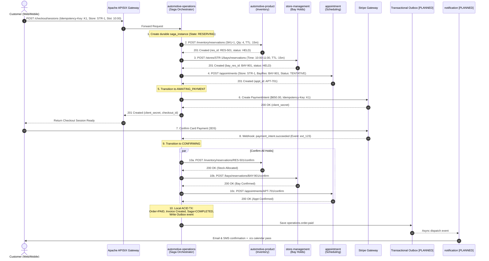
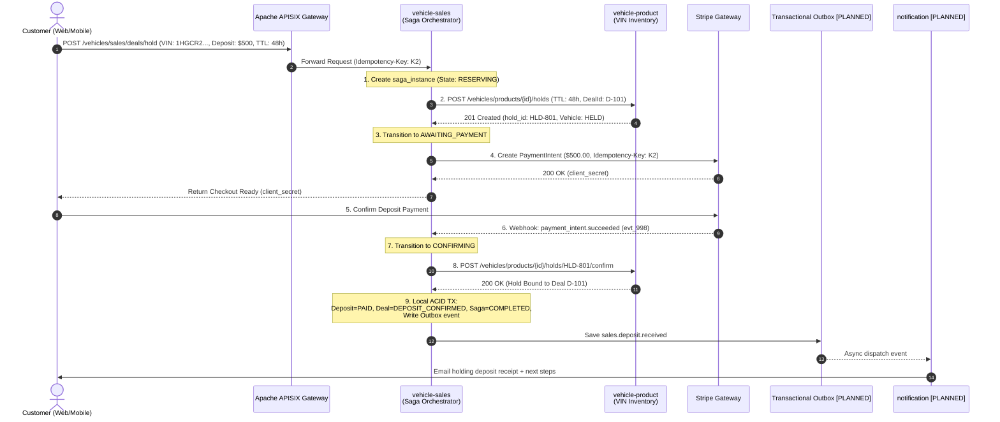

# Cross-Service Workflows & Distributed Saga Choreography

> **Document Status**: `PROPOSED DESIGN` / `APPROVED DECISIONS` (Phase 2E-R Revised)  
> **Key Architecture Decisions**:
> - `automotive-operations` owns the Tire Checkout Saga (Approved Decision B).
> - `vehicle-sales` owns the Used-Vehicle Sales Saga (Approved Decision C).
> - `appointment` coordinates standalone service appointments; `store-management` owns physical bay reservations (Approved Decision D).
> - Apache APISIX is strictly the ingress API gateway, not a workflow orchestrator (Approved Decision A).
> - All intermediate holds are tentative local transactions; **distributed 2PC/XA is strictly prohibited**.
> - Message Broker (RabbitMQ) and Transactional Outbox are `[PLANNED]`.

---

## 1. Overview & Distributed Transaction Principles

In a distributed microservice architecture with independent databases per service, cross-service workflows cannot use distributed two-phase commit (XA/2PC) transactions due to lock escalation, network blocking, and cloud database constraints.

The platform enforces the following transaction coordination rules:
1. **Single Orchestrator per Business Process**: Every multi-service workflow has exactly one authoritative orchestrator responsible for dispatching steps, verifying acknowledgments, and executing compensations upon failure.
2. **Orchestrated Saga Pattern for High-Stakes Operations**: Workflows involving monetary exchange, inventory deductions, and physical resource locks (e.g. Tire Checkout with Installation, Used Vehicle Sales Deals) use stateful orchestrators persisting progress in PostgreSQL.
3. **Event-Driven Choreography for Asynchronous Side Effects**: Non-blocking side effects (e.g., sending customer emails, low-stock warnings) are triggered asynchronously via RabbitMQ domain events through the Transactional Outbox.
4. **Tentative Holds vs. Final Allocation**: Downstream services provide explicit two-stage reservation semantics:
   - **Tentative Reservation** (`POST /reservations`): Holds resources with a Time-To-Live (TTL) deadline.
   - **Final Confirmation** (`POST /reservations/{id}/confirm`): Commits the allocation permanently upon successful payment.
   - **Compensation / Release** (`DELETE /reservations/{id}`): Idempotently releases held resources if subsequent steps fail.
5. **Idempotency Everywhere**: All mutating REST endpoints and asynchronous message listeners accept idempotency keys (`Idempotency-Key` header or event UUID) to safely handle network retries.

---

## 2. Core Workflows with Detailed Saga Design

---

### Workflow 1: Search Tires Compatible with a Customer's Vehicle
- **Initiator**: Customer on Web or Mobile App.
- **Participating Services**: `automotive-product` (Authoritative Owner).
- **Single Business Owner**: `automotive-product`.
- **Ordered Steps**:
  1. Customer selects `Year`, `Make`, `Model`, `Trim` (or loads from Garage Vehicle in `identity-access`).
  2. Client calls `GET /api/v1/automotive/products/fitment/lookup?year=2023&make=Toyota&model=Camry&trim=SE`.
  3. `automotive-product` resolves OEM tire size (`235/45R18`) and minimum load index (`94V`).
  4. Client queries tire catalog: `GET /api/v1/automotive/products/tires?width=235&aspectRatio=45&rimDiameter=18&minLoadIndex=94`.
  5. `automotive-product` executes composite index query and returns verified matching products.
- **Transaction Boundary**: Read-Only Local Transaction.
- **Failure Handling**: If fitment reference data is incomplete, the engine returns `UNCERTAIN` status with a safety disclaimer prompting manual door-jamb verification.
- **Observable Completion State**: Customer views list of verified compatible tire models.

---

### Workflow 2: Find Compatible Tires Available at a Nearby Store
- **Initiator**: Customer on Web or Mobile App.
- **Participating Services**: `store-management`, `automotive-product`.
- **Single Business Owner / Orchestrator**: Next.js App Router (BFF Layer).
- **Ordered Steps**:
  1. Client sends GPS coordinates to `store-management`: `GET /api/v1/stores?lat=37.77&lng=-122.41&radiusMiles=25`.
  2. `store-management` executes PostGIS spatial query (`ST_DWithin`) and returns ordered list of nearest store IDs (`STR-101`, `STR-102`).
  3. Client queries tire catalog with store list: `GET /api/v1/automotive/products/tires?width=235&aspectRatio=45&rimDiameter=18&storeIds=STR-101,STR-102&inStockOnly=true`.
  4. `automotive-product` filters active stock balances where $\text{on\_hand} - (\text{reserved} + \text{allocated}) \ge 4$.
- **Transaction Boundary**: Read-Only Local Transactions across both services.
- **Observable Completion State**: Customer views nearest store having verified in-stock tires.

---

### Workflow 3: Purchase Tires with Store Pickup (Tire-Only Checkout)
- **Initiator**: Customer submitting checkout for in-store pickup (no installation labor).
- **Participating Services**: `automotive-operations` (Orchestrator), `automotive-product`, Stripe Payment Gateway, `notification` `[PLANNED]`.
- **Single Business Owner / Saga Orchestrator**: `automotive-operations`.
- **Ordered Steps**:
  1. Customer submits checkout: `POST /api/v1/automotive/operations/checkout/sessions` with `Idempotency-Key: <UUID>`.
  2. `automotive-operations` creates durable `saga_instance` (status: `RESERVING`).
  3. `automotive-operations` calls `POST /api/v1/automotive/products/inventory/reservations` (`X-Saga-Id`, `X-Saga-Step-Id: stock_01`, `ttlMinutes: 15` [PROPOSED default]).
  4. `automotive-product` executes atomic reservation (conditional SQL decrement or row lock) and returns `201 Created` with `reservation_id: RES-501`.
  5. `automotive-operations` creates Stripe `PaymentIntent` ($520.00) and advances saga to `AWAITING_PAYMENT`. Returns `client_secret` to user.
  6. Customer completes payment via Stripe Elements.
  7. Stripe emits webhook `payment_intent.succeeded` to `automotive-operations`.
  8. `automotive-operations` transitions saga to `CONFIRMING`:
     - Calls `POST /inventory/reservations/RES-501/confirm` on `automotive-product` (moves stock from `reserved` to `allocated`).
  9. `automotive-operations` creates `CustomerOrder` (status: `PAID`), generates `Invoice`, writes `operations.order.paid` to `transactional_outbox`, and transitions saga to `COMPLETED`.
  10. `notification` asynchronously consumes outbox event and sends customer pickup instructions and 4-digit pickup PIN.
- **Failure Handling**:
  - If stock reservation fails: Saga transitions to `FAILED`; HTTP `409 Conflict` returned to client.
  - If payment fails or times out: Saga enters `COMPENSATING`; calls `DELETE /inventory/reservations/RES-501` to release stock; transitions to `COMPENSATED`.
- **Observable Completion State**: Order is `PAID`, stock is `ALLOCATED`, customer has received confirmation email.

---

### Workflow 4: Purchase Tires with Installation Appointment (Master Checkout Saga)

> [!IMPORTANT]
> **Owner Decision**: `automotive-operations` is the authoritative orchestrator for the entire checkout workflow. Downstream bay reservations and appointment records are coordinated participants.

#### 4A. Normal Path Sequence Diagram



#### 4B. Failure & Compensation Sequence Diagram (Bay Unavailable or Payment Declined)

```mermaid
sequenceDiagram
    autonumber
    actor Customer as Customer
    participant Ops as automotive-operations<br/>(Saga Orchestrator)
    participant Prod as automotive-product
    participant Store as store-management
    participant Stripe as Stripe Gateway

    Note over Ops: Scenario A: Bay Reservation Conflict
    Ops->>Prod: 1. POST /inventory/reservations (Qty: 4)
    Prod-->>Ops: 201 Created (RES-501)
    Ops->>Store: 2. POST /bays/reservations (10:00-11:00)
    Store-->>Ops: 409 Conflict (BAY_UNAVAILABLE)
    Note over Ops: Step failed -> Transition to COMPENSATING
    Ops->>Prod: 3. DELETE /inventory/reservations/RES-501 (Compensate Stock)
    Prod-->>Ops: 200 OK (Stock Released)
    Note over Ops: Saga State: COMPENSATED
    Ops-->>Customer: HTTP 409 Conflict ("Selected service bay is no longer available.")

    Note over Ops: Scenario B: Payment Declined after Holds
    Customer->>Stripe: 4. Card Payment Fails (card_declined)
    Stripe-->>Ops: 5. Webhook: payment_intent.payment_failed
    Note over Ops: Step failed -> Transition to COMPENSATING
    par Release All Holds
        Ops->>Prod: 6a. DELETE /inventory/reservations/RES-501
        Prod-->>Ops: 200 OK
        Ops->>Store: 6b. DELETE /bays/reservations/BAY-901
        Store-->>Ops: 200 OK
        Ops->>Appt: 6c. DELETE /appointments/APT-701
        Appt-->>Ops: 200 OK
    end
    Note over Ops: Saga State: COMPENSATED
    Ops-->>Customer: Payment Failed Notification ("Card declined; holds released.")
```

---

### Workflow 5: Standalone Service Appointment Booking
- **Initiator**: Customer scheduling service (e.g. oil change or customer-provided tire swap).
- **Participating Services**: `appointment` (Coordinator), `store-management` (Bay Owner), `notification` `[PLANNED]`.
- **Single Business Owner**: `appointment`.
- **Ordered Steps**:
  1. Customer requests appointment: `POST /api/v1/appointments` (`storeId: STR-101`, `serviceType: TIRE_SWAP`, `timeSlot: 2026-11-28 14:00`).
  2. `appointment` validates customer profile via token claims.
  3. `appointment` calls `store-management`: `POST /api/v1/stores/STR-101/bays/reservations` (`timeRange: 14:00-15:00`, `serviceType: TIRE_SWAP`, `status: CONFIRMED`).
  4. `store-management` evaluates GiST Range Exclusion Constraint on `bay_reservation`.
  5. If bay available: `store-management` returns `201 Created` with `bayReservationId: BAY-402`.
  6. `appointment` inserts `ServiceAppointment` (status: `CONFIRMED`, `bayReservationId: BAY-402`) and writes `appointment.lifecycle.confirmed` to its local Outbox.
  7. If bay unavailable: `store-management` returns `409 Conflict`. `appointment` returns `409 Conflict` to client.
- **Transaction Boundary**: Independent local ACID transactions with immediate compensating rollback if appointment insert fails.
- **Observable Completion State**: Appointment confirmed and bound to an exclusive physical bay.

---

### Workflow 6: Reschedule an Existing Appointment
- **Initiator**: Customer via Mobile App or Web.
- **Participating Services**: `appointment` (Coordinator), `store-management`, `notification` `[PLANNED]`.
- **Single Business Owner**: `appointment`.
- **Ordered Steps**:
  1. Customer requests new slot: `POST /api/v1/appointments/{bookingRef}/reschedule` with `newStartTime = 2026-11-29 14:00`.
  2. `appointment` validates appointment is in `CONFIRMED` state.
  3. `appointment` reserves the **new** bay slot first: `POST /bays/reservations` on `store-management`.
  4. If new bay hold succeeds:
     - `appointment` calls `store-management` to release the **old** bay slot: `DELETE /bays/reservations/{oldBayResId}`.
     - `appointment` updates appointment record with new times and new bay reservation ID.
     - `appointment` writes `appointment.lifecycle.rescheduled` to local Outbox.
  5. If new bay hold fails:
     - `appointment` aborts the transaction; existing appointment and old bay hold remain completely untouched.
  6. `notification` asynchronously delivers updated confirmation and revised `.ics` calendar pass.
- **Observable Completion State**: Appointment safely rescheduled with zero risk of losing the original slot if the requested slot is unavailable.

---

### Workflow 7: Stock Reservation Expiration (Janitor Recovery)
- **Initiator**: Background `@Scheduled` Janitor in `automotive-product`.
- **Participating Services**: `automotive-product`.
- **Single Business Owner**: `automotive-product`.
- **Ordered Steps**:
  1. Customer abandons cart after `POST /inventory/reservations`.
  2. Janitor runs every 60 seconds executing:
     ```sql
     SELECT id, store_id, sku_id, quantity 
     FROM stock_reservation 
     WHERE status = 'HELD' AND expires_at < NOW() 
     FOR UPDATE SKIP LOCKED;
     ```
  3. For each expired reservation:
     - Updates `stock_reservation SET status = 'EXPIRED'`.
     - Decrements `store_inventory.quantity_reserved` by `quantity`.
     - Appends `stock_movement(type: HOLD_EXPIRED)`.
  4. Transaction commits. Available stock is immediately restored for search.
- **Observable Completion State**: Abandoned holds released automatically without manual intervention.

---

### Workflow 8: Cancel a Paid Order with Stock and Bay Allocations
- **Initiator**: Customer or Store Manager.
- **Participating Services**: `automotive-operations` (Orchestrator), `automotive-product`, `store-management`, `appointment`, Stripe Gateway, `notification` `[PLANNED]`.
- **Single Business Owner**: `automotive-operations`.
- **Ordered Steps**:
  1. User calls `POST /api/v1/automotive/operations/orders/{id}/cancel`.
  2. `automotive-operations` checks that order is in `PAID` state and unfulfilled.
  3. `automotive-operations` calls Stripe API to issue refund on `PaymentIntent`.
  4. If refund succeeds:
     - Calls `DELETE /inventory/allocations/{orderId}` on `automotive-product` (restores stock).
     - Calls `DELETE /appointments/{apptId}` on `appointment` (which releases bay in `store-management`).
     - Updates order status to `CANCELLED`, generates `CreditNote`, and writes `operations.order.cancelled` to Outbox.
  5. If refund fails: order remains `PAID`, alert logged for manual review.
- **Partial Progress & Irreversibility**: Once physical installation begins (Work Order status `IN_PROGRESS`), order cancellation via automated refund is **prohibited**. It requires physical inspection, restocking assessment, and manager authorization.

---

### Workflow 9: Create and Publish a Used Vehicle Listing
- **Initiator**: Store Inventory Manager & Certified Technician.
- **Participating Services**: `vehicle-product`.
- **Single Business Owner**: `vehicle-product`.
- **Ordered Steps**:
  1. Intake manager inputs VIN and odometer: `POST /api/v1/vehicles/products`.
  2. `vehicle-product` validates 17-character VIN checksum and verifies unique constraint in database. Creates `VehicleUnit(status: DRAFT)`.
  3. Technician completes inspection: `POST /vehicles/products/{id}/inspection`.
  4. Media manager uploads photos: `POST /vehicles/products/{id}/photos`.
  5. Manager publishes listing: `POST /vehicles/products/{id}/publish`. Status transitions to `LISTED`.
- **Observable Completion State**: Vehicle is discoverable on public storefront.

---

### Workflow 10: Place a Holding Deposit on a Used Vehicle (Sales Saga)

> [!IMPORTANT]
> **Owner Decision**: `vehicle-sales` owns the vehicle sales Saga. It coordinates VIN-specific holds in `vehicle-product` and monetary deposits via Stripe. Proposed default: $500 deposit and 48-hour hold duration (both configurable policies requiring owner approval).

#### 10A. Vehicle Sales Saga Sequence Diagram



#### 10B. Failure & Compensation Path (Deposit Declined)
1. If customer card is declined: Stripe sends `payment_intent.payment_failed`.
2. `vehicle-sales` transitions saga to `COMPENSATING`.
3. `vehicle-sales` calls `DELETE /vehicles/products/{id}/holds/HLD-801` on `vehicle-product`.
4. `vehicle-product` transitions vehicle status back from `HELD` to `LISTED`.
5. `vehicle-sales` transitions saga to `COMPENSATED` and marks deal `DEPOSIT_FAILED`.

---

### Workflow 11: Complete a Used Vehicle Sale & Handover

> [!WARNING]
> **Irreversible Business Steps**: A vehicle sales transaction transitions through legally binding and physical stages that cannot be rolled back via automated Saga compensations.

- **Initiator**: Finance Manager and Customer at Store.
- **Participating Services**: `vehicle-sales` (Orchestrator), `vehicle-product`, `notification` `[PLANNED]`.
- **Ordered Steps**:
  1. Deal Desk drafts purchase contract with final price, trade-in, and taxes: `POST /deals/{id}/contract`.
  2. Customer and Dealership sign contract digitally: `POST /contracts/{id}/sign`.
     - *Irreversibility Boundary 1*: Both parties have executed a legal agreement. Cancellation now requires formal legal rescission.
  3. Full vehicle financing/payment is cleared: `POST /deals/{id}/payment-cleared`.
  4. Finance Manager finalizes sale: `POST /deals/{id}/complete`.
  5. `vehicle-sales` calls `vehicle-product`: `PATCH /vehicles/products/{id}/mark-sold`.
  6. `vehicle-product` permanently marks vehicle status `SOLD`.
  7. Physical handover checklist completed (odometer verified, keys handed over): `POST /deals/{id}/handover`.
     - *Irreversibility Boundary 2*: Physical property transfer completed. Cannot be reversed by database rollback.
  8. `vehicle-sales` emits `sales.transaction.completed` to Outbox.
  9. `notification` delivers customer title documentation and warranty packet.

---

### Workflow 12: Notification Failure Decoupling (Resilience Proof)
- **Initiator**: Domain event published to Outbox upon successful order or sale completion.
- **Participating Services**: `notification` `[PLANNED]`, RabbitMQ Broker `[PLANNED]`.
- **Scenario**: External SendGrid/SES email gateway experiences a total 30-minute outage.
- **System Behavior**:
  1. `automotive-operations` successfully commits customer order, charges card, allocates tires, and writes `operations.order.paid` to `transactional_outbox`.
  2. The customer's order is **100% complete and safe**.
  3. `OutboxPublisher` pushes event to RabbitMQ topic `operations.events`.
  4. `notification` consumer receives message and attempts HTTP call to SendGrid.
  5. SendGrid returns HTTP `503 Service Unavailable`.
  6. `notification` consumer catches exception and executes **bounded exponential retry** (3 attempts).
  7. If still failing, message is routed to `notification.dlq` (Dead Letter Queue) or marked `PENDING_RETRY` in `delivery_attempt_log`.
  8. Customer order is **NEVER rolled back or canceled**.
  9. When SendGrid connectivity recovers, a retry worker redelivers all queued notifications.
- **Observable Completion State**: Critical commercial transaction succeeds completely independent of downstream communication provider health.
