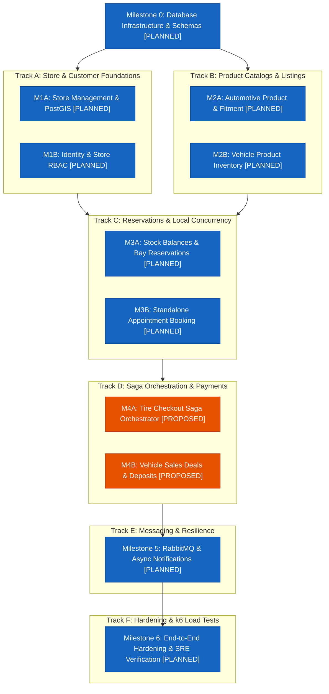

# Phased Implementation Roadmap & Dependency DAG

> **Document Status**: `PROPOSED ROADMAP` / `PLANNING BASELINE` (Phase 2E-R Revised)  
> **Notice**: This roadmap outlines the recommended execution sequence across 7 milestones (M0 through M6). Independent service modules can proceed in parallel tracks. **No milestone implementation is performed in this phase.**

---

## 1. Architectural Dependency DAG & Parallel Execution Tracks

### Critical Path Analysis
The critical path for commercial checkout functionality is:
$$\text{M0 (Databases)} \longrightarrow \text{M1A (Stores)} \longrightarrow \text{M2A (Tire Catalog)} \longrightarrow \text{M3A (Stock/Bay Holds)} \longrightarrow \text{M4A (Checkout Saga)} \longrightarrow \text{M5 (Outbox/RabbitMQ)} \longrightarrow \text{M6 (Load Testing)}$$
Non-critical parallel tracks (e.g. Used-Vehicle Sales: `M2B` $\rightarrow$ `M4B`) can be developed concurrently without blocking core tire checkout.

---

## 2. Detailed Milestone Specifications & Exit Criteria

---

### Milestone 0: Database Infrastructure, Flyway Harness & Testcontainers
- **Primary Goal**: Establish independent PostgreSQL schemas, versioned Flyway migrations, and automated Testcontainers testing harness for all 8 microservices.
- **Included Services**: All 8 microservices.
- **Required Work**:
  - Deploy PostgreSQL 16 container with PostGIS 3.4 on kind development cluster.
  - Create 8 isolated databases (`db_operations`, `db_product`, `db_store`, `db_appointment`, `db_sales`, `db_vehicle`, `db_identity`, `db_notification`).
  - Configure Flyway migration directory (`db/migration/V1__init.sql`) in each service.
  - Add Testcontainers PostgreSQL integration test verifying clean migration on container startup.
- **Exit Gate**: All 8 services compile and pass JUnit 5 tests against ephemeral PostgreSQL containers with zero schema errors.

---

### Milestone 1: Master Reference & Store-Scoped Identity Foundation
- **Primary Goal**: Implement master retail store directory with PostGIS spatial search, and user profile management with store-scoped RBAC.
- **Track A Services**:
  - `store-management`: Store Directory Module, Operating Hours Module, Service Capability Module.
  - `identity-access`: User Profile Module, Access Management (RBAC) Module, Customer Garage Module.
- **Required Work**:
  - OpenAPI contracts for `/api/v1/stores` and `/api/v1/identity`.
  - PostGIS spatial query implementation (`ST_DWithin`) for nearest store discovery.
  - Store-scoped JWT authorization (`shop_worker` / `store_manager` scoped to `store_id`).
- **Exit Gate**: Stores can be created and queried by GPS coordinates; users can be assigned store-scoped roles; unauthorized cross-store mutations return HTTP 403 Forbidden.

---

### Milestone 2: Product Catalogs & Vehicle Listings
- **Primary Goal**: Implement comprehensive tire/part catalog, vehicle fitment lookup engine, and used vehicle listing inventory.
- **Track B Services**:
  - `automotive-product`: Product Catalog Module, Vehicle Fitment Module, Pricing Module, Search Module.
  - `vehicle-product`: Vehicle Inventory Module, Condition/Inspection Module, Photo Asset Module, Listing Module.
- **Required Work**:
  - Ingest Year/Make/Model/Trim (YMMT) reference data and OEM tire sizing rules.
  - Implement composite B-Tree indexes on tire dimensions (`width`, `aspect_ratio`, `rim_diameter`).
  - Enforce 17-character unique VIN constraint in `vehicle-product`.
- **Exit Gate**: Customers can search tires by dimension or vehicle YMMT; used car listings can be created and queried with photo assets.

---

### Milestone 3: Inventory Balances, Physical Bay Holds & Concurrency Controls
- **Primary Goal**: Implement physical inventory movement ledger, atomic stock reservations, and zero-double-booking physical bay reservations.
- **Track C Services**:
  - `automotive-product`: Inventory Module, Stock Reservation Module.
  - `store-management`: Bay Registry Module, Exclusive Bay Reservation Module.
  - `appointment`: Appointment Lifecycle Module, Customer Scheduling Module.
- **Required Work**:
  - Implement conditional atomic updates or row locks for stock reservation (`POST /inventory/reservations`).
  - Configure PostgreSQL GiST Range Exclusion Constraint on `bay_reservation`.
  - Implement background janitor job (`@Scheduled`) to release expired holds after TTL (15-min default).
- **Exit Gate**: 50 concurrent threads attempting to reserve the last 4 tires or book the same bay slot result in exactly 1 success and 49 clean HTTP 409 Conflict responses.

---

### Milestone 4: Distributed Saga Orchestration & Commercial Workflows
- **Primary Goal**: Implement stateful Saga orchestrators in `automotive-operations` (checkout) and `vehicle-sales` (used car sales), integrating Stripe payment processing and compensating transactions.
- **Track D Services**:
  - `automotive-operations`: Order Module, Checkout Saga Orchestrator Module, Payment & Billing Module.
  - `vehicle-sales`: Sales Pipeline Module, Deposit Module, Sales Contract Module.
- **Required Work**:
  - Create durable `saga_instance` state table in PostgreSQL.
  - Implement orchestrator state machines (`CREATED` $\rightarrow$ `RESERVING` $\rightarrow$ `AWAITING_PAYMENT` $\rightarrow$ `CONFIRMING` $\rightarrow$ `COMPLETED`).
  - Implement compensating transactions (releasing stock and bays if payment fails or times out).
  - Stripe PaymentIntent creation, webhook verification, and idempotency handling.
- **Exit Gate**: End-to-end checkout succeeds on happy path; simulated card decline reliably releases downstream stock and bay holds; zero orphaned holds remain.

---

### Milestone 5: Transactional Outbox, RabbitMQ & Asynchronous Notifications
- **Primary Goal**: Establish RabbitMQ message broker topology and decoupled multi-channel notification dispatch.
- **Track E Services**:
  - `notification`: Template Management Module, Delivery Dispatcher Module, Preferences Module, DLQ.
  - All producer services: `transactional_outbox` table and background `OutboxPublisher`.
- **Required Work**:
  - Deploy RabbitMQ 3.13 cluster on Kubernetes with AMQP topic exchanges.
  - Implement Transactional Outbox pattern in `automotive-operations`, `vehicle-sales`, and `appointment`.
  - Implement asynchronous consumer in `notification` with consumer-side deduplication table (`processed_event_log`).
  - Configure Dead-Letter Exchange (DLX) for failed delivery retries.
- **Exit Gate**: Order paid events emit to Outbox, publish to RabbitMQ, and trigger customer email dispatch without blocking HTTP checkout threads.

---

### Milestone 6: End-to-End Hardening, Observability & Saturation Validation
- **Primary Goal**: Full platform load testing, saturation validation, distributed tracing, and production readiness audit.
- **Required Work**:
  - Export OpenTelemetry W3C trace context (`traceparent`) across APISIX and all 8 services.
  - Execute k6 load tests validating Scenario B (150 peak RPS across platform).
  - Execute chaos resilience tests (pod crash recovery, database restart, network latency injection).
- **Exit Gate**: All p95 latency SLO targets satisfied; zero data corruption under load; complete system audit pass.

---

## 3. Phasing Matrix: MVP vs. Medium-Scale vs. Future Evolution

| Capability Dimension | Minimum Viable Product (Phase 3 MVP) | Medium-Scale Target (Phase 4) | Future Evolution (Phase 5+) |
| :--- | :--- | :--- | :--- |
| **Catalog & Fitment** | PostgreSQL B-Tree dimension filtering; YMMT lookup | Staggered tire fitment; seasonal promo rules | AI tire recommendations; 3D wheel visualizer |
| **Inventory Control** | Store on-hand ledger; atomic checkout reservation | Low-stock alerts; inter-branch transfers | Supplier automated EDI reordering triggers |
| **Service Bays** | GiST range exclusion scheduling; 15-min hold TTL | Technician skill-based bay routing | Computer-vision automated bay occupancy |
| **Checkout & Payments** | Stripe Elements credit card; invoice generation | Mobile Apple Pay / Google Pay; partial refunds | Commercial fleet credit lines; multi-tender |
| **Used Vehicles** | VIN intake; 150-point inspection; deposit hold | Digital contract signing; trade-in valuation | State DMV electronic title integration |
| **Saga Coordination** | Custom Spring Boot state machine in PostgreSQL | Automated reconciliation scanner dashboards | Temporal / Camunda workflow engine (if needed) |
| **Database & Caching** | Dedicated PostgreSQL schemas; HikariCP pooling | Caffeine L1 cache; PgBouncer connection pooling | Read replicas; Redis distributed L2 cache |
| **Messaging** | Transactional Outbox + RabbitMQ Topic Exchanges | RabbitMQ Quorum Queues; consumer autoscale | Kafka event streaming (if analytics demands) |
