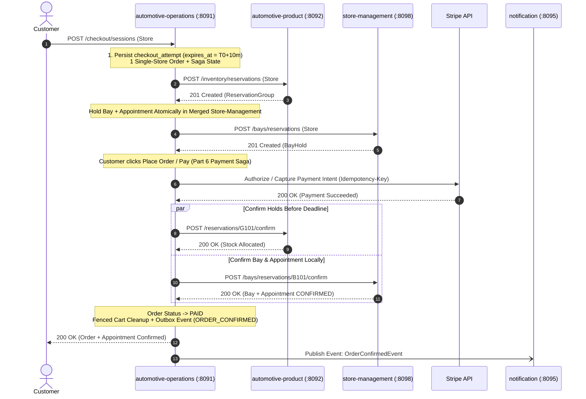

# Comprehensive Cross-Service Business Workflows & Distributed Sagas

> **Status**: AUTHORITATIVE DISTRIBUTED WORKFLOW SPECIFICATION (Phase 2F-B-R2)
> **Scope**: 12 Master Business Workflows covering 70 Granular Operational Scenarios

---

## 1. Master Workflow Catalog Overview

The platform coordinates distributed business capabilities across 7 target independently deployed Spring Boot microservices (`appointment` merged into `store-management` per `P5-DEC-01`). This document defines the end-to-end sequences, local ACID boundaries, failure recovery paths, and activity mappings for all major business workflows.

```
Master Business Workflows
  ├── WF-01: Vehicle Fitment Search & Catalog Exploration
  ├── WF-02: Shopping Cart Management & Multi-Tier Revalidation
  ├── WF-03: Multi-Store Cart Detection & Partitioned Authorization
  ├── WF-04: Mixed Tire & Service Installation Checkout Saga
  ├── WF-05: Product-Only In-Store Pickup Checkout
  ├── WF-06: Standalone Service Appointment Booking
  ├── WF-07: Unscheduled Service Entitlement (SCHEDULE_LATER) Redemption
  ├── WF-08: Workshop Execution, Inspection & Supplemental Quote Approval
  ├── WF-09: Physical Inventory Restocking & Guarded Adjustments (Transfers/Quarantine DEFERRED_BY_OWNER_V1)
  ├── WF-10: Used-Vehicle Sales Inquiry, Deposit & Digital Contract Execution
  ├── WF-11: Distributed Saga Failure Recovery & Crash Janitor
  └── WF-12: Transactional Outbox Event Dispatch & Dead-Letter Processing
```

---

## 2. Customer Shopping & Fitment Workflows

### WF-01: Vehicle Fitment Search & Catalog Exploration
- **Trigger**: Customer enters Year/Make/Model/Trim (YMMT) or license plate/VIN on web or mobile.
- **Participating Services**: `automotive-product` (:8092), `identity-access` (:8096).
- **Sequence**:
  1. Client queries `GET /api/v1/automotive/products/fitment/lookup?year=2022&make=Toyota&model=RAV4&trim=XLE`.
  2. `automotive-product` queries `fitment_specification` to return OEM front/rear tire sizes (e.g., `225/65R17 102H`).
  3. If user is authenticated, client invokes `POST /api/v1/identity/garage/vehicles` to save vehicle to garage.
  4. Client queries `GET /api/v1/automotive/products/catalog/tires?size=225/65R17` with optional store filter.
  5. Search engine returns matching tires with MSRP and real-time branch availability.
- **Activities Involved**: `ACT-PRD-003`, `ACT-PRD-004`, `ACT-PRD-001`, `ACT-IDN-005`.

### WF-02: Authenticated Single-Store Cart, Targeted SSE & Store-Switch Reset (`P4-DEC-01`, `P4-DEC-06`, `P5-DEC-02`, `P5-DEC-09`)
- **Trigger**: Authenticated customer (Keycloak JWT `sub`) selects a store (`store_id`), adds/updates items in `cart:account:{user_id}`, or opens the cart/slot view across Web/Android/iOS.
- **Participating Services**: `automotive-operations` (:8091), `automotive-product` (:8092), `store-management` (:8098).
- **Sequence**:
  1. Customer selects one store (`store_id`). Client calls `POST /api/v1/automotive/operations/cart/items` with `expected_version`, `mutation_id`, `store_id`, `(item_type, item_id)`, and `selected_vehicle` (required on first `SERVICE` line; single vehicle per cart per `P5-DEC-03`).
  2. Adding an item from a different `store_id` when the cart is populated returns `409 STORE_MISMATCH_CONFIRM_RESET`; switching stores requires explicit confirmation via `POST /cart/switch-store` (honoring active checkout locks).
  3. Active authenticated SSE connections (`GET /events/stream`) receive `CART_UPDATED`, `INVENTORY_AVAILABILITY_CHANGED`, `PHYSICAL_PRODUCT_PRICE_CHANGED`, `STORE_SERVICE_PRICE_CHANGED`, and `SERVICE_SLOT_AVAILABILITY_CHANGED` (scoped by `(store_id, date_window, duration)`).
  4. On reconnect, page focus, or `POST /cart/validate`, client fetches authoritative Redis cart, `automotive-product` batch prices/balances, and `store-management` advisory slots.
- **Activities Involved**: `ACT-OPS-017`, `ACT-OPS-019`, `ACT-PRD-006`, `ACT-PRD-023`, `ACT-APT-001`.

### WF-03: Single-Store Unified Checkout & Separate Internal Fulfillment (`P5-DEC-02`, `P5-DEC-04` — Supersedes Multi-Store Checkout)
- **Trigger**: Authenticated customer selects Proceed to Checkout for their single-store cart (physical-only, service-only, or mixed).
- **Participating Services**: `automotive-operations` (:8091), `automotive-product` (:8092), `store-management` (:8098).
- **Sequence**:
  1. Client calls `POST /api/v1/automotive/operations/checkout/sessions` with `cart_id`, `cart_version`, `store_id`, `approved_total_cents`, and `requested_slot` (required when any service has `requires_store_materials = TRUE`).
  2. `automotive-operations` freezes the cart snapshot, validates single-store, single-vehicle, store service offerings, material fitment, and authoritative USD prices (`POST /catalog/prices:batch`).
  3. `automotive-operations` creates **one** `checkout_attempt` (`expires_at = T0 + 10m`) and **one** single-store `orders` record, then reserves physical stock (including required store-supplied materials) in `automotive-product` and bay+appointment in merged `store-management` (:8098) using the **same** 10-minute `expires_at`.
  4. One customer payment covers the entire order; physical delivery and service work execution proceed as separate internal workflows.
- **Activities Involved**: `ACT-OPS-002`, `ACT-PRD-008`, `ACT-PRD-023`, `ACT-STR-007`.

---

## 3. Distributed Checkout Sagas

### WF-04: Mixed Tire & Service Installation Checkout Saga (`P5-DEC-01`, `P5-DEC-08`)
- **Trigger**: Customer enters checkout for 4 tires + installation appointment at Store #101.
- **Saga Orchestrator**: `automotive-operations` (:8091).
- **Participants**: `automotive-product` (:8092), `store-management` (:8098, *includes Appointment Management*), `notification` (:8095), Stripe.



#### Failure Compensations in WF-04:
- **Case A: Inventory Hold Fails**: Checkout entry immediately returns `409 INSUFFICIENT_STOCK` with per-line diagnostics; no downstream holds attempted.
- **Case B: Bay Hold Fails**: Saga invokes compensation: `DELETE /reservations/G101` on `automotive-product`. Stock hold released. Order marked `FAILED_BAY_UNAVAILABLE`.
- **Case C: Payment Fails / Card Declined**: Saga invokes compensations:
  1. `DELETE /bays/reservations/B101` on `store-management`.
  2. `DELETE /reservations/G101` on `automotive-product`.
  3. Order marked `PAYMENT_DECLINED`.
- **Case D: Crash After Payment Capture**: On orchestrator restart, `CheckoutSagaRecoveryJob` detects `STEP_3_PAYMENT` completed. It idempotently re-executes confirmation calls forward using preserved reservation group IDs.

---

## 4. Appointment & Workshop Operations

### WF-07: Unscheduled Service Entitlement (SCHEDULE_LATER) Redemption *(Merged into `store-management` :8098)*
- **Trigger**: Customer purchased a **material-free** service (`requires_store_materials = FALSE`) online with `SCHEDULE_LATER` and is now booking an appointment. *(Parts-dependent services must be scheduled at checkout per `P5-DEC-07`.)*
- **Participating Services**: `store-management` (:8098, *Appointment Management + Bay Scheduling*), `automotive-operations` (:8091), `notification` (:8095).
- **Coordination Protocol (Part 7 Finalization — Local Bay+Appointment TX inside `store-management`, Fenced Entitlement Handshake with `automotive-operations`)**:
  1. Customer submits `POST /api/v1/appointments/entitlements/redeem` on `store-management` (:8098) with `redemption_token`, `store_id`, and requested slot.
  2. `store-management` generates unique `redemption_attempt_id: att-7766-5544` and executes the fenced entitlement lock (`automotive-operations`), local ACID bay+appointment hold/confirm (`store-management`), and entitlement commit (`automotive-operations`) per Part 7 (`APT-01`–`APT-12`).
- **Activities Involved**: `ACT-APT-010`, `ACT-STR-007`, `ACT-STR-008`, `ACT-OPS-004`, `ACT-NOT-003`.

### WF-08: Workshop Execution, Inspection & Supplemental Quote Approval
- **Trigger**: Vehicle arrives at shop; technician conducts inspection and discovers worn brake pads during tire mounting.
- **Participating Services**: `automotive-operations` (:8091), `notification` (:8095).
- **Sequence**:
  1. Shop worker opens Work Order (`GET /api/v1/automotive/operations/work-orders/{id}`).
  2. Technician checks in vehicle; changes status to `IN_PROGRESS`.
  3. Technician logs inspection finding: "Front brake pads at 2mm".
  4. Service advisor drafts supplemental quote (`ACT-OPS-021`): `POST /work-orders/{id}/quotes` with parts and labor items.
  5. Quote created with `revision_number = 2`, `status = 'PENDING_CUSTOMER_APPROVAL'`.
  6. `notification` dispatches SMS with deep link to customer.
  7. Customer reviews itemized quote on mobile web; clicks "Approve Supplemental Work" (`ACT-OPS-022`).
  8. Work Order unlocks brake service task for technician.
  9. Technician completes tasks, logs consumed parts, and closes Work Order (`ACT-OPS-014`).
- **Activities Involved**: `ACT-OPS-011`, `ACT-OPS-012`, `ACT-OPS-021`, `ACT-OPS-022`, `ACT-OPS-014`, `ACT-NOT-003`.

---

## 5. Used-Vehicle Sales Journey

### WF-10: Used-Vehicle Sales Inquiry, Deposit & Digital Contract Execution
- **Trigger**: Customer places $500 refundable deposit on a 2021 Ford F-150 (VIN: 1FTFW1E8...).
- **Participating Services**: `vehicle-sales` (:8093), `vehicle-product` (:8094), `notification` (:8095), Stripe.
- **Sequence**:
  1. Customer clicks "Place Holding Deposit" on vehicle details page.
  2. `vehicle-sales` calls `POST /api/v1/vehicles/inventory/{vin}/hold` on `vehicle-product`.
  3. `vehicle-product` executes conditional update setting vehicle status to `DEPOSIT_HOLD` for 72 hours.
  4. Customer completes $500 deposit via Stripe.
  5. `vehicle-sales` logs Deal record; assigns dealership sales representative.
  6. Sales rep finalizes terms; triggers `POST /deals/{id}/contracts` to generate digital purchase agreement.
  7. Customer signs contract via DocuSign/embedded signing integration.
  8. Full payment cleared (financing / wire transfer).
  9. Dealership handover completed; `vehicle-sales` calls `POST /vehicles/inventory/{vin}/sold`.
  10. Vehicle status permanently marked `SOLD` (terminal state).
- **Activities Involved**: `ACT-SAL-002`, `ACT-SAL-003`, `ACT-SAL-005`, `ACT-SAL-007`, `ACT-VEH-002`.

---

## 6. Background Reliability & Recovery Workflows

### WF-11: Distributed Saga Failure Recovery & Crash Janitor
- **Trigger**: Scheduled background worker runs every 60 seconds across microservices.
- **Participating Services**: `automotive-operations` (:8091), `automotive-product` (:8092), `store-management` (:8098).
- **Sequence**:
  1. `ReservationJanitorJob` in `automotive-product` queries `stock_reservation` where `status = 'HELD'` and `expires_at < NOW()`.
  2. For each expired hold, it atomically releases stock (`quantity_reserved = quantity_reserved - N`) and marks reservation `EXPIRED`.
  3. `BayReservationJanitorJob` in `store-management` performs identical cleanup for unconfirmed bay holds.
  4. `CheckoutSagaRecoveryJob` in `automotive-operations` queries `checkout_saga_instance` where `status = 'IN_PROGRESS'` and `updated_at < NOW() - 5m`.
  5. Evaluates last recorded step against Stripe/Product/Store APIs; resumes forward completion or issues compensating rollbacks.
- **Activities Involved**: `ACT-PRD-019`, `ACT-STR-010`, `ACT-OPS-006`.
