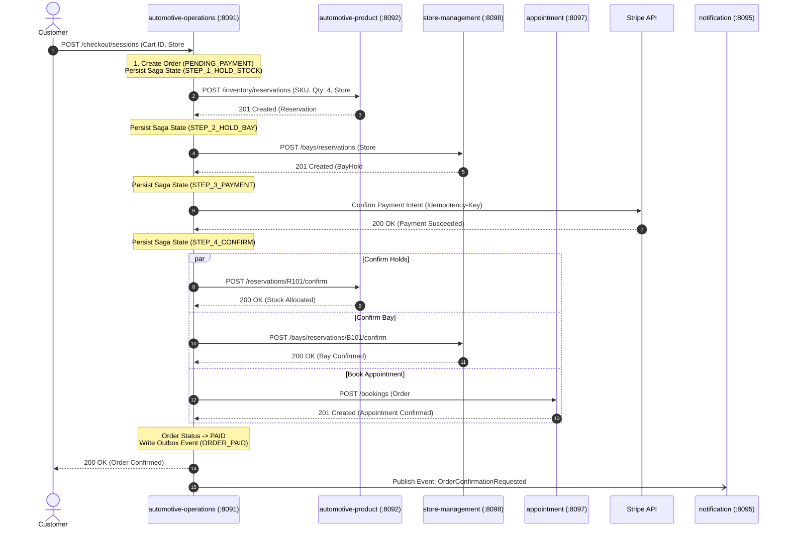

# Comprehensive Cross-Service Business Workflows & Distributed Sagas

> **Status**: AUTHORITATIVE DISTRIBUTED WORKFLOW SPECIFICATION (Phase 2F-B-R2)
> **Scope**: 12 Master Business Workflows covering 70 Granular Operational Scenarios

---

## 1. Master Workflow Catalog Overview

The platform coordinates distributed business capabilities across 8 independently deployed Spring Boot microservices. This document defines the end-to-end sequences, local ACID boundaries, failure recovery paths, and activity mappings for all major business workflows.

```
Master Business Workflows
  ├── WF-01: Vehicle Fitment Search & Catalog Exploration
  ├── WF-02: Shopping Cart Management & Multi-Tier Revalidation
  ├── WF-03: Multi-Store Cart Detection & Partitioned Authorization
  ├── WF-04: Mixed Tire & Service Installation Checkout Saga
  ├── WF-05: Product-Only In-Store Pickup Checkout
  ├── WF-06: Standalone Service Appointment Booking
  ├── WF-07: Unscheduled Service Entitlement (SCHEDULE_LATER) Redemption
  ├── WF-08: Workshop Execution, Inspection & Supplemental Quote Approval
  ├── WF-09: Physical Inventory Restocking, Transfers & Damage Adjustments
  ├── WF-10: Used-Vehicle Sales Inquiry, Deposit & Digital Contract Execution
  ├── WF-11: Distributed Saga Failure Recovery & Crash Janitor
  └── WF-12: Transactional Outbox Event Dispatch & Dead-Letter Processing
```

---

## 2. Customer Shopping & Fitment Workflows

### WF-01: Vehicle Fitment Search & Catalog Exploration
- **Trigger**: Customer enters Year/Make/Model/Trim (YMMT) or license plate/VIN on web or mobile.
- **Participating Services**: `automotive-product` (:8092), `identity-access` (:8096).
- **Sequence**:
  1. Client queries `GET /api/v1/automotive/products/fitment/lookup?year=2022&make=Toyota&model=RAV4&trim=XLE`.
  2. `automotive-product` queries `fitment_specification` to return OEM front/rear tire sizes (e.g., `225/65R17 102H`).
  3. If user is authenticated, client invokes `POST /api/v1/identity/garage/vehicles` to save vehicle to garage.
  4. Client queries `GET /api/v1/automotive/products/catalog/tires?size=225/65R17` with optional store filter.
  5. Search engine returns matching tires with MSRP and real-time branch availability.
- **Activities Involved**: `ACT-PRD-003`, `ACT-PRD-004`, `ACT-PRD-001`, `ACT-IDN-005`.

### WF-02: Shopping Cart Management & Multi-Tier Revalidation
- **Trigger**: Customer adds tires, road hazard warranty, and installation services to cart.
- **Participating Services**: `automotive-operations` (:8091), `automotive-product` (:8092).
- **Sequence**:
  1. Client calls `POST /api/v1/automotive/operations/cart/{id}/items` with `item_type` (`PHYSICAL_PRODUCT` | `SERVICE`), `physical_product_id` or `service_id`, `quantity`, and target `store_id`.
  2. `automotive-operations` executes atomic Redis Lua script updating cart JSON document, returning updated totals.
  3. Customer switches to browser tab or enters checkout: Client calls `POST /api/v1/automotive/operations/cart/{id}/validate`.
  4. `automotive-operations` batch-checks inventory and price freshness against `automotive-product` (`POST /api/v1/automotive/products/inventory/balances:batch`).
  5. If price or stock has changed, cart is flagged with `PRICE_CHANGED` or `INSUFFICIENT_STOCK` notices.
- **Activities Involved**: `ACT-OPS-017`, `ACT-OPS-018`, `ACT-OPS-019`, `ACT-PRD-006`.

### WF-03: Multi-Store Cart Detection & Partitioned Authorization
- **Trigger**: Customer attempts checkout with items originating from two distinct physical stores.
- **Participating Services**: `automotive-operations` (:8091).
- **Sequence**:
  1. Client calls `POST /api/v1/automotive/operations/checkout/sessions`.
  2. Cart service checks store consistency across line items. Identifies Store A (Tires) and Store B (Wheels).
  3. **Cart Service Rejects Single Order Creation**: Returns HTTP `422 Unprocessable Entity` with error code `MULTI_STORE_CART_PARTITION_REQUIRED` and grouped item metadata.
  4. Web/Mobile UI partitions cart into Store A Tab and Store B Tab.
  5. Customer explicitly reviews and authorizes Store A checkout (creating Order 1), then authorizes Store B checkout (creating Order 2).
  6. **Invariant**: No silent or implicit multiple card charges. Each order has its own authorization, receipt, and Saga.
- **Activities Involved**: `ACT-OPS-002`, `ACT-OPS-019`.

---

## 3. Distributed Checkout Sagas

### WF-04: Mixed Tire & Service Installation Checkout Saga
- **Trigger**: Customer submits payment for 4 tires + installation appointment at Store #101.
- **Saga Orchestrator**: `automotive-operations` (:8091).
- **Participants**: `automotive-product` (:8092), `store-management` (:8098), `appointment` (:8097), `notification` (:8095), Stripe.



#### Failure Compensations in WF-04:
- **Case A: Inventory Hold Fails**: Saga immediately terminates; Order marked `FAILED_OUT_OF_STOCK`. No downstream holds attempted.
- **Case B: Bay Hold Fails**: Saga invokes compensation: `DELETE /reservations/R101` on `automotive-product`. Stock hold released. Order marked `FAILED_BAY_UNAVAILABLE`.
- **Case C: Payment Fails / Card Declined**: Saga invokes compensations:
  1. `DELETE /bays/reservations/B101` on `store-management`.
  2. `DELETE /reservations/R101` on `automotive-product`.
  3. Order marked `PAYMENT_DECLINED`.
- **Case D: Crash After Payment Capture**: On orchestrator restart, `CheckoutSagaRecoveryJob` detects `STEP_3_PAYMENT` completed. It idempotently re-executes confirmation calls forward using preserved reservation IDs.

---

## 4. Appointment & Workshop Operations

### WF-07: Unscheduled Service Entitlement (SCHEDULE_LATER) Two-Phase Redemption Protocol
- **Trigger**: Customer purchased service online with `SCHEDULE_LATER` and is now booking an appointment.
- **Participating Services**: `appointment` (:8097), `automotive-operations` (:8091), `store-management` (:8098), `notification` (:8095).
- **Coordination Protocol (Durable Two-Phase Handshake - No Cross-Service ACID)**:
  1. Customer submits `POST /api/v1/appointments/entitlements/redeem` on `appointment` with `redemption_token`, `store_id`, and requested slot.
  2. `appointment` generates unique `redemption_attempt_id: att-7766-5544`.
  3. *Phase 1 (Lock Entitlement with Monotonic Generation)*: `appointment` calls `POST /api/v1/automotive/operations/entitlements/{token}/lock-for-redemption` with `attempt_id` and 15m hold lease. `automotive-operations` executes atomic CAS incrementing `fencing_generation = fencing_generation + 1` (`status: ISSUED -> REDEMPTION_PENDING`), returning the generated `fencing_generation`. If already redeemed, refunded, or actively locked, returns HTTP 409 Conflict.
  4. *Phase 2 (Reserve Bay)*: `appointment` calls `store-management` (`POST /api/v1/stores/bays/reservations`) to acquire bay hold (`HOLD`). If unavailable, `appointment` calls operations to release lock (`POST .../release-redemption-lock`) and returns HTTP 409 Bay Unavailable to customer.
  5. *Phase 3 (Local Persistence)*: `appointment` inserts `service_appointment` in its PostgreSQL database with `status = CONFIRMED`, `bay_reservation_id`, and `redemption_attempt_id`.
  6. *Phase 4 (Confirm Bay & Commit Entitlement)*: `appointment` calls `store-management` to confirm bay (`POST .../confirm`), then calls `automotive-operations` (`POST .../commit-redemption`) passing `attempt_id` and `fencing_generation`. Operations verifies fencing generation and transitions `status: REDEMPTION_PENDING -> REDEEMED` binding `redeemed_appointment_id`. Stale attempts with superseded generation numbers are rejected.
  7. *Recovery & Compensation*: If `appointment` crashes or network times out after Step 3, background daemon `EntitlementLeaseJanitorJob` in operations queries `appointment` status after the 15m lease: if appointment exists, commits entitlement; if absent, restores status to `ISSUED` and releases bay hold.
  8. *Cancellation / Rescheduling*: Cancelling appointment (`ACT-APT-005`) emits `AppointmentCancelledEvent`; operations consumes event and restores entitlement to `ISSUED` if within legal voucher expiration.
- **Activities Involved**: `ACT-APT-010`, `ACT-STR-007`, `ACT-STR-008`, `ACT-OPS-004`, `ACT-NOT-003`.

### WF-08: Workshop Execution, Inspection & Supplemental Quote Approval
- **Trigger**: Vehicle arrives at shop; technician conducts inspection and discovers worn brake pads during tire mounting.
- **Participating Services**: `automotive-operations` (:8091), `notification` (:8095).
- **Sequence**:
  1. Shop worker opens Work Order (`GET /api/v1/automotive/operations/work-orders/{id}`).
  2. Technician checks in vehicle; changes status to `IN_PROGRESS`.
  3. Technician logs inspection finding: "Front brake pads at 2mm".
  4. Service advisor drafts supplemental quote (`ACT-OPS-021`): `POST /work-orders/{id}/quotes` with parts and labor items.
  5. Quote created with `revision_number = 2`, `status = 'PENDING_CUSTOMER_APPROVAL'`.
  6. `notification` dispatches SMS with deep link to customer.
  7. Customer reviews itemized quote on mobile web; clicks "Approve Supplemental Work" (`ACT-OPS-022`).
  8. Work Order unlocks brake service task for technician.
  9. Technician completes tasks, logs consumed parts, and closes Work Order (`ACT-OPS-014`).
- **Activities Involved**: `ACT-OPS-011`, `ACT-OPS-012`, `ACT-OPS-021`, `ACT-OPS-022`, `ACT-OPS-014`, `ACT-NOT-003`.

---

## 5. Used-Vehicle Sales Journey

### WF-10: Used-Vehicle Sales Inquiry, Deposit & Digital Contract Execution
- **Trigger**: Customer places $500 refundable deposit on a 2021 Ford F-150 (VIN: 1FTFW1E8...).
- **Participating Services**: `vehicle-sales` (:8093), `vehicle-product` (:8094), `notification` (:8095), Stripe.
- **Sequence**:
  1. Customer clicks "Place Holding Deposit" on vehicle details page.
  2. `vehicle-sales` calls `POST /api/v1/vehicles/inventory/{vin}/hold` on `vehicle-product`.
  3. `vehicle-product` executes conditional update setting vehicle status to `DEPOSIT_HOLD` for 72 hours.
  4. Customer completes $500 deposit via Stripe.
  5. `vehicle-sales` logs Deal record; assigns dealership sales representative.
  6. Sales rep finalizes terms; triggers `POST /deals/{id}/contracts` to generate digital purchase agreement.
  7. Customer signs contract via DocuSign/embedded signing integration.
  8. Full payment cleared (financing / wire transfer).
  9. Dealership handover completed; `vehicle-sales` calls `POST /vehicles/inventory/{vin}/sold`.
  10. Vehicle status permanently marked `SOLD` (terminal state).
- **Activities Involved**: `ACT-SAL-002`, `ACT-SAL-003`, `ACT-SAL-005`, `ACT-SAL-007`, `ACT-VEH-002`.

---

## 6. Background Reliability & Recovery Workflows

### WF-11: Distributed Saga Failure Recovery & Crash Janitor
- **Trigger**: Scheduled background worker runs every 60 seconds across microservices.
- **Participating Services**: `automotive-operations` (:8091), `automotive-product` (:8092), `store-management` (:8098).
- **Sequence**:
  1. `ReservationJanitorJob` in `automotive-product` queries `stock_reservation` where `status = 'HELD'` and `expires_at < NOW()`.
  2. For each expired hold, it atomically releases stock (`quantity_reserved = quantity_reserved - N`) and marks reservation `EXPIRED`.
  3. `BayReservationJanitorJob` in `store-management` performs identical cleanup for unconfirmed bay holds.
  4. `CheckoutSagaRecoveryJob` in `automotive-operations` queries `checkout_saga_instance` where `status = 'IN_PROGRESS'` and `updated_at < NOW() - 5m`.
  5. Evaluates last recorded step against Stripe/Product/Store APIs; resumes forward completion or issues compensating rollbacks.
- **Activities Involved**: `ACT-PRD-019`, `ACT-STR-010`, `ACT-OPS-006`.
