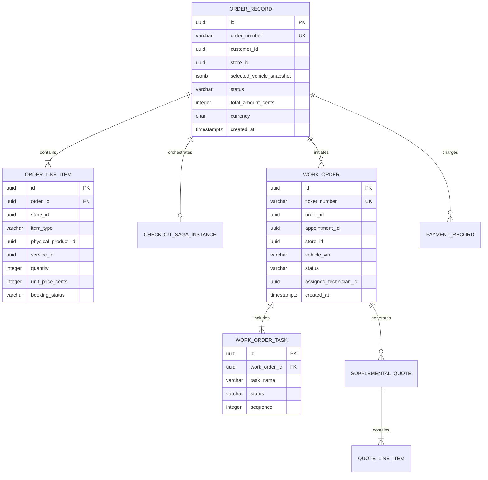

# Physical Data Architecture Specification: `automotive-operations`

> **Service Identity**: `automotive-operations` (Port 8091)
> **Status**: AUTHORITATIVE IMPLEMENTATION SPECIFICATION (Phase 2F-C)
> **Primary Storage**: PostgreSQL (orders, line items, checkout sagas, work orders, quotes, outbox) + Redis (active carts)
> **Logical Database**: `automotive_operations_db` | **Database Schema**: `automotive_operations`
> **Flyway & Role Ownership (`OPS-01`)**: `spring.flyway.schemas=automotive_operations`, `spring.flyway.default-schema=automotive_operations`; migration role `automotive_operations_migrator` (DDL on `automotive_operations` only), runtime role `automotive_operations_app` (DML only, zero cross-DB/schema grants).
> **Owned Modules**: Cart & Checkout Module, Order & Commercial Fulfillment Module, Work Order & Workshop Execution Module

---

## 1. Entity-Relationship Model (Mermaid ERD)



---

## 2. PostgreSQL Relational DDL Specifications

### 2.1 Tables: `orders` & `order_fulfillment_groups` (`P4-DEC-03` Multi-Store Parent Order)

```sql
CREATE TABLE automotive_operations.orders (
    id UUID PRIMARY KEY DEFAULT gen_random_uuid(),
    order_number VARCHAR(32) NOT NULL UNIQUE,
    customer_id UUID NOT NULL,
    store_id UUID NOT NULL, -- Single selected store per order (P5-DEC-02 supersedes multi-store orders)
    cart_id UUID NOT NULL,
    cart_version INTEGER NOT NULL,
    customer_garage_vehicle_id UUID NULL, -- Optional convenience ref; never relied on for historical data
    selected_vehicle_snapshot JSONB NULL CHECK (selected_vehicle_snapshot IS NULL OR jsonb_typeof(selected_vehicle_snapshot) = 'object'), -- Required when order has >=1 SERVICE line (P5-DEC-03)
    status VARCHAR(32) NOT NULL,
    subtotal_cents INTEGER NOT NULL CHECK (subtotal_cents >= 0),
    tax_cents INTEGER NOT NULL CHECK (tax_cents >= 0),
    total_amount_cents INTEGER NOT NULL CHECK (total_amount_cents >= 0),
    currency CHAR(3) NOT NULL DEFAULT 'USD',
    customer_email VARCHAR(255) NOT NULL,
    pickup_pin_hash VARCHAR(64) NULL,
    created_at TIMESTAMPTZ NOT NULL DEFAULT NOW(),
    updated_at TIMESTAMPTZ NOT NULL DEFAULT NOW(),
    version INTEGER NOT NULL DEFAULT 1,
    CONSTRAINT chk_order_status CHECK (status IN (
        'DRAFT', 'PENDING_PAYMENT', 'PAID', 'PROCESSING',
        'PARTIALLY_FULFILLED', 'FULFILLED', 'CANCELLED', 'REFUNDED'
    ))
);

CREATE INDEX idx_orders_customer ON automotive_operations.orders (customer_id, created_at DESC);
CREATE INDEX idx_orders_store_status ON automotive_operations.orders (store_id, status, created_at DESC);
```

### 2.2 Table: `order_items`

```sql
CREATE TABLE automotive_operations.service_entitlements (
    redemption_token VARCHAR(128) PRIMARY KEY,
    order_item_id UUID NOT NULL REFERENCES automotive_operations.order_items(id) ON DELETE RESTRICT,
    customer_id UUID NOT NULL,
    service_item_id UUID NOT NULL,
    status VARCHAR(32) NOT NULL DEFAULT 'ISSUED',
    locked_by_attempt_id UUID NULL,
    fencing_generation BIGINT NOT NULL DEFAULT 1,
    lease_expires_at TIMESTAMPTZ NULL,
    expires_at TIMESTAMPTZ NOT NULL,
    redeemed_appointment_id UUID NULL,
    redeemed_at TIMESTAMPTZ NULL,
    created_at TIMESTAMPTZ NOT NULL DEFAULT NOW(),
    updated_at TIMESTAMPTZ NOT NULL DEFAULT NOW(),
    version INTEGER NOT NULL DEFAULT 1,
    CONSTRAINT chk_entitlement_status CHECK (status IN ('ISSUED', 'REDEMPTION_PENDING', 'REDEEMED', 'EXPIRED', 'REFUNDED'))
);

CREATE INDEX idx_entitlement_customer ON automotive_operations.service_entitlements (customer_id, status);

CREATE TABLE automotive_operations.order_items (
    id UUID PRIMARY KEY DEFAULT gen_random_uuid(),
    order_id UUID NOT NULL REFERENCES automotive_operations.orders(id) ON DELETE CASCADE,
    store_id UUID NOT NULL, -- Matches orders.store_id (single-store order per P5-DEC-02)
    item_type VARCHAR(24) NOT NULL CHECK (item_type IN ('PHYSICAL_PRODUCT', 'SERVICE')),
    physical_product_id UUID NULL, -- Opaque reference to automotive_product.physical_product(id); NO cross-DB FK
    service_id UUID NULL,          -- Opaque reference to automotive_product.service(id); NO cross-DB FK
    sku_code VARCHAR(64) NULL,     -- Populated for PHYSICAL_PRODUCT snapshot only
    description VARCHAR(255) NOT NULL,
    quantity INTEGER NOT NULL CHECK (quantity > 0),
    fulfilled_quantity INTEGER NOT NULL DEFAULT 0 CHECK (fulfilled_quantity >= 0),
    shipped_quantity INTEGER NOT NULL DEFAULT 0 CHECK (shipped_quantity >= 0),
    delivered_quantity INTEGER NOT NULL DEFAULT 0 CHECK (delivered_quantity >= 0), -- shipped != delivered (P3-DEC-02)
    cancelled_quantity INTEGER NOT NULL DEFAULT 0 CHECK (cancelled_quantity >= 0),
    unit_price_cents INTEGER NOT NULL CHECK (unit_price_cents >= 0),
    total_price_cents INTEGER NOT NULL CHECK (total_price_cents >= 0),
    booking_status VARCHAR(32) NOT NULL DEFAULT 'NOT_APPLICABLE',
    CONSTRAINT chk_order_item_fulfillment_bounds CHECK (
        fulfilled_quantity + cancelled_quantity <= quantity
        AND delivered_quantity <= shipped_quantity
    ),
    CONSTRAINT chk_item_typed_reference CHECK (
        (item_type = 'PHYSICAL_PRODUCT' AND physical_product_id IS NOT NULL AND service_id IS NULL)
        OR
        (item_type = 'SERVICE' AND service_id IS NOT NULL AND physical_product_id IS NULL)
    ),
    CONSTRAINT chk_item_booking_status CHECK (booking_status IN (
        'NOT_APPLICABLE', 'ENTITLED_UNSCHEDULED', 'SCHEDULED', 'COMPLETED'
    ))
);

CREATE INDEX idx_order_items_order ON automotive_operations.order_items (order_id);
```

### 2.2B Table: `checkout_attempt` (`P5-DEC-02`, `P5-DEC-03`, `P5-DEC-08`, `P4-DEC-09`)

```sql
CREATE TABLE automotive_operations.checkout_attempt (
    id UUID PRIMARY KEY DEFAULT gen_random_uuid(),
    cart_id UUID NOT NULL,
    cart_version INTEGER NOT NULL,
    customer_id UUID NOT NULL, -- Derived strictly from verified JWT sub
    store_id UUID NOT NULL,    -- Single selected store per checkout (P5-DEC-02)
    selected_vehicle_snapshot JSONB NULL, -- Single vehicle for all service lines (P5-DEC-03)
    idempotency_key UUID NOT NULL,
    checkout_fencing_token UUID NOT NULL DEFAULT gen_random_uuid(),
    locked_keys JSONB NOT NULL DEFAULT '[]'::jsonb, -- Canonical snapshot keys protected until COMPLETED/FAILED/CANCELLED/EXPIRED_UNAUTHORIZED
    reservation_group_id UUID NULL, -- Opaque reference to automotive_product.stock_reservation_group(id)
    bay_reservation_id UUID NULL,   -- Opaque reference to store_management.bay_schedule_entries(id)
    payment_intent_id VARCHAR(128) NULL,
    status VARCHAR(32) NOT NULL,
    expires_at TIMESTAMPTZ NOT NULL, -- Authoritative 10-minute deadline shared across stock & bay holds (P5-DEC-08)
    cart_cleaned_at TIMESTAMPTZ NULL,
    created_at TIMESTAMPTZ NOT NULL DEFAULT NOW(),
    updated_at TIMESTAMPTZ NOT NULL DEFAULT NOW(),
    CONSTRAINT chk_checkout_attempt_status CHECK (status IN (
        'INITIATED', 'HOLDS_ACQUIRED', 'PAYMENT_PENDING',
        'AUTHORIZED', 'SETTLED', 'COMPLETED',
        'EXPIRED_UNAUTHORIZED', 'FAILED', 'CANCELLED'
    ))
);

-- Durable Idempotency Across Lifecycle
CREATE UNIQUE INDEX idx_uk_checkout_idempotency_global
ON automotive_operations.checkout_attempt (customer_id, idempotency_key);

-- One Active Unified Checkout Per Authenticated Customer (includes SETTLED until async cart cleanup finishes)
CREATE UNIQUE INDEX idx_uk_active_checkout_customer
ON automotive_operations.checkout_attempt (customer_id)
WHERE status IN ('INITIATED', 'HOLDS_ACQUIRED', 'PAYMENT_PENDING', 'AUTHORIZED', 'SETTLED');

-- Strict 1:1 mapping between external payment intent and checkout attempt
CREATE UNIQUE INDEX idx_uk_payment_intent_active
ON automotive_operations.checkout_attempt (payment_intent_id)
WHERE payment_intent_id IS NOT NULL;
```

### 2.3 Table: `checkout_saga_instance`

```sql
CREATE TABLE automotive_operations.checkout_saga_instance (
    id UUID PRIMARY KEY DEFAULT gen_random_uuid(),
    order_id UUID NOT NULL UNIQUE REFERENCES automotive_operations.orders(id),
    current_step VARCHAR(64) NOT NULL,
    status VARCHAR(32) NOT NULL,
    idempotency_key UUID NOT NULL UNIQUE,
    stock_reservation_id UUID NULL,
    bay_reservation_id UUID NULL,
    payment_intent_id VARCHAR(128) NULL,
    error_message TEXT NULL,
    created_at TIMESTAMPTZ NOT NULL DEFAULT NOW(),
    updated_at TIMESTAMPTZ NOT NULL DEFAULT NOW(),
    CONSTRAINT chk_saga_status CHECK (status IN ('IN_PROGRESS', 'COMPLETED', 'FAILED', 'COMPENSATING', 'COMPENSATED'))
);

CREATE INDEX idx_saga_recovery ON automotive_operations.checkout_saga_instance (status, updated_at)
WHERE status IN ('IN_PROGRESS', 'COMPENSATING');
```

### 2.4 Table: `work_orders` & `work_order_tasks`

```sql
CREATE TABLE automotive_operations.work_orders (
    id UUID PRIMARY KEY DEFAULT gen_random_uuid(),
    ticket_number VARCHAR(32) NOT NULL UNIQUE,
    order_id UUID NULL REFERENCES automotive_operations.orders(id),
    appointment_id UUID NULL,
    store_id UUID NOT NULL,
    vehicle_vin CHAR(17) NOT NULL,
    status VARCHAR(32) NOT NULL,
    assigned_technician_id UUID NULL,
    customer_notes TEXT NULL,
    inspection_findings JSONB NULL,
    created_at TIMESTAMPTZ NOT NULL DEFAULT NOW(),
    updated_at TIMESTAMPTZ NOT NULL DEFAULT NOW(),
    version INTEGER NOT NULL DEFAULT 1,
    CONSTRAINT chk_work_order_status CHECK (status IN (
        'CREATED', 'VEHICLE_CHECKED_IN', 'IN_PROGRESS',
        'PENDING_QUOTE_APPROVAL', 'QUOTE_APPROVED', 'COMPLETED', 'CANCELLED'
    ))
);

CREATE INDEX idx_work_orders_store_status ON automotive_operations.work_orders (store_id, status);
CREATE INDEX idx_work_orders_vin ON automotive_operations.work_orders (vehicle_vin);

CREATE TABLE automotive_operations.work_order_tasks (
    id UUID PRIMARY KEY DEFAULT gen_random_uuid(),
    work_order_id UUID NOT NULL REFERENCES automotive_operations.work_orders(id) ON DELETE CASCADE,
    service_item_id UUID NOT NULL,
    task_name VARCHAR(128) NOT NULL,
    status VARCHAR(32) NOT NULL DEFAULT 'PENDING',
    sequence INTEGER NOT NULL DEFAULT 1,
    technician_notes TEXT NULL,
    completed_at TIMESTAMPTZ NULL,
    CONSTRAINT chk_task_status CHECK (status IN ('PENDING', 'IN_PROGRESS', 'COMPLETED', 'BLOCKED', 'CANCELLED'))
);
```

### 2.5 Table: `supplemental_quotes`

```sql
CREATE TABLE automotive_operations.supplemental_quotes (
    id UUID PRIMARY KEY DEFAULT gen_random_uuid(),
    work_order_id UUID NOT NULL REFERENCES automotive_operations.work_orders(id) ON DELETE CASCADE,
    revision_number INTEGER NOT NULL DEFAULT 1,
    status VARCHAR(32) NOT NULL DEFAULT 'PENDING_CUSTOMER_APPROVAL',
    additional_labor_cents INTEGER NOT NULL DEFAULT 0,
    additional_parts_cents INTEGER NOT NULL DEFAULT 0,
    total_cents INTEGER NOT NULL CHECK (total_cents >= 0),
    items JSONB NOT NULL,
    approval_token VARCHAR(128) NOT NULL UNIQUE,
    approved_at TIMESTAMPTZ NULL,
    approved_by VARCHAR(128) NULL,
    created_at TIMESTAMPTZ NOT NULL DEFAULT NOW(),
    CONSTRAINT chk_quote_status CHECK (status IN ('PENDING_CUSTOMER_APPROVAL', 'APPROVED', 'REJECTED', 'SUPERSEDED'))
);

CREATE UNIQUE INDEX idx_work_order_quote_rev ON automotive_operations.supplemental_quotes (work_order_id, revision_number);
```

---

## 3. Redis Cart & Mutation Deduplication Modeling (`P4-DEC-01`, `P4-DEC-02`, `P4-DEC-06`, `P4-DEC-09`)

### 3.1 Key Schema: Authenticated Single-Store Account Cart Document (`P5-DEC-02`, `P5-DEC-03`)

- **Key Pattern**: `cart:account:{user_id}` (one logical cart per authenticated Keycloak `sub` UUID; zero guest carts in V1).
- **Redis Type**: String (Serialized JSON), initialized atomically via Lua `SET NX` on first authenticated mutation.
- **TTL**: `604,800` seconds (7 days), refreshed on every successful mutation.
- **Mandatory Single-Store & Single-Vehicle Rules**: Top-level `store_id` is authoritative; every cart is limited to **one store**. Within `store_id`, canonical line identity is `(item_type, item_id)` (`(store_id, item_type, item_id)` in backend product/inventory calls). Physical-only carts require no `selected_vehicle`; adding the first `SERVICE` line requires setting one `selected_vehicle` shared by all service lines in the cart.
- **Value JSON Structure**:
  ```json
  {
    "cart_id": "7b8c9d0e-1f2a-3b4c-5d6e-7f8a9b0c1d2e",
    "user_id": "u9z8y7x6-5w4v-3u2t-1s0r-q9p8o7n6m5l4",
    "store_id": "1a2b3c4d-5e6f-7a8b-9c0d-1e2f3a4b5c6d",
    "selected_vehicle": {
      "customer_garage_vehicle_id": "g1a2b3c4-1111-4000-8000-000000000001",
      "year": 2022,
      "make": "Toyota",
      "model": "RAV4",
      "trim": "XLE"
    },
    "version": 4,
    "currency": "USD",
    "created_at": 1732400000,
    "updated_at": 1732400500,
    "items": [
      {
        "item_type": "PHYSICAL_PRODUCT",
        "item_id": "8a3e7b1a-4d2c-4b5a-9f8e-1b2c3d4e5f6a",
        "sku_code": "MIC-DEF2-2256517",
        "title": "Michelin Defender 2 225/65R17",
        "quantity": 4,
        "advisory_unit_price_cents": 14999
      },
      {
        "item_type": "SERVICE",
        "item_id": "a1b2c3d4-0004-4000-8000-000000000004",
        "service_code": "INSTALL_4_WHEELS",
        "title": "Tire Mounting & Balancing (4-Wheel Package)",
        "quantity": 1,
        "advisory_unit_price_cents": 8000
      }
    ]
  }
  ```

### 3.2 Key Schema: Mutation Idempotency & Fenced Checkout Lock

- **Mutation Dedupe Key**: `cart:mut:{user_id}:{mutation_id}` (Redis String JSON, TTL `86,400`s / 24h). Atomically checked and written inside the same Redis Lua script as `cart:account:{user_id}`:
  1. If `cart:mut:{user_id}:{mutation_id}` exists → replay persisted result without re-applying.
  2. Else verify `cart.version == expected_version` (if mismatch → return `409 CART_VERSION_CONFLICT` with current `version`).
  3. Apply composite-key mutation, increment `version`, refresh 7-day TTL, and persist result in `cart:mut:{user_id}:{mutation_id}`.
- **Fenced Checkout Lock Cache (`cart:checkout-lock:{user_id}`) & PostgreSQL Authority**:
  - `cart:checkout-lock:{user_id}` is a **fast-path Redis cache** storing `{"checkout_attempt_id": "...", "fencing_token": "...", "snapshot_version": 6, "locked_keys": ["S1|PHYSICAL_PRODUCT|P_TIRE", "S2|PHYSICAL_PRODUCT|P_WIPER"], "expires_at": "..."}`. **PostgreSQL `checkout_attempt` (`status`, `locked_keys`, `checkout_fencing_token`, `expires_at`) is the authoritative lock source**—an expired or evicted Redis key never means checkout is finished.
  - *Concurrent Checkout Freeze*: On `POST /checkout/sessions`, an atomic Redis Lua script checks `cart.version == request.cart_version` (else `409 CART_VERSION_CONFLICT`), verifies no active lock exists, writes `cart:checkout-lock:{user_id}` (bounded cache TTL `900s` so the fast-path cache outlives the 10m hold while `AUTHORIZED`/`SETTLED` completes asynchronously), and returns the frozen snapshot. `automotive-operations` then persists `checkout_attempt` (`expires_at = clock_timestamp() + INTERVAL '10 minutes'`, `locked_keys`, `checkout_fencing_token`) in PostgreSQL.
  - *Active-Checkout Line Protection (Redis + PG Fallback)*: While `cart:checkout-lock:{user_id}` is present, `ACT-OPS-017` rejects mutations to `locked_keys` with `409 CART_LINE_LOCKED_BY_ACTIVE_CHECKOUT`. If `cart:checkout-lock:{user_id}` is **absent** (evicted or expired), `ACT-OPS-017` checks PostgreSQL `checkout_attempt` (`idx_uk_active_checkout_customer`): if an active attempt (`INITIATED`..`SETTLED`) exists, it rehydrates `cart:checkout-lock:{user_id}` and rejects `locked_keys` mutations (`409`); unrelated keys remain mutable.
- **Safe Post-Checkout Snapshot Cleanup & Recovery (`P4-DEC-09`)**:
  - *Completion Marker*: `cart:checkout-done:{checkout_attempt_id}` (TTL `86,400`s / 24h) + PostgreSQL `checkout_attempt.cart_cleaned_at`.
  - *On `AUTHORIZED` / `SETTLED` & Completion*: Transitioning to `AUTHORIZED`/`SETTLED` refreshes `cart:checkout-lock:{user_id}` TTL so asynchronous completion callbacks retain protection. `CHECKOUT_COMPLETE_CLEANUP` reads `locked_keys` and `checkout_fencing_token` from **PostgreSQL `checkout_attempt`** (surviving Redis lock loss or pod restarts), checks `cart:checkout-done:{checkout_attempt_id}` / `cart_cleaned_at` (no-op on duplicate callbacks), runs token-fenced Lua to remove **only** `locked_keys` from `cart:account:{user_id}` (preserving later unrelated edits), increments `version`, deletes `cart:checkout-lock:{user_id}` if `fencing_token` matches, sets `cart:checkout-done:{checkout_attempt_id}`, and marks `checkout_attempt` `COMPLETED` (`cart_cleaned_at = clock_timestamp()`).
  - *On `FAILED` / `CANCELLED` / `EXPIRED_UNAUTHORIZED`*: Once PostgreSQL `checkout_attempt` reaches a failed/cancelled/genuinely expired terminal state (and `stock_reservation_group` is released/expired), token-fenced Lua unlock (`if lock.fencing_token == :token then DEL cart:checkout-lock:{user_id}`) releases `locked_keys` **without deleting or altering any cart contents**. Stale callbacks with mismatched `fencing_token` are ignored as no-ops.

---

## 4. Local ACID Transaction Boundaries

1. **Single-Store Unified Checkout Initiation (`ACT-OPS-002`, `P5-DEC-02`, `P5-DEC-03`, `P5-DEC-08`)**:
   `BEGIN` → Insert `checkout_attempt` (`store_id`, `selected_vehicle_snapshot`, `expires_at = clock_timestamp() + INTERVAL '10 minutes'`, `locked_keys`, `checkout_fencing_token`) → Insert `orders` (`store_id`, `PENDING_PAYMENT`) → Insert `order_items` (`store_id`) → Insert `checkout_saga_instance` → `COMMIT`. Authoritative price/material/fitment validation (`automotive-product`), single-store stock hold (`POST /inventory/reservations`), and atomic bay+appointment hold (`store-management` `POST /bays/reservations` passing the same `expires_at`) occur over HTTP **outside** this SQL transaction; any failure compensates acquired holds and transitions `checkout_attempt` to `FAILED`.
2. **Supplemental Quote Approval (`ACT-OPS-022`)**:
   `BEGIN` → `SELECT * FROM supplemental_quotes WHERE id = :id FOR UPDATE` → Update quote status to `APPROVED` → Insert new `work_order_tasks` for authorized labor/parts → Insert `outbox_event` → `COMMIT`.

---

## Local Outbox & Consumer Inbox Tables (`automotive_operations`)

- **Messaging Role**: **Producer & Consumer**
- **Service-Owned Flyway Instantiation**: Instantiates both `automotive_operations.outbox_event` (produces `OrderConfirmedEvent`, `OrderCancelledEvent`, `QuoteApprovedEvent`, `WorkOrderCompletedEvent`) and `automotive_operations.consumer_inbox` (consumes `ProductPriceChangedEvent`, `StockAllocationConfirmedEvent`) via `backend/services/automotive-operations/src/main/resources/db/migration/V*.sql`.
- **Canonical Schema Reference**: Follow the exact `outbox_event` / `consumer_inbox` DDL, T1/T2/T3 boundaries, and retry rules in [`../events-and-projections.md`](../events-and-projections.md) (no shared cross-service tables; DDL is instantiated in `automotive_operations` within `automotive_operations_db`).
