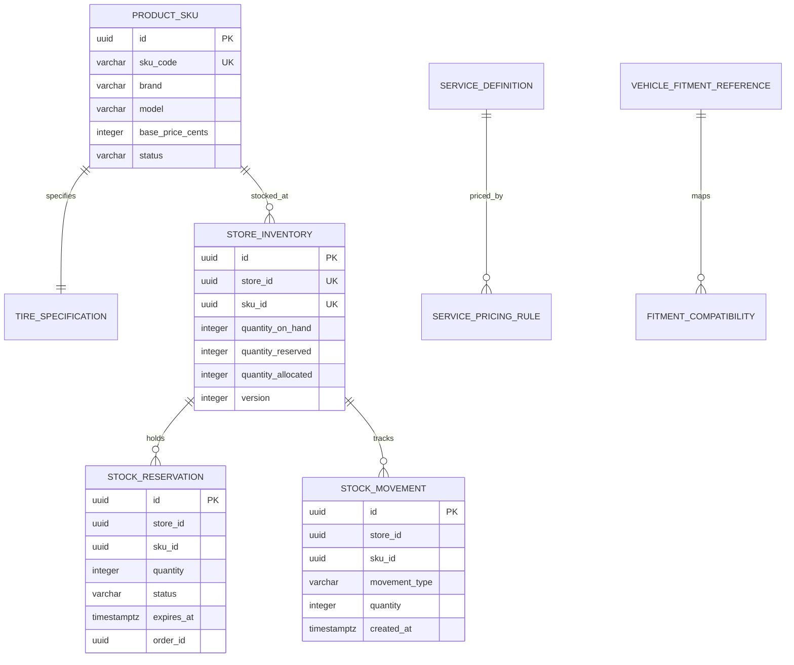

# Physical Data Architecture Specification: `automotive-product`

> **Service Identity**: `automotive-product` (Port 8092)
> **Status**: AUTHORITATIVE IMPLEMENTATION SPECIFICATION (Phase 2F-C)
> **Primary Storage**: PostgreSQL (catalog, specifications, branch inventory, stock reservations, movements, outbox)
> **Database Schema**: `automotive_product`
> **Owned Modules**: Catalog & Services Module, Vehicle Fitment Module, Branch Inventory & Stock Allocation Module

---

## 1. Entity-Relationship Model (Mermaid ERD)



---

## 2. PostgreSQL Relational DDL Specifications

### 2.1 Table: `product_skus` & `tire_specifications`
```sql
CREATE TABLE product_skus (
    id UUID PRIMARY KEY DEFAULT gen_random_uuid(),
    sku_code VARCHAR(64) NOT NULL UNIQUE,
    brand VARCHAR(64) NOT NULL,
    model VARCHAR(128) NOT NULL,
    item_type VARCHAR(16) NOT NULL DEFAULT 'PRODUCT',
    base_price_cents INTEGER NOT NULL CHECK (base_price_cents >= 0),
    is_active BOOLEAN NOT NULL DEFAULT TRUE,
    created_at TIMESTAMPTZ NOT NULL DEFAULT NOW(),
    updated_at TIMESTAMPTZ NOT NULL DEFAULT NOW()
);

CREATE TABLE tire_specifications (
    sku_id UUID PRIMARY KEY REFERENCES product_skus(id) ON DELETE CASCADE,
    section_width INTEGER NOT NULL CHECK (section_width BETWEEN 125 AND 355),
    aspect_ratio INTEGER NOT NULL CHECK (aspect_ratio BETWEEN 25 AND 85),
    rim_diameter INTEGER NOT NULL CHECK (rim_diameter BETWEEN 12 AND 26),
    speed_rating CHAR(1) NOT NULL,
    load_index INTEGER NOT NULL CHECK (load_index BETWEEN 70 AND 130),
    is_run_flat BOOLEAN NOT NULL DEFAULT FALSE,
    utqg_treadwear INTEGER NULL,
    dimension_string VARCHAR(32) GENERATED ALWAYS AS (
        section_width || '/' || aspect_ratio || 'R' || rim_diameter
    ) STORED
);

CREATE INDEX idx_tire_dimension ON tire_specifications (dimension_string);
CREATE INDEX idx_tire_specs_filter ON tire_specifications (section_width, aspect_ratio, rim_diameter);
```

### 2.2 Table: `store_inventory`
```sql
CREATE TABLE store_inventory (
    id UUID PRIMARY KEY DEFAULT gen_random_uuid(),
    store_id UUID NOT NULL,
    sku_id UUID NOT NULL REFERENCES product_skus(id),
    quantity_on_hand INTEGER NOT NULL DEFAULT 0 CHECK (quantity_on_hand >= 0),
    quantity_reserved INTEGER NOT NULL DEFAULT 0 CHECK (quantity_reserved >= 0),
    quantity_allocated INTEGER NOT NULL DEFAULT 0 CHECK (quantity_allocated >= 0),
    version INTEGER NOT NULL DEFAULT 1,
    updated_at TIMESTAMPTZ NOT NULL DEFAULT NOW(),
    CONSTRAINT uq_store_sku UNIQUE (store_id, sku_id),
    CONSTRAINT chk_atp_non_negative CHECK (
        quantity_on_hand - (quantity_reserved + quantity_allocated) >= 0
    )
);

CREATE INDEX idx_inventory_store_sku ON store_inventory (store_id, sku_id);
```

### 2.3 Table: `stock_reservations`
```sql
CREATE TABLE stock_reservations (
    id UUID PRIMARY KEY DEFAULT gen_random_uuid(),
    store_id UUID NOT NULL,
    sku_id UUID NOT NULL REFERENCES product_skus(id),
    quantity INTEGER NOT NULL CHECK (quantity > 0),
    status VARCHAR(32) NOT NULL DEFAULT 'HELD',
    order_id UUID NOT NULL,
    idempotency_key UUID NOT NULL,
    expires_at TIMESTAMPTZ NOT NULL,
    created_at TIMESTAMPTZ NOT NULL DEFAULT NOW(),
    updated_at TIMESTAMPTZ NOT NULL DEFAULT NOW(),
    version INTEGER NOT NULL DEFAULT 1,
    CONSTRAINT uq_reservation_idempotency UNIQUE (order_id, sku_id, idempotency_key),
    CONSTRAINT chk_reservation_status CHECK (status IN (
        'HELD', 'CONFIRMED', 'EXPIRED', 'RELEASED', 'FULFILLED'
    ))
);

CREATE INDEX idx_reservations_janitor ON stock_reservations (expires_at)
WHERE status = 'HELD';
CREATE INDEX idx_reservations_order ON stock_reservations (order_id);
```

### 2.4 Table: `stock_movements` (Partitioned Ledger)
```sql
CREATE TABLE stock_movements (
    id UUID DEFAULT gen_random_uuid(),
    store_id UUID NOT NULL,
    sku_id UUID NOT NULL REFERENCES product_skus(id),
    movement_type VARCHAR(32) NOT NULL,
    quantity INTEGER NOT NULL,
    reference_id VARCHAR(64) NOT NULL,
    created_at TIMESTAMPTZ NOT NULL DEFAULT NOW(),
    PRIMARY KEY (id, created_at),
    CONSTRAINT chk_movement_type CHECK (movement_type IN (
        'GOODS_RECEIPT', 'FULFILLMENT_PICKUP', 'WORKSHOP_CONSUMPTION',
        'TRANSFER_OUT', 'TRANSFER_IN', 'DAMAGE_SCRAP', 'COUNT_ADJUSTMENT'
    ))
) PARTITION BY RANGE (created_at);

-- Example Partition
CREATE TABLE stock_movements_2026 PARTITION OF stock_movements
FOR VALUES FROM ('2026-01-01 00:00:00Z') TO ('2027-01-01 00:00:00Z');

CREATE INDEX idx_movements_sku_store ON stock_movements (store_id, sku_id, created_at DESC);
```

---

### 2.5 Table: `inventory_quarantine_stock` & `quarantine_disposition_log`
```sql
-- Separate Quarantine Inventory: Physical isolation from sellable stock (quantity_on_hand)
CREATE TABLE inventory_quarantine_stock (
    id UUID PRIMARY KEY DEFAULT gen_random_uuid(),
    store_id UUID NOT NULL,
    sku_id UUID NOT NULL,
    return_intake_number VARCHAR(64) NOT NULL UNIQUE,
    quantity INTEGER NOT NULL CHECK (quantity > 0),
    original_order_id UUID NULL,
    original_work_order_id UUID NULL,
    status VARCHAR(32) NOT NULL DEFAULT 'QUARANTINE_PENDING_INSPECTION',
    intake_reason VARCHAR(64) NOT NULL,
    intake_notes TEXT NULL,
    received_by UUID NOT NULL,
    created_at TIMESTAMPTZ NOT NULL DEFAULT NOW(),
    updated_at TIMESTAMPTZ NOT NULL DEFAULT NOW(),
    CONSTRAINT chk_quarantine_status CHECK (status IN (
        'QUARANTINE_PENDING_INSPECTION',
        'DISPOSITION_APPROVED_RESTOCK',
        'DISPOSITION_DAMAGED_SCRAP',
        'DISPOSITION_VENDOR_WARRANTY',
        'DISPOSITION_SERVICE_REWORK'
    ))
);

CREATE INDEX idx_quarantine_store_status ON inventory_quarantine_stock (store_id, status);

CREATE TABLE quarantine_disposition_log (
    id UUID PRIMARY KEY DEFAULT gen_random_uuid(),
    quarantine_stock_id UUID NOT NULL REFERENCES inventory_quarantine_stock(id) ON DELETE RESTRICT,
    disposition_outcome VARCHAR(32) NOT NULL,
    inspected_by UUID NOT NULL,
    inspection_findings JSONB NOT NULL,
    quantity_restocked INTEGER NOT NULL DEFAULT 0 CHECK (quantity_restocked >= 0),
    quantity_scrapped INTEGER NOT NULL DEFAULT 0 CHECK (quantity_scrapped >= 0),
    quantity_warranty_claimed INTEGER NOT NULL DEFAULT 0 CHECK (quantity_warranty_claimed >= 0),
    approved_by UUID NOT NULL,
    disposition_notes TEXT NULL,
    created_at TIMESTAMPTZ NOT NULL DEFAULT NOW()
);
```

## 3. Atomic Reservation SQL & Concurrency Verification

```sql
-- Executed inside a single local ACID transaction during ACT-PRD-008
-- Step 1: Idempotency check
SELECT id, status, expires_at FROM stock_reservations
WHERE order_id = :order_id AND sku_id = :sku_id AND idempotency_key = :idempotency_key;

-- Step 2: For multi-SKU requests, rows are locked in deterministic sorted order (ORDER BY sku_id ASC)
-- to completely eliminate deadlock cycles across competing concurrent checkout sessions:
SELECT id FROM store_inventory
WHERE store_id = :store_id AND sku_id IN (:sorted_sku_ids)
ORDER BY sku_id ASC
FOR UPDATE;

-- Step 3: Atomic conditional reservation update
WITH reserved_stock AS (
    UPDATE store_inventory
    SET quantity_reserved = quantity_reserved + :req_qty,
        version = version + 1,
        updated_at = NOW()
    WHERE store_id = :store_id
      AND sku_id = :sku_id
      AND (quantity_on_hand - quantity_reserved - quantity_allocated) >= :req_qty
    RETURNING store_id, sku_id, quantity_on_hand, quantity_reserved, quantity_allocated
)
INSERT INTO stock_reservations (store_id, sku_id, quantity, status, order_id, idempotency_key, expires_at)
SELECT store_id, sku_id, :req_qty, 'HELD', :order_id, :idempotency_key, NOW() + INTERVAL '15 minutes'
FROM reserved_stock
RETURNING id, status, expires_at;
```

### 3.1 Race Condition & Uncertain Response Recovery Matrix
- **Confirmation Racing Expiration**: If `confirm` arrives while `ReservationJanitorJob` is evaluating the row, the transaction acquires `FOR UPDATE`. If status is already `EXPIRED`, `confirm` fails safely with HTTP 409 Conflict. If `confirm` acquires the lock first, status becomes `CONFIRMED`, causing the janitor to skip it.
- **Uncertain Network Response**: If the orchestrator times out calling `POST /reservations`, it retries with the exact same `idempotency_key`. The service returns the existing reservation without re-incrementing `quantity_reserved`.


---

## 4. Physical Stock Handover Semantics (`ACT-PRD-031`)

```sql
-- Executed when tires physically leave the shop via customer pickup or installation
BEGIN;
  UPDATE store_inventory
  SET quantity_allocated = quantity_allocated - :qty,
      quantity_on_hand = quantity_on_hand - :qty,
      version = version + 1,
      updated_at = NOW()
  WHERE store_id = :store_id AND sku_id = :sku_id AND quantity_allocated >= :qty AND quantity_on_hand >= :qty;

  UPDATE stock_reservations
  SET status = 'FULFILLED', updated_at = NOW()
  WHERE order_id = :order_id AND sku_id = :sku_id AND status = 'CONFIRMED';

  INSERT INTO stock_movements (store_id, sku_id, movement_type, quantity, reference_id)
  VALUES (:store_id, :sku_id, :movement_type, :qty, :order_number);
COMMIT;
```
