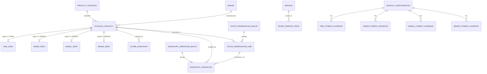

# Physical Data Architecture Specification: `automotive-product`

> **Service Identity**: `automotive-product` (Port 8092)
> **Status**: AUTHORITATIVE PART 2 + PART 3 SPECIFICATION (Updated 2026-11-26 per `P2-DEC-01`–`P2-DEC-05` & `P3-DEC-01`–`P3-DEC-07`; DDL **NOT EXECUTED**)
> **Primary Storage**: PostgreSQL (catalog, typed category specs, service prices, YMMT fitment evidence, branch inventory, atomic group reservations, minimal operation audit, outbox/inbox)
> **Logical Database**: `automotive_product_db` | **Database Schema**: `automotive_product`
> **Flyway & Role Ownership (`OPS-01`)**: `spring.flyway.schemas=automotive_product`, `spring.flyway.default-schema=automotive_product`; migration role `automotive_product_migrator` (DDL on `automotive_product` only), runtime role `automotive_product_app` (DML only, zero cross-DB/schema grants).
> **Owned Modules**: Catalog & Services Module, Vehicle Fitment Module, Branch Inventory & Stock Allocation Module

---

## 1. Entity-Relationship Model (Mermaid ERD)



---

## 2. PostgreSQL Relational DDL Specifications (Schema: `automotive_product`)

> **Nomenclature & Legacy Compatibility (`P2-DEC-01`)**: Legacy `product_skus.id` and `tire_specifications.sku_id` UUIDs are preserved 1:1 as `physical_product.id` and `tire_spec.physical_product_id` during future expand–migrate–contract Flyway migrations (Part 3 inventory/reservation tables below retain `physical_product_id` as canonical FK with `sku_id` noted as legacy alias).

### 2.1 Lookup Tables: `product_category` & `brand`
```sql
CREATE TABLE automotive_product.product_category (
    code VARCHAR(32) PRIMARY KEY,
    display_name VARCHAR(64) NOT NULL,
    spec_storage_mode VARCHAR(24) NOT NULL DEFAULT 'TYPED_TABLE'
        CHECK (spec_storage_mode IN ('TYPED_TABLE', 'EXTRA_SPECS_ONLY')),
    fitment_mode VARCHAR(24) NOT NULL DEFAULT 'CATEGORY_EVIDENCE'
        CHECK (fitment_mode IN ('CATEGORY_EVIDENCE', 'NONE_REQUIRED')),
    extra_specs_schema JSONB NULL CHECK (extra_specs_schema IS NULL OR jsonb_typeof(extra_specs_schema) = 'object'),
    schema_version VARCHAR(16) NOT NULL DEFAULT '1.0',
    is_active BOOLEAN NOT NULL DEFAULT TRUE,
    created_at TIMESTAMPTZ NOT NULL DEFAULT NOW()
);

CREATE TABLE automotive_product.brand (
    id UUID PRIMARY KEY DEFAULT gen_random_uuid(),
    name VARCHAR(64) NOT NULL,
    normalized_name VARCHAR(64) NOT NULL UNIQUE,
    created_at TIMESTAMPTZ NOT NULL DEFAULT NOW()
);
```

### 2.2 Physical Catalog & Typed Category Spec Tables (`P2-DEC-01`, `P2-DEC-03`, `P2-DEC-04`, `P2-DEC-05`)
```sql
CREATE TABLE automotive_product.physical_product (
    id UUID PRIMARY KEY DEFAULT gen_random_uuid(),
    sku_code VARCHAR(64) NOT NULL UNIQUE,
    category_code VARCHAR(32) NOT NULL REFERENCES automotive_product.product_category(code) ON DELETE RESTRICT,
    brand_id UUID NOT NULL REFERENCES automotive_product.brand(id) ON DELETE RESTRICT,
    name VARCHAR(160) NOT NULL,
    price_cents INTEGER NOT NULL CHECK (price_cents >= 0), -- Global nationwide USD price (no store override)
    is_active BOOLEAN NOT NULL DEFAULT TRUE,               -- Admin visibility flag only (no archival state machine)
    extra_specs JSONB NOT NULL DEFAULT '{}'::jsonb CHECK (jsonb_typeof(extra_specs) = 'object'),
    version INTEGER NOT NULL DEFAULT 1,
    created_at TIMESTAMPTZ NOT NULL DEFAULT NOW(),
    updated_at TIMESTAMPTZ NOT NULL DEFAULT NOW(),
    CONSTRAINT uq_physical_product_id_category UNIQUE (id, category_code)
);

CREATE INDEX idx_physical_product_category ON automotive_product.physical_product (category_code, is_active);
CREATE INDEX idx_physical_product_brand ON automotive_product.physical_product (brand_id);

-- Category-equality enforcement: composite FK (physical_product_id, category_code) guarantees a TIRE row cannot attach to a WIPER product.
CREATE TABLE automotive_product.tire_spec (
    physical_product_id UUID PRIMARY KEY,
    category_code VARCHAR(32) NOT NULL DEFAULT 'TIRE' CHECK (category_code = 'TIRE'),
    width_mm INTEGER NOT NULL CHECK (width_mm BETWEEN 125 AND 355),
    aspect_ratio INTEGER NOT NULL CHECK (aspect_ratio BETWEEN 25 AND 85),
    rim_diameter_in INTEGER NOT NULL CHECK (rim_diameter_in BETWEEN 12 AND 26),
    season VARCHAR(24) NOT NULL CHECK (season IN ('ALL_SEASON', 'SUMMER', 'WINTER', 'ALL_WEATHER')),
    load_index INTEGER NOT NULL CHECK (load_index BETWEEN 70 AND 130),
    speed_rating VARCHAR(4) NOT NULL CHECK (speed_rating IN ('L', 'M', 'N', 'P', 'Q', 'R', 'S', 'T', 'U', 'H', 'V', 'Z', 'W', 'Y', '(Y)')),
    is_run_flat BOOLEAN NOT NULL DEFAULT FALSE,
    utqg_treadwear INTEGER NULL CHECK (utqg_treadwear IS NULL OR utqg_treadwear > 0),
    dimension_string VARCHAR(32) GENERATED ALWAYS AS (
        width_mm || '/' || aspect_ratio || 'R' || rim_diameter_in
    ) STORED,
    CONSTRAINT fk_tire_spec_product FOREIGN KEY (physical_product_id, category_code)
        REFERENCES automotive_product.physical_product(id, category_code) ON DELETE RESTRICT
);

CREATE INDEX idx_tire_spec_search ON automotive_product.tire_spec (width_mm, season, rim_diameter_in);
CREATE INDEX idx_tire_spec_dims ON automotive_product.tire_spec (width_mm, aspect_ratio, rim_diameter_in);

CREATE TABLE automotive_product.wiper_spec (
    physical_product_id UUID PRIMARY KEY,
    category_code VARCHAR(32) NOT NULL DEFAULT 'WIPER' CHECK (category_code = 'WIPER'),
    length_in NUMERIC(4,1) NOT NULL CHECK (length_in BETWEEN 8.0 AND 36.0),
    connector_type VARCHAR(32) NOT NULL,
    position VARCHAR(24) NOT NULL CHECK (position IN ('FRONT_LEFT', 'FRONT_RIGHT', 'REAR', 'UNIVERSAL')),
    CONSTRAINT fk_wiper_spec_product FOREIGN KEY (physical_product_id, category_code)
        REFERENCES automotive_product.physical_product(id, category_code) ON DELETE RESTRICT
);

CREATE INDEX idx_wiper_spec_search ON automotive_product.wiper_spec (length_in, connector_type);

CREATE TABLE automotive_product.wheel_spec (
    physical_product_id UUID PRIMARY KEY,
    category_code VARCHAR(32) NOT NULL DEFAULT 'WHEEL' CHECK (category_code = 'WHEEL'),
    diameter_in NUMERIC(4,1) NOT NULL CHECK (diameter_in BETWEEN 12.0 AND 28.0),
    width_in NUMERIC(4,1) NOT NULL CHECK (width_in BETWEEN 4.0 AND 15.0),
    bolt_lug_count SMALLINT NOT NULL CHECK (bolt_lug_count BETWEEN 4 AND 8),
    bolt_circle_mm NUMERIC(5,1) NOT NULL CHECK (bolt_circle_mm > 0),
    offset_mm SMALLINT NOT NULL CHECK (offset_mm BETWEEN -60 AND 80),
    hub_bore_mm NUMERIC(5,1) NOT NULL CHECK (hub_bore_mm > 0),
    CONSTRAINT fk_wheel_spec_product FOREIGN KEY (physical_product_id, category_code)
        REFERENCES automotive_product.physical_product(id, category_code) ON DELETE RESTRICT
);

CREATE INDEX idx_wheel_spec_search ON automotive_product.wheel_spec (diameter_in, bolt_lug_count, bolt_circle_mm);

CREATE TABLE automotive_product.brake_spec (
    physical_product_id UUID PRIMARY KEY,
    category_code VARCHAR(32) NOT NULL DEFAULT 'BRAKE' CHECK (category_code = 'BRAKE'),
    position VARCHAR(24) NOT NULL CHECK (position IN ('FRONT', 'REAR', 'FRONT_AND_REAR')),
    part_subtype VARCHAR(24) NOT NULL CHECK (part_subtype IN ('PAD', 'ROTOR', 'CALIPER', 'KIT')),
    friction_material VARCHAR(32) NULL,
    rotor_diameter_mm NUMERIC(5,1) NULL CHECK (rotor_diameter_mm IS NULL OR rotor_diameter_mm > 0),
    CONSTRAINT fk_brake_spec_product FOREIGN KEY (physical_product_id, category_code)
        REFERENCES automotive_product.physical_product(id, category_code) ON DELETE RESTRICT
);

CREATE INDEX idx_brake_spec_search ON automotive_product.brake_spec (position, part_subtype);
```

- **Category-Change Rejection & Transaction Ordering**: `physical_product` is inserted first with its immutable `category_code`, followed in the same local ACID transaction by the matching `<cat>_spec` row (when `spec_storage_mode = 'TYPED_TABLE'`). Updating `physical_product.category_code` when a spec row exists is rejected by `ON DELETE/UPDATE RESTRICT` on `(id, category_code)`.

#### 2.2.1 Extensible Category Onboarding Procedure (No NoSQL, Zero `physical_product` DDL Changes)
`product_category` is open-ended (no fixed four-category `CHECK` constraint). Adding a new category—such as `WINDSHIELD`—follows a three-step PostgreSQL-only procedure without introducing NoSQL or altering `physical_product`:
1. **Register Category & Validation Contract**: Insert a row into `automotive_product.product_category` (e.g., `code = 'WINDSHIELD'`, `spec_storage_mode`, `fitment_mode`, and `extra_specs_schema` JSON Schema defining required/typed attributes).
2. **Attribute Storage & Validation**:
   - *Indexed relational attributes (`spec_storage_mode = 'TYPED_TABLE'`)*: Add an additive 1:1 `automotive_product.windshield_spec` table via a service-owned Flyway migration with `category_code VARCHAR(32) NOT NULL DEFAULT 'WINDSHIELD' CHECK (category_code = 'WINDSHIELD')` and composite FK `(physical_product_id, category_code) REFERENCES automotive_product.physical_product(id, category_code) ON DELETE RESTRICT`, plus category B-Tree indexes (e.g., OEM glass tint, ADAS camera mount, rain-sensor cutout).
   - *Schema-validated JSONB (`spec_storage_mode = 'EXTRA_SPECS_ONLY'`)*: Store attributes in `physical_product.extra_specs` validated at write time against `product_category.extra_specs_schema` (optionally backed by PostgreSQL expression/GIN indexes).
3. **Category-Appropriate Fitment Contract**:
   - If `fitment_mode = 'CATEGORY_EVIDENCE'`, add an additive `automotive_product.<category>_fitment_evidence` table referencing `vehicle_configuration(id)` with `source_provider`, `evidence_version`, `is_active`, and category-specific matching attributes (e.g., ADAS/HUD/rain-sensor compatibility for `WINDSHIELD`), and register its evaluator in `FitmentEvaluationService` (`POST /fitment/validate`).
   - If `fitment_mode = 'NONE_REQUIRED'` (universal non-vehicle-specific accessories), the evaluator returns `fitment_required: false` with `result: null` and `reasons: ["CATEGORY_FITMENT_NOT_REQUIRED"]`—preserving the strict three-value `result` enum (`COMPATIBLE`, `INCOMPATIBLE`, `UNKNOWN`) rather than introducing a fourth compatibility value.

### 2.3 Purchasable Services & Store-Specific USD Pricing (`P2-DEC-01`, `P2-DEC-02`, `P2-DEC-05`)
```sql
CREATE TABLE automotive_product.service (
    id UUID PRIMARY KEY DEFAULT gen_random_uuid(),
    service_code VARCHAR(64) NOT NULL UNIQUE, -- e.g. INSTALL_1_WHEEL, INSTALL_2_WHEELS, INSTALL_4_WHEELS
    name VARCHAR(160) NOT NULL,
    wheel_count SMALLINT NULL CHECK (wheel_count IS NULL OR wheel_count IN (1, 2, 4)),
    estimated_duration_minutes INTEGER NOT NULL CHECK (estimated_duration_minutes > 0),
    required_capability_code VARCHAR(64) NOT NULL, -- Validated against store-management at booking
    is_active BOOLEAN NOT NULL DEFAULT TRUE,
    version INTEGER NOT NULL DEFAULT 1,
    created_at TIMESTAMPTZ NOT NULL DEFAULT NOW(),
    updated_at TIMESTAMPTZ NOT NULL DEFAULT NOW()
);

CREATE TABLE automotive_product.store_service_price (
    store_id UUID NOT NULL, -- Opaque reference to store-management store ID (NO cross-DB FK)
    service_id UUID NOT NULL REFERENCES automotive_product.service(id) ON DELETE RESTRICT,
    price_cents INTEGER NOT NULL CHECK (price_cents >= 0), -- Absent row = not sellable at this store
    version INTEGER NOT NULL DEFAULT 1,
    updated_at TIMESTAMPTZ NOT NULL DEFAULT NOW(),
    updated_by UUID NULL,
    PRIMARY KEY (store_id, service_id)
);

CREATE INDEX idx_store_service_price_service ON automotive_product.store_service_price (service_id);
```

### 2.4 Vehicle Reference & Category-Specific Fitment Evidence (`P2-DEC-03`)
```sql
CREATE TABLE automotive_product.vehicle_configuration (
    id UUID PRIMARY KEY DEFAULT gen_random_uuid(),
    year SMALLINT NOT NULL CHECK (year >= 1980),
    make VARCHAR(64) NOT NULL,
    model VARCHAR(64) NOT NULL,
    trim VARCHAR(64) NOT NULL,
    body_style VARCHAR(64) NOT NULL DEFAULT 'STANDARD',
    source_provider VARCHAR(64) NOT NULL,
    source_version VARCHAR(32) NOT NULL,
    external_ref_code VARCHAR(64) NULL,
    created_at TIMESTAMPTZ NOT NULL DEFAULT NOW(),
    CONSTRAINT uq_vehicle_config_ymmt UNIQUE (year, make, model, trim, body_style)
);

CREATE INDEX idx_vehicle_config_ymmt ON automotive_product.vehicle_configuration (year, make, model, trim);

CREATE TABLE automotive_product.tire_fitment_evidence (
    id UUID PRIMARY KEY DEFAULT gen_random_uuid(),
    vehicle_configuration_id UUID NOT NULL REFERENCES automotive_product.vehicle_configuration(id) ON DELETE RESTRICT,
    axle_position VARCHAR(16) NOT NULL CHECK (axle_position IN ('FRONT', 'REAR', 'ALL')),
    oem_width_mm INTEGER NOT NULL,
    oem_aspect_ratio INTEGER NOT NULL,
    oem_rim_diameter_in INTEGER NOT NULL,
    min_load_index INTEGER NOT NULL,
    min_speed_rating VARCHAR(4) NOT NULL CHECK (min_speed_rating IN ('L', 'M', 'N', 'P', 'Q', 'R', 'S', 'T', 'U', 'H', 'V', 'Z', 'W', 'Y', '(Y)')),
    is_staggered BOOLEAN NOT NULL DEFAULT FALSE,
    source_provider VARCHAR(64) NOT NULL,
    evidence_version VARCHAR(32) NOT NULL,
    is_active BOOLEAN NOT NULL DEFAULT TRUE,
    created_at TIMESTAMPTZ NOT NULL DEFAULT NOW(),
    CONSTRAINT uq_tire_fitment_ev UNIQUE (vehicle_configuration_id, axle_position, oem_width_mm, oem_aspect_ratio, oem_rim_diameter_in, source_provider, evidence_version)
);

CREATE TABLE automotive_product.wiper_fitment_evidence (
    id UUID PRIMARY KEY DEFAULT gen_random_uuid(),
    vehicle_configuration_id UUID NOT NULL REFERENCES automotive_product.vehicle_configuration(id) ON DELETE RESTRICT,
    position VARCHAR(24) NOT NULL CHECK (position IN ('FRONT_LEFT', 'FRONT_RIGHT', 'REAR')),
    required_length_in NUMERIC(4,1) NOT NULL,
    required_connector_type VARCHAR(32) NOT NULL,
    source_provider VARCHAR(64) NOT NULL,
    evidence_version VARCHAR(32) NOT NULL,
    is_active BOOLEAN NOT NULL DEFAULT TRUE,
    created_at TIMESTAMPTZ NOT NULL DEFAULT NOW(),
    CONSTRAINT uq_wiper_fitment_ev UNIQUE (vehicle_configuration_id, position, required_connector_type, source_provider, evidence_version)
);

CREATE TABLE automotive_product.wheel_fitment_evidence (
    id UUID PRIMARY KEY DEFAULT gen_random_uuid(),
    vehicle_configuration_id UUID NOT NULL REFERENCES automotive_product.vehicle_configuration(id) ON DELETE RESTRICT,
    axle_position VARCHAR(16) NOT NULL CHECK (axle_position IN ('FRONT', 'REAR', 'ALL')),
    required_diameter_in NUMERIC(4,1) NOT NULL,
    required_bolt_lug_count SMALLINT NOT NULL,
    required_bolt_circle_mm NUMERIC(5,1) NOT NULL,
    min_offset_mm SMALLINT NOT NULL,
    max_offset_mm SMALLINT NOT NULL,
    min_hub_bore_mm NUMERIC(5,1) NOT NULL,
    source_provider VARCHAR(64) NOT NULL,
    evidence_version VARCHAR(32) NOT NULL,
    is_active BOOLEAN NOT NULL DEFAULT TRUE,
    created_at TIMESTAMPTZ NOT NULL DEFAULT NOW()
);

CREATE TABLE automotive_product.brake_fitment_evidence (
    id UUID PRIMARY KEY DEFAULT gen_random_uuid(),
    vehicle_configuration_id UUID NOT NULL REFERENCES automotive_product.vehicle_configuration(id) ON DELETE RESTRICT,
    physical_product_id UUID NOT NULL,
    category_code VARCHAR(32) NOT NULL DEFAULT 'BRAKE' CHECK (category_code = 'BRAKE'),
    position VARCHAR(24) NOT NULL CHECK (position IN ('FRONT', 'REAR', 'FRONT_AND_REAR')),
    source_provider VARCHAR(64) NOT NULL,
    evidence_version VARCHAR(32) NOT NULL,
    is_active BOOLEAN NOT NULL DEFAULT TRUE,
    created_at TIMESTAMPTZ NOT NULL DEFAULT NOW(),
    CONSTRAINT fk_brake_fitment_product FOREIGN KEY (physical_product_id, category_code)
        REFERENCES automotive_product.physical_product(id, category_code) ON DELETE RESTRICT,
    CONSTRAINT uq_brake_fitment_ev UNIQUE (vehicle_configuration_id, physical_product_id, position, source_provider, evidence_version)
);
```

#### 2.4.1 Category-Specific Fitment Evaluation Rules, Provenance & Three-State Semantics
- **Explicit Result Semantics (`COMPATIBLE` | `INCOMPATIBLE` | `UNKNOWN`)**:
  - `COMPATIBLE`: Non-conflicting active evidence exists for `(vehicle_configuration_id, category_code, position/axle)` AND all category-specific rules below pass.
  - `INCOMPATIBLE`: Non-conflicting active evidence exists AND at least one category-specific rule fails.
  - `UNKNOWN`: Missing `vehicle_configuration`, missing active evidence for the category/axle/position, unrecognized rating symbol, **or conflicting active evidence rows** (`CONFLICTING_FITMENT_EVIDENCE`). Missing or conflicting evidence **never** resolves to `COMPATIBLE`.
- **Evidence Provenance & Conflict Resolution**:
  - Evaluators filter `is_active = TRUE` and inspect `source_provider` + `evidence_version`. If two or more active evidence rows for the same `(vehicle_configuration_id, category_code, axle/position)` disagree on required bounds/specs, the evaluator returns `UNKNOWN` with reason `CONFLICTING_FITMENT_EVIDENCE` (and logs for catalog reconciliation) rather than picking arbitrarily.
- **Category-Specific Rules**:
  1. **Tire (`tire_spec` vs `tire_fitment_evidence`)**:
     - *Front/Rear & Staggered Axle Matching*: If active evidence has `is_staggered = TRUE` (distinct `FRONT` and `REAR` rows), the caller must specify `axle_position IN ('FRONT', 'REAR')`; omitting it or requesting `'ALL'` returns `UNKNOWN` (`AXLE_POSITION_REQUIRED_FOR_STAGGERED_FITMENT`). Non-staggered `'ALL'` evidence satisfies `'FRONT'`, `'REAR'`, or `'ALL'`.
     - *Dimensions*: `tire_spec.width_mm = oem_width_mm`, `aspect_ratio = oem_aspect_ratio`, and `rim_diameter_in = oem_rim_diameter_in` (mismatch → `INCOMPATIBLE`).
     - *Load Index*: `tire_spec.load_index >= tire_fitment_evidence.min_load_index` (lower → `INCOMPATIBLE`).
     - *Speed Rating Ordered Rank Comparison (Never ASCII)*: Both `tire_spec.speed_rating` and `tire_fitment_evidence.min_speed_rating` (`VARCHAR(4)`) are validated against the canonical symbol set `('L', 'M', 'N', 'P', 'Q', 'R', 'S', 'T', 'U', 'H', 'V', 'Z', 'W', 'Y', '(Y)')` and compared via an explicit ordered speed-rating rank table (`L(120) < M(130) < N(140) < P(150) < Q(160) < R(170) < S(180) < T(190) < U(200) < H(210) < V(240) < Z(240+) < W(270) < Y(300) < (Y)(300+)`). Require `rank(tire_spec.speed_rating) >= rank(min_speed_rating)` (lower → `INCOMPATIBLE`; unknown symbol → `UNKNOWN`). Note that `'H'` (210 km/h) outranks `'T'` (190 km/h) even though `'H' < 'T'` lexicographically.
  2. **Wiper (`wiper_spec` vs `wiper_fitment_evidence`)**:
     - `wiper_spec.length_in = required_length_in` AND `wiper_spec.connector_type = required_connector_type`.
     - *Position Matching*: `wiper_spec.position = wiper_fitment_evidence.position` (or `UNIVERSAL` for `FRONT_LEFT`/`FRONT_RIGHT` only when length + connector match; `REAR` requires explicit `REAR` match unless evidence permits). Mismatch → `INCOMPATIBLE`.
  3. **Wheel (`wheel_spec` vs `wheel_fitment_evidence`)**:
     - Same `FRONT`/`REAR`/`ALL` staggered axle rule as tires.
     - `bolt_lug_count = required_bolt_lug_count`, `bolt_circle_mm = required_bolt_circle_mm`, `diameter_in = required_diameter_in`, `offset_mm BETWEEN min_offset_mm AND max_offset_mm`, and `hub_bore_mm >= min_hub_bore_mm` (mismatch or smaller hub bore → `INCOMPATIBLE`).
  4. **Brake (`brake_spec` vs `brake_fitment_evidence`)**:
     - Explicit `(vehicle_configuration_id, physical_product_id, position)` active evidence required (missing → `UNKNOWN`; position mismatch such as `FRONT` pad on `REAR` request → `INCOMPATIBLE`).

### 2.5 Branch Physical Inventory & Atomic Group Reservations (`P3-DEC-01`, `P3-DEC-02`, `P3-DEC-06`, `P3-DEC-07`)
> **Scope & Ownership**: `store_inventory` tracks **physical products only** (`physical_product_id` = legacy `sku_id` alias); `service_id` never enters `store_inventory` or `stock_reservation_line`. `store_id` is an opaque UUID referencing `store-management` (zero cross-DB FK). No redundant `idx_inventory_store_sku` index is created (`INV-18`), as `uq_store_product` already provides the unique B-Tree on `(store_id, physical_product_id)`.

```sql
CREATE TABLE automotive_product.store_inventory (
    id UUID PRIMARY KEY DEFAULT gen_random_uuid(),
    store_id UUID NOT NULL,
    physical_product_id UUID NOT NULL REFERENCES automotive_product.physical_product(id) ON DELETE RESTRICT,
    quantity_on_hand INTEGER NOT NULL DEFAULT 0 CHECK (quantity_on_hand >= 0),
    quantity_reserved INTEGER NOT NULL DEFAULT 0 CHECK (quantity_reserved >= 0),
    quantity_allocated INTEGER NOT NULL DEFAULT 0 CHECK (quantity_allocated >= 0),
    available_quantity INTEGER GENERATED ALWAYS AS (
        quantity_on_hand - quantity_reserved - quantity_allocated
    ) STORED,
    version INTEGER NOT NULL DEFAULT 1,
    updated_at TIMESTAMPTZ NOT NULL DEFAULT NOW(),
    CONSTRAINT uq_store_product UNIQUE (store_id, physical_product_id),
    CONSTRAINT chk_atp_non_negative CHECK (
        quantity_on_hand - (quantity_reserved + quantity_allocated) >= 0
    )
);

-- Stored group status is maintained synchronously in the same ACID transaction as its component lines.
CREATE TABLE automotive_product.stock_reservation_group (
    id UUID PRIMARY KEY DEFAULT gen_random_uuid(),
    store_id UUID NOT NULL,
    checkout_attempt_id UUID NOT NULL, -- Opaque reference to automotive_operations.checkout_attempt(id)
    idempotency_key UUID NOT NULL,
    canonical_request_hash CHAR(64) NOT NULL, -- Versioned SHA-256 of canonicalized request payload
    status VARCHAR(32) NOT NULL DEFAULT 'HELD',
    failure_code VARCHAR(64) NULL,
    expires_at TIMESTAMPTZ NOT NULL, -- Authoritative 10m deadline passed from automotive-operations.checkout_attempt (P3-DEC-07)
    allocated_at TIMESTAMPTZ NULL,
    released_at TIMESTAMPTZ NULL,
    expired_at TIMESTAMPTZ NULL,
    cancelled_at TIMESTAMPTZ NULL,
    version INTEGER NOT NULL DEFAULT 1,
    created_at TIMESTAMPTZ NOT NULL DEFAULT NOW(),
    updated_at TIMESTAMPTZ NOT NULL DEFAULT NOW(),
    CONSTRAINT uq_res_group_idempotency UNIQUE (store_id, idempotency_key),
    CONSTRAINT uq_res_group_checkout_attempt UNIQUE (checkout_attempt_id),
    CONSTRAINT chk_res_group_status CHECK (status IN (
        'HELD', 'ALLOCATED', 'PARTIALLY_FULFILLED', 'FULFILLED',
        'RELEASED', 'EXPIRED', 'CANCELLED'
    ))
);

CREATE INDEX idx_res_group_janitor ON automotive_product.stock_reservation_group (expires_at)
WHERE status = 'HELD';

CREATE TABLE automotive_product.stock_reservation_line (
    id UUID PRIMARY KEY DEFAULT gen_random_uuid(),
    reservation_group_id UUID NOT NULL REFERENCES automotive_product.stock_reservation_group(id) ON DELETE RESTRICT,
    physical_product_id UUID NOT NULL REFERENCES automotive_product.physical_product(id) ON DELETE RESTRICT,
    requested_quantity INTEGER NOT NULL CHECK (requested_quantity > 0),
    held_quantity INTEGER NOT NULL CHECK (held_quantity >= 0),
    allocated_quantity INTEGER NOT NULL DEFAULT 0 CHECK (allocated_quantity >= 0),
    fulfilled_quantity INTEGER NOT NULL DEFAULT 0 CHECK (fulfilled_quantity >= 0),
    cancelled_quantity INTEGER NOT NULL DEFAULT 0 CHECK (cancelled_quantity >= 0),
    status VARCHAR(32) NOT NULL DEFAULT 'HELD',
    version INTEGER NOT NULL DEFAULT 1,
    created_at TIMESTAMPTZ NOT NULL DEFAULT NOW(),
    updated_at TIMESTAMPTZ NOT NULL DEFAULT NOW(),
    CONSTRAINT uq_res_line_group_product UNIQUE (reservation_group_id, physical_product_id),
    CONSTRAINT chk_res_line_status CHECK (status IN (
        'HELD', 'ALLOCATED', 'PARTIALLY_FULFILLED', 'FULFILLED',
        'RELEASED', 'EXPIRED', 'CANCELLED'
    )),
    CONSTRAINT chk_res_line_qty_conservation CHECK (
        held_quantity <= requested_quantity
        AND allocated_quantity + fulfilled_quantity + cancelled_quantity <= requested_quantity
        AND (
            (status = 'HELD' AND held_quantity = requested_quantity AND allocated_quantity = 0 AND fulfilled_quantity = 0 AND cancelled_quantity = 0)
            OR (status IN ('RELEASED', 'EXPIRED') AND held_quantity = 0 AND allocated_quantity = 0 AND fulfilled_quantity = 0 AND cancelled_quantity = 0)
            OR (status = 'ALLOCATED' AND held_quantity = 0 AND allocated_quantity = requested_quantity AND fulfilled_quantity = 0 AND cancelled_quantity = 0)
            OR (status = 'PARTIALLY_FULFILLED' AND held_quantity = 0 AND fulfilled_quantity > 0 AND allocated_quantity > 0 AND fulfilled_quantity + allocated_quantity + cancelled_quantity = requested_quantity)
            -- Supports full fulfillment AND partial fulfillment + remainder cancellation (e.g., requested=4, fulfilled=2, cancelled=2, allocated=0)
            OR (status = 'FULFILLED' AND held_quantity = 0 AND allocated_quantity = 0 AND fulfilled_quantity > 0 AND fulfilled_quantity + cancelled_quantity = requested_quantity)
            OR (status = 'CANCELLED' AND held_quantity = 0 AND allocated_quantity = 0 AND fulfilled_quantity = 0 AND cancelled_quantity = requested_quantity)
        )
    )
);
```

- **Group-Level Status Aggregation Invariant** (maintained synchronously in the same ACID transaction):
  - `HELD` / `EXPIRED` / `RELEASED` / `ALLOCATED`: all component lines are in that same state.
  - `PARTIALLY_FULFILLED`: at least one line is `PARTIALLY_FULFILLED`, OR lines are a mix of `ALLOCATED` and `FULFILLED`/`CANCELLED`.
  - `FULFILLED` (terminal): all lines are terminal (`FULFILLED` or `CANCELLED`) and at least one line has `fulfilled_quantity > 0` (including mixed-fulfillment lines such as `requested=4, fulfilled=2, cancelled=2, allocated=0`).
  - `CANCELLED` (terminal): all lines are `CANCELLED` (`fulfilled_quantity = 0` across the entire group).

### 2.6 Minimal Unpartitioned Operation Audit (`inventory_operation_batch` & `inventory_operation` — `P3-DEC-03`, `P3-DEC-04`, `P3-DEC-05`)
> **V1 Scope Deferrals (`DEFERRED_BY_OWNER_V1`)**: Inter-store transfers (`stock_transfer`, `INV-12`), dedicated quarantine/RMA workflows (`inventory_quarantine_stock`, `quarantine_disposition_log`, `INV-14`), and annual-partitioned movement ledgers (`stock_movements`, `INV-15`, `INV-17`) are **deferred by owner for V1** and removed from active V1 DDL. Only `inventory_operation_batch` + `inventory_operation` (unpartitioned, keyed by unique batch `operation_id` + `request_hash`) are retained to guarantee atomic, exactly-once single-line and multi-line stock changes (`INV-07`, `INV-08`, `INV-13`, `INV-16`).

```sql
CREATE TABLE automotive_product.inventory_operation_batch (
    id UUID PRIMARY KEY DEFAULT gen_random_uuid(),
    operation_id UUID NOT NULL UNIQUE, -- Stable caller business operation ID for the entire single/multi-line request
    request_hash CHAR(64) NOT NULL,    -- SHA-256 of canonicalized request (type, store, group, sorted lines); mismatch -> 409
    operation_type VARCHAR(32) NOT NULL CHECK (operation_type IN (
        'GOODS_RECEIPT', 'FULFILLMENT_PICKUP', 'FULFILLMENT_WORKSHOP',
        'FULFILLMENT_SHIPMENT', 'ALLOCATION_CANCEL', 'STOCK_ADJUSTMENT'
    )),
    store_id UUID NOT NULL,
    reservation_group_id UUID NULL REFERENCES automotive_product.stock_reservation_group(id) ON DELETE RESTRICT,
    actor_id UUID NOT NULL,
    reason_code VARCHAR(64) NOT NULL,
    origin_service VARCHAR(64) NOT NULL,
    notes TEXT NULL,
    created_at TIMESTAMPTZ NOT NULL DEFAULT NOW()
);

CREATE TABLE automotive_product.inventory_operation (
    id UUID PRIMARY KEY DEFAULT gen_random_uuid(),
    batch_id UUID NOT NULL REFERENCES automotive_product.inventory_operation_batch(id) ON DELETE RESTRICT,
    physical_product_id UUID NOT NULL REFERENCES automotive_product.physical_product(id) ON DELETE RESTRICT,
    reservation_line_id UUID NULL REFERENCES automotive_product.stock_reservation_line(id) ON DELETE RESTRICT,
    order_id UUID NULL,
    order_line_id UUID NULL,
    quantity_delta_on_hand INTEGER NOT NULL,
    quantity_delta_reserved INTEGER NOT NULL DEFAULT 0,
    quantity_delta_allocated INTEGER NOT NULL DEFAULT 0,
    created_at TIMESTAMPTZ NOT NULL DEFAULT NOW(),
    CONSTRAINT uq_inv_op_batch_product UNIQUE (batch_id, physical_product_id)
);

CREATE INDEX idx_inv_op_batch_store_created ON automotive_product.inventory_operation_batch (store_id, created_at DESC);
CREATE INDEX idx_inv_op_product_created ON automotive_product.inventory_operation (physical_product_id, created_at DESC);
CREATE INDEX idx_inv_op_res_line ON automotive_product.inventory_operation (reservation_line_id)
WHERE reservation_line_id IS NOT NULL;
```

---

## 3. Part 2 & Part 3 SQL Query, Atomic Reservation & Concurrency Contracts (**NOT EXECUTED**)

1. **Typed Tire Search (`width_mm = 215 AND season = 'ALL_SEASON'`, selected store `ATP > 0`, no JSONB cast)**:
   ```sql
   SELECT p.id AS physical_product_id, p.sku_code, p.name, p.price_cents,
          t.width_mm, t.aspect_ratio, t.rim_diameter_in, t.season, t.load_index, t.speed_rating,
          (si.quantity_on_hand - si.quantity_reserved - si.quantity_allocated) AS atp_quantity
   FROM automotive_product.physical_product p
   JOIN automotive_product.tire_spec t
     ON t.physical_product_id = p.id AND t.category_code = p.category_code
   JOIN automotive_product.store_inventory si
     ON si.physical_product_id = p.id AND si.store_id = :store_id
   WHERE p.category_code = 'TIRE'
     AND p.is_active = TRUE
     AND t.width_mm = 215
     AND t.season = 'ALL_SEASON'
     AND (si.quantity_on_hand - si.quantity_reserved - si.quantity_allocated) > 0
   ORDER BY p.price_cents ASC, p.id ASC
   LIMIT :limit OFFSET :offset;
   ```
2. **Typed Wiper Search (`length_in = 18.0`, selected store `ATP > 0`, uses `idx_wiper_spec_search`)**:
   ```sql
   SELECT p.id AS physical_product_id, p.sku_code, p.name, p.price_cents,
          w.length_in, w.connector_type, w.position,
          (si.quantity_on_hand - si.quantity_reserved - si.quantity_allocated) AS atp_quantity
   FROM automotive_product.physical_product p
   JOIN automotive_product.wiper_spec w
     ON w.physical_product_id = p.id AND w.category_code = p.category_code
   JOIN automotive_product.store_inventory si
     ON si.physical_product_id = p.id AND si.store_id = :store_id
   WHERE p.category_code = 'WIPER'
     AND p.is_active = TRUE
     AND w.length_in = 18.0
     AND (si.quantity_on_hand - si.quantity_reserved - si.quantity_allocated) > 0
   ORDER BY p.price_cents ASC, p.id ASC;
   ```
3. **Part 3 Atomic Group Reservation Algorithm (`ACT-PRD-008`, `P3-DEC-01`, `P3-DEC-06`, `P3-DEC-07`)**:
   - **Authoritative Checkout Deadline & Canonicalization**: `automotive-operations` generates the single authoritative `expires_at` (`clock_timestamp() + INTERVAL '10 minutes'`) when persisting `checkout_attempt` and passes it to `POST /inventory/reservations`. `automotive-product` validates `clock_timestamp() < expires_at <= clock_timestamp() + INTERVAL '10 minutes 5 seconds'` (clock-skew guard; delayed expired RPCs fail closed with `409 CHECKOUT_DEADLINE_EXPIRED`; attempts to exceed 10 minutes fail with `422 INVALID_EXPIRATION_DEADLINE`) and **preserves** that exact `expires_at` without extending it. Lines are normalized by summing duplicate `physical_product_id` quantities (reject `<= 0` or overflow with `422`), sorted ascending by UUID, and hashed into `canonical_request_hash = SHA256("v1|" + store_id + "|" + checkout_attempt_id + "|" + expires_at_iso + "|" + sorted_lines)`.
   - **Exact Transaction Order (Single Local PostgreSQL TX, `READ COMMITTED` + deterministic `FOR UPDATE`, bounded retry up to 3 attempts on SQLSTATE `40P01`/`40001` without changing `idempotency_key`)**:
     1. **Atomic Idempotency Claim First (Before Any Inventory Mutation)**:
        ```sql
        INSERT INTO automotive_product.stock_reservation_group (
            store_id, checkout_attempt_id, idempotency_key,
            canonical_request_hash, status, expires_at
        )
        VALUES (
            :store_id, :checkout_attempt_id, :idempotency_key,
            :canonical_request_hash, 'HELD', :expires_at
        )
        ON CONFLICT DO NOTHING
        RETURNING id;
        ```
        - If `0` rows returned (conflict on `uq_res_group_idempotency (store_id, idempotency_key)` OR `uq_res_group_checkout_attempt (checkout_attempt_id)`):
          - Lookup by `(store_id, idempotency_key)`: if found with matching `canonical_request_hash`, replay persisted group + lines (even if expired/released/cancelled—never resurrect); if found with differing `canonical_request_hash`, abort and return `409 IDEMPOTENCY_PAYLOAD_MISMATCH`.
          - Otherwise lookup by `checkout_attempt_id`: if found (different `idempotency_key` for the same attempt), abort and return `409 CHECKOUT_ATTEMPT_RESERVATION_CONFLICT`.
          - *(Concurrent first-use race: PostgreSQL blocks the second `INSERT` until the first TX commits or rolls back. If the first commits, the second's `ON CONFLICT DO NOTHING` returns 0 rows and reads the committed outcome; if the first rolls back, the second acquires the claim and evaluates current ATP.)*
     2. **Lock All Requested `store_inventory` Rows in Deterministic UUID Order**:
        ```sql
        SELECT id, physical_product_id, quantity_on_hand, quantity_reserved, quantity_allocated
        FROM automotive_product.store_inventory
        WHERE store_id = :store_id
          AND physical_product_id = ANY(:sorted_product_ids)
        ORDER BY physical_product_id ASC
        FOR UPDATE;
        ```
     3. **Validate All Rows & Quantities**: Verify every requested `physical_product_id` exists and `ATP >= requested_quantity`. If any row is missing or short, **`ROLLBACK` the entire transaction** (including the claimed `stock_reservation_group` row — zero partial stock mutations, zero orphan holds, zero outbox events) and return `409 INSUFFICIENT_STOCK` with per-line diagnostics scoped strictly to `:store_id`.
     4. **Update All `store_inventory` Counters**: Execute guarded conditional update per sorted line and assert `affected_rows = 1` for every line:
        ```sql
        UPDATE automotive_product.store_inventory
        SET quantity_reserved = quantity_reserved + :req_qty,
            version = version + 1,
            updated_at = clock_timestamp()
        WHERE store_id = :store_id
          AND physical_product_id = :physical_product_id
          AND (quantity_on_hand - quantity_reserved - quantity_allocated) >= :req_qty;
        ```
     5. **Insert Lines & Outbox, then `COMMIT`**: Insert all `stock_reservation_line` rows (`status = 'HELD'`, `held_quantity = requested_quantity`) and local `outbox_event` (`StockReservationHeldEvent`); `COMMIT`.
   - **Note on Deadlocks (`INV-10`)**: Deterministic lock ordering reduces multi-SKU deadlock cycles, but does **not** claim to eliminate all deadlocks across unrelated queries/workers; therefore transactions stay short and retry SQLSTATE `40P01`/`40001` up to 3 times with jittered backoff.

4. **Part 3 Guarded State Transitions & Multi-Line Operation Idempotency (`INV-05`–`INV-09`, `INV-13`, `INV-16`)**:
   - **Confirm Allocation (`HELD -> ALLOCATED`, `ACT-PRD-009`)**: Locks group (`FOR UPDATE`) + sorted `store_inventory` rows; requires `status = 'HELD' AND expires_at > clock_timestamp()`. If `status IN ('EXPIRED', 'RELEASED')` or `expires_at <= clock_timestamp()`, **do not resurrect or allocate**—return `409 RESERVATION_EXPIRED` for Part 6 reconciliation. Otherwise, atomically update `store_inventory` (`quantity_reserved = quantity_reserved - req_qty`, `quantity_allocated = quantity_allocated + req_qty`, `on_hand` unchanged), update lines + group to `ALLOCATED` (`affected_rows = 1` required), and insert `StockAllocationConfirmedEvent` into `outbox_event`.
   - **Expire / Release (`HELD -> EXPIRED | RELEASED`, `ACT-PRD-010`, `ACT-PRD-019`)**: Janitor (`FOR UPDATE SKIP LOCKED` on `status = 'HELD' AND expires_at <= clock_timestamp()`) and explicit cancel compete via guarded `WHERE status = 'HELD'` (`affected_rows = 1` required). Decrements `quantity_reserved` once only; `on_hand` unchanged.
   - **Multi-Line / Single-Line Physical Handover or Shipping Dispatch (`ALLOCATED -> PARTIALLY_FULFILLED -> FULFILLED`, `ACT-PRD-031`)**:
     - Claims `inventory_operation_batch(operation_id, request_hash)` first (`INSERT ... ON CONFLICT DO NOTHING RETURNING id`). Same `operation_id` + same `request_hash` replays the persisted batch + per-line results; same `operation_id` + different `request_hash` returns `409 IDEMPOTENCY_PAYLOAD_MISMATCH`.
     - Normalizes and sorts requested lines by `physical_product_id` ASC, locks `stock_reservation_group` + `stock_reservation_line` rows (`status IN ('ALLOCATED', 'PARTIALLY_FULFILLED')`) + `store_inventory` rows in deterministic order, and validates `deliver_qty > 0 AND deliver_qty <= allocated_quantity` on every line (any failure rolls back the entire batch, including `inventory_operation_batch`).
     - Atomically decrements `quantity_on_hand` and `quantity_allocated` by `deliver_qty` (`affected_rows = 1` per line), increments `fulfilled_quantity`, updates each line (`PARTIALLY_FULFILLED` or `FULFILLED`) and group status, and inserts one `inventory_operation` row per line under `batch_id`. Delivery acknowledgment (`shipped != delivered`) never decrements stock again.
   - **Cancel Unfulfilled Allocation (`ALLOCATED | PARTIALLY_FULFILLED`, `ACT-PRD-010B`)**: Claims `inventory_operation_batch(operation_id, request_hash, operation_type = 'ALLOCATION_CANCEL')`, releases remaining `allocated_quantity` back to ATP (`quantity_allocated = quantity_allocated - rem_qty`, `on_hand` unchanged), sets `cancelled_quantity = cancelled_quantity + rem_qty` and `allocated_quantity = 0`. Lines with `fulfilled_quantity > 0` transition to `FULFILLED` (`requested = fulfilled + cancelled, allocated = 0`); lines with `fulfilled_quantity = 0` transition to `CANCELLED`. Group status updates per the aggregation invariant above.
   - **Minimal Stock Adjustment (`ACT-PRD-014`)**: Claims `inventory_operation_batch(operation_id, request_hash, operation_type = 'STOCK_ADJUSTMENT')`, locks `store_inventory`, requires `quantity_on_hand + :delta >= 0 AND (quantity_on_hand + :delta - quantity_reserved - quantity_allocated) >= 0` (`affected_rows = 1`; rejects commitment breach with `409 ADJUSTMENT_BREACHES_COMMITMENTS`), and inserts one `inventory_operation` row.

---

## Local Outbox & Consumer Inbox Tables (`automotive_product`)
- **Messaging Role**: **Producer & Consumer**
- **Service-Owned Flyway Instantiation**: Instantiates both `automotive_product.outbox_event` (produces `ProductPriceChangedEvent`, `StockAllocationConfirmedEvent`, `ServiceDefinitionChangedEvent`, `StockLowReorderEvent`) and `automotive_product.consumer_inbox` / `automotive_product.consumer_retry_state` (consumes `OrderCancelledEvent`, `WorkOrderCompletedEvent`) via `backend/services/automotive-product/src/main/resources/db/migration/V*.sql`.
- **Canonical Schema Reference**: Follow the exact `outbox_event` / `consumer_inbox` DDL, T1/T2/T3 boundaries, and retry rules in [`../events-and-projections.md`](../events-and-projections.md) (no shared cross-service tables; DDL is instantiated in `automotive_product` within `automotive_product_db`).
