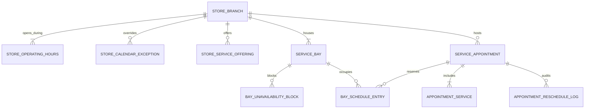

# Physical Data Architecture Specification: `store-management` (Consolidated with `appointment`)

> **Service Identity**: `store-management` (Port 8098) — *Absorbs retired standalone `appointment` (Port 8097) per `P5-DEC-01` (2026-11-27)*
> **Status**: AUTHORITATIVE PART 5 SPECIFICATION (`P5-DEC-01`, `P5-DEC-05`, `P5-DEC-06`, `P5-DEC-08`, `P5-DEC-10`; DDL **NOT EXECUTED**)
> **Primary Storage**: PostgreSQL + PostGIS (stores, operating intervals, holidays/closures, bays, GiST `TSTZRANGE` holds, appointments, outbox/inbox)
> **Logical Database**: `store_management_db` | **Database Schema**: `store_management`
> **Flyway & Role Ownership (`OPS-01`)**: `spring.flyway.schemas=store_management`, `spring.flyway.default-schema=store_management`; migration role `store_management_migrator` (DDL on `store_management` only), runtime role `store_management_app` (DML only, zero cross-DB/schema grants).
> **Owned Modules**: Store Administration Module, Bay Scheduling Module, Appointment Management Module
> **Bay Scheduling Strategy (`COR-DIR-07`, `P5-DEC-05`, `P5-DEC-06`, `APT-14`)**: **FINALIZED V1 DESIGN**. The system allocates an available active bay automatically using PostgreSQL `TSTZRANGE` GiST range exclusions (`btree_gist`) and a deterministic minimal-fragmentation best-fit heuristic. Every active bay at a store can perform every service offered at that store in V1 (no per-bay capability matrix). Customers choose start times, never physical bay numbers.

---

## 1. Entity-Relationship Model (Mermaid ERD)



---

## 2. Relational DDL Specifications (`store_management` Schema — **NOT EXECUTED**)

### 2.1 Store Administration Tables (`P5-DEC-05`, `P5-DEC-06`, `P5-DEC-10`)
```sql
CREATE EXTENSION IF NOT EXISTS postgis SCHEMA store_management;
CREATE EXTENSION IF NOT EXISTS btree_gist SCHEMA store_management;

CREATE TABLE store_management.store_branches (
    id UUID PRIMARY KEY DEFAULT gen_random_uuid(),
    store_number VARCHAR(16) NOT NULL UNIQUE,
    name VARCHAR(128) NOT NULL,
    address_line1 VARCHAR(255) NOT NULL,
    city VARCHAR(64) NOT NULL,
    state CHAR(2) NOT NULL,
    postal_code VARCHAR(16) NOT NULL,
    location_geog GEOGRAPHY(POINT, 4326) NOT NULL,
    phone VARCHAR(32) NOT NULL,
    timezone VARCHAR(64) NOT NULL DEFAULT 'America/New_York', -- Validated IANA zone_id (APT-19)
    default_visit_buffer_minutes SMALLINT NOT NULL DEFAULT 15 CHECK (default_visit_buffer_minutes >= 0),
    slot_increment_minutes SMALLINT NOT NULL DEFAULT 15 CHECK (slot_increment_minutes IN (10, 15, 30, 60)),
    is_active BOOLEAN NOT NULL DEFAULT TRUE,
    created_at TIMESTAMPTZ NOT NULL DEFAULT NOW(),
    updated_at TIMESTAMPTZ NOT NULL DEFAULT NOW()
);

CREATE INDEX idx_store_location ON store_management.store_branches USING GIST (location_geog);

-- Supports multiple opening intervals per weekday (e.g., morning + afternoon split shifts; APT-18)
CREATE TABLE store_management.store_operating_hours (
    id UUID PRIMARY KEY DEFAULT gen_random_uuid(),
    store_id UUID NOT NULL REFERENCES store_management.store_branches(id) ON DELETE RESTRICT,
    day_of_week SMALLINT NOT NULL CHECK (day_of_week BETWEEN 0 AND 6),
    interval_seq SMALLINT NOT NULL DEFAULT 1 CHECK (interval_seq >= 1),
    open_time TIME NOT NULL,
    close_time TIME NOT NULL,
    is_closed BOOLEAN NOT NULL DEFAULT FALSE,
    CONSTRAINT uq_store_day_interval UNIQUE (store_id, day_of_week, interval_seq),
    CONSTRAINT chk_hours_valid CHECK (is_closed OR close_time > open_time)
);

-- Holidays, modified hours, and unexpected/emergency closures (APT-18, P5-DEC-10)
CREATE TABLE store_management.store_calendar_exceptions (
    id UUID PRIMARY KEY DEFAULT gen_random_uuid(),
    store_id UUID NOT NULL REFERENCES store_management.store_branches(id) ON DELETE RESTRICT,
    exception_date DATE NOT NULL,
    exception_type VARCHAR(32) NOT NULL CHECK (exception_type IN ('HOLIDAY_CLOSED', 'EMERGENCY_CLOSURE', 'MODIFIED_HOURS')),
    open_time TIME NULL,
    close_time TIME NULL,
    reason VARCHAR(255) NOT NULL,
    affected_appointments_flagged BOOLEAN NOT NULL DEFAULT FALSE,
    created_by UUID NOT NULL,
    created_at TIMESTAMPTZ NOT NULL DEFAULT NOW(),
    CONSTRAINT uq_store_exception_date_type UNIQUE (store_id, exception_date, exception_type),
    CONSTRAINT chk_exception_hours CHECK (
        (exception_type IN ('HOLIDAY_CLOSED', 'EMERGENCY_CLOSURE') AND open_time IS NULL AND close_time IS NULL)
        OR (exception_type = 'MODIFIED_HOURS' AND open_time IS NOT NULL AND close_time IS NOT NULL AND close_time > open_time)
    )
);

-- Authoritative store service capability/offering flag (no pricing authority; automotive-product owns store_service_price)
CREATE TABLE store_management.store_service_offerings (
    store_id UUID NOT NULL REFERENCES store_management.store_branches(id) ON DELETE RESTRICT,
    service_id UUID NOT NULL, -- Opaque reference to automotive_product.service(id) (NO cross-DB FK)
    is_offered BOOLEAN NOT NULL DEFAULT TRUE,
    updated_at TIMESTAMPTZ NOT NULL DEFAULT NOW(),
    PRIMARY KEY (store_id, service_id)
);
```

### 2.2 Bay Scheduling & Appointment Management Tables (`P5-DEC-01`, `P5-DEC-05`, `P5-DEC-08`, `P5-DEC-10`)
```sql
-- In V1, all active bays at a store are interchangeable for all offered services (P5-DEC-05).
-- Future bay-specific equipment constraints may extend this table without breaking V1 contracts.
CREATE TABLE store_management.service_bays (
    id UUID PRIMARY KEY DEFAULT gen_random_uuid(),
    store_id UUID NOT NULL REFERENCES store_management.store_branches(id) ON DELETE RESTRICT,
    bay_number INTEGER NOT NULL, -- Internal staff identifier only; NEVER exposed to customers
    bay_label VARCHAR(64) NULL,
    is_active BOOLEAN NOT NULL DEFAULT TRUE,
    created_at TIMESTAMPTZ NOT NULL DEFAULT NOW(),
    CONSTRAINT uq_store_bay_number UNIQUE (store_id, bay_number)
);

CREATE TABLE store_management.bay_unavailability_blocks (
    id UUID PRIMARY KEY DEFAULT gen_random_uuid(),
    store_id UUID NOT NULL REFERENCES store_management.store_branches(id) ON DELETE RESTRICT,
    bay_id UUID NOT NULL REFERENCES store_management.service_bays(id) ON DELETE RESTRICT,
    blocked_period TSTZRANGE NOT NULL,
    reason VARCHAR(128) NOT NULL,
    is_active BOOLEAN NOT NULL DEFAULT TRUE,
    created_at TIMESTAMPTZ NOT NULL DEFAULT NOW(),
    CONSTRAINT chk_block_nonempty CHECK (NOT isempty(blocked_period) AND lower(blocked_period) < upper(blocked_period))
);

CREATE TABLE store_management.service_appointments (
    id UUID PRIMARY KEY DEFAULT gen_random_uuid(),
    appointment_number VARCHAR(32) NOT NULL UNIQUE,
    store_id UUID NOT NULL REFERENCES store_management.store_branches(id) ON DELETE RESTRICT,
    customer_id UUID NOT NULL,
    order_id UUID NULL,             -- Opaque reference to automotive_operations.orders(id)
    checkout_attempt_id UUID NULL,  -- Opaque reference to automotive_operations.checkout_attempt(id)
    entitlement_token VARCHAR(128) NULL,
    assigned_bay_id UUID NULL REFERENCES store_management.service_bays(id) ON DELETE RESTRICT, -- Staff-only
    customer_garage_vehicle_id UUID NULL, -- Optional convenience reference to identity-access
    vehicle_snapshot JSONB NOT NULL CHECK (jsonb_typeof(vehicle_snapshot) = 'object'), -- Immutable YMMT/VIN snapshot
    scheduled_start TIMESTAMPTZ NOT NULL,
    scheduled_end TIMESTAMPTZ NOT NULL,
    total_service_duration_minutes INTEGER NOT NULL CHECK (total_service_duration_minutes > 0),
    buffer_minutes INTEGER NOT NULL DEFAULT 0 CHECK (buffer_minutes >= 0),
    status VARCHAR(32) NOT NULL DEFAULT 'HELD',
    closure_review_required BOOLEAN NOT NULL DEFAULT FALSE,
    closure_exception_id UUID NULL REFERENCES store_management.store_calendar_exceptions(id) ON DELETE RESTRICT,
    expires_at TIMESTAMPTZ NULL, -- Matches checkout_attempt.expires_at (10m) while HELD
    created_at TIMESTAMPTZ NOT NULL DEFAULT NOW(),
    updated_at TIMESTAMPTZ NOT NULL DEFAULT NOW(),
    version INTEGER NOT NULL DEFAULT 1,
    CONSTRAINT chk_appt_status CHECK (status IN (
        'HELD', 'CONFIRMED', 'CHECKED_IN', 'IN_SERVICE', 'COMPLETED',
        'RELEASED', 'EXPIRED', 'CANCELLED', 'RESCHEDULED', 'NO_SHOW'
    )),
    CONSTRAINT chk_appt_duration CHECK (scheduled_end > scheduled_start)
);

CREATE INDEX idx_appts_store_schedule ON store_management.service_appointments (store_id, scheduled_start);
CREATE INDEX idx_appts_customer ON store_management.service_appointments (customer_id, scheduled_start DESC);
CREATE INDEX idx_appts_checkout_attempt ON store_management.service_appointments (checkout_attempt_id) WHERE checkout_attempt_id IS NOT NULL;
CREATE UNIQUE INDEX idx_appts_active_entitlement ON store_management.service_appointments (entitlement_token)
WHERE entitlement_token IS NOT NULL AND status NOT IN ('CANCELLED', 'RELEASED', 'EXPIRED', 'NO_SHOW');

CREATE TABLE store_management.appointment_services (
    id UUID PRIMARY KEY DEFAULT gen_random_uuid(),
    appointment_id UUID NOT NULL REFERENCES store_management.service_appointments(id) ON DELETE RESTRICT,
    service_id UUID NOT NULL,
    sequence_order SMALLINT NOT NULL CHECK (sequence_order >= 1),
    service_code VARCHAR(64) NOT NULL,
    estimated_duration_minutes INTEGER NOT NULL CHECK (estimated_duration_minutes > 0),
    CONSTRAINT uq_appt_service_seq UNIQUE (appointment_id, sequence_order)
);

CREATE TABLE store_management.bay_schedule_entries (
    id UUID PRIMARY KEY DEFAULT gen_random_uuid(),
    store_id UUID NOT NULL REFERENCES store_management.store_branches(id) ON DELETE RESTRICT,
    bay_id UUID NOT NULL REFERENCES store_management.service_bays(id) ON DELETE RESTRICT,
    appointment_id UUID NOT NULL REFERENCES store_management.service_appointments(id) ON DELETE RESTRICT,
    booked_period TSTZRANGE NOT NULL,
    status VARCHAR(32) NOT NULL DEFAULT 'HELD',
    checkout_attempt_id UUID NULL,
    idempotency_key UUID NOT NULL UNIQUE,
    canonical_request_hash CHAR(64) NOT NULL,
    expires_at TIMESTAMPTZ NOT NULL, -- Authoritative 10m deadline passed from checkout_attempt (P5-DEC-08)
    created_at TIMESTAMPTZ NOT NULL DEFAULT NOW(),
    updated_at TIMESTAMPTZ NOT NULL DEFAULT NOW(),
    version INTEGER NOT NULL DEFAULT 1,
    CONSTRAINT chk_schedule_status CHECK (status IN ('HELD', 'CONFIRMED', 'RELEASED', 'EXPIRED', 'CANCELLED', 'RESCHEDULED')),
    CONSTRAINT chk_nonempty_interval CHECK (NOT isempty(booked_period) AND lower(booked_period) < upper(booked_period)),
    -- Static predicate only (NO NOW() inside GiST index!); expired HELD rows are retired in-TX before insert (APT-16)
    EXCLUDE USING GIST (bay_id WITH =, booked_period WITH &&)
    WHERE (status IN ('HELD', 'CONFIRMED'))
);

CREATE INDEX idx_schedule_janitor ON store_management.bay_schedule_entries (expires_at)
WHERE status = 'HELD';
CREATE INDEX idx_schedule_lookup ON store_management.bay_schedule_entries (bay_id, lower(booked_period));

CREATE TABLE store_management.appointment_reschedule_logs (
    id UUID PRIMARY KEY DEFAULT gen_random_uuid(),
    appointment_id UUID NOT NULL REFERENCES store_management.service_appointments(id) ON DELETE RESTRICT,
    previous_start TIMESTAMPTZ NOT NULL,
    previous_end TIMESTAMPTZ NOT NULL,
    new_start TIMESTAMPTZ NOT NULL,
    new_end TIMESTAMPTZ NOT NULL,
    previous_bay_entry_id UUID NOT NULL REFERENCES store_management.bay_schedule_entries(id) ON DELETE RESTRICT,
    new_bay_entry_id UUID NOT NULL REFERENCES store_management.bay_schedule_entries(id) ON DELETE RESTRICT,
    rescheduled_by UUID NOT NULL,
    rescheduled_at TIMESTAMPTZ NOT NULL DEFAULT NOW()
);
```

---

## 3. Concurrency Safety, Expired-Hold Retirement & Non-Destructive Lifecycle (`APT-16`–`APT-20`)

1. **Atomic Bay Hold + Appointment Transaction (`P5-DEC-01`, `P5-DEC-08`)**:
   - Because `appointment` and `bay_schedule_entries` share `store_management_db`, holding a bay and creating the `HELD` `service_appointments` + `appointment_services` rows occur in **one local ACID PostgreSQL transaction**:
     1. Claim/check `idempotency_key` + `canonical_request_hash` (`409 IDEMPOTENCY_PAYLOAD_MISMATCH` on mismatch; replay persisted hold on match).
     2. Validate `clock_timestamp() < expires_at <= clock_timestamp() + INTERVAL '10 minutes 5 seconds'` (`409 CHECKOUT_DEADLINE_EXPIRED` if delayed past `expires_at`), store `is_active`, `store_service_offerings`, and IANA `timezone` opening-hour / closure / DST validity (`[scheduled_start, scheduled_end)` must lie completely inside one allowed operating interval).
     3. **Retire Expired Conflicting Holds (`APT-16` — No `NOW()` in GiST Predicate)**: Lock and transition any conflicting expired `HELD` rows for that store/interval **before** bay selection:
        ```sql
        WITH expired_entries AS (
            UPDATE store_management.bay_schedule_entries
            SET status = 'EXPIRED', version = version + 1, updated_at = clock_timestamp()
            WHERE store_id = :store_id
              AND booked_period && tstzrange(:scheduled_start, :scheduled_end, '[)')
              AND status = 'HELD'
              AND expires_at <= clock_timestamp()
            RETURNING appointment_id
        )
        UPDATE store_management.service_appointments a
        SET status = 'EXPIRED', version = version + 1, updated_at = clock_timestamp()
        FROM expired_entries e
        WHERE a.id = e.appointment_id AND a.status = 'HELD';
        ```
     4. Evaluate active bays (`is_active = TRUE`, no active `bay_unavailability_blocks`, no `HELD`/`CONFIRMED` overlap) using the deterministic minimal-fragmentation best-fit heuristic (`bay_number ASC, bay_id ASC` tie-breaker).
     5. Insert `service_appointments` (`HELD`), `appointment_services`, `bay_schedule_entries` (`HELD`), and `outbox_event` (`ServiceSlotAvailabilityChangedEvent`); `COMMIT`. If GiST `23P01` exclusion fires from a concurrent transaction, retry candidate bays in the same request before returning `409 BAY_SLOT_UNAVAILABLE`.
2. **Guarded Confirmation, Release & Non-Destructive History (`APT-17`, `APT-20`)**:
   - `POST /bays/reservations/{id}/confirm`: Requires `status = 'HELD' AND expires_at > clock_timestamp()` (`affected_rows = 1`); transitions both `bay_schedule_entries` and `service_appointments` to `CONFIRMED`. Once `CONFIRMED`, the appointment never expires when the original 10m hold window passes. Late confirm after expiry returns `409 BAY_RESERVATION_EXPIRED` (never resurrects).
   - `DELETE /bays/reservations/{id}` (Release) & `POST /appointments/{id}/cancel`: Perform guarded status transitions (`HELD -> RELEASED` or `CONFIRMED -> CANCELLED`) and **never physically delete** historical `bay_schedule_entries` or `service_appointments` rows.
3. **Background Expiration Janitor (`BayReservationJanitorJob`)**: Runs every 60s (`FOR UPDATE SKIP LOCKED` on `status = 'HELD' AND expires_at <= clock_timestamp()`), transitioning expired holds to `EXPIRED` and emitting `ServiceSlotAvailabilityChangedEvent`.

---

## 4. Part 7 Deferred Schema Dependencies (`APT-01`–`APT-13`)

- **`store_management.redemption_attempt` (Pending Part 7)**: Durable attempt-tracking table for `ACT-APT-010` (`SCHEDULE_LATER` entitlement redemption) with `fencing_token`, `lease_deadline`, and reconciliation states (`PENDING_LOCK`, `CONFIRMED`, `ABORTED_SLOT_UNAVAILABLE`, `FAILED`). Owned by `store_management_db` / `store_management`; exact DDL and full cancellation/reschedule matrix (`APT-01`–`APT-13`) will be finalized in Part 7.

---

## Local Outbox & Consumer Inbox Tables (`store_management`)
- **Messaging Role**: **Producer & Consumer**
- **Service-Owned Flyway Instantiation**: Instantiates `store_management.outbox_event` (produces `StoreOfferingChangedEvent`, `ServiceSlotAvailabilityChangedEvent`, `AppointmentConfirmedEvent`, `AppointmentRescheduledEvent`, `AppointmentCancelledEvent`, `StoreClosureImpactedAppointmentsEvent`) and `store_management.consumer_inbox` / `store_management.consumer_retry_state` (consumes `OrderCancelledEvent`, `ServiceDefinitionChangedEvent`) via `backend/services/store-management/src/main/resources/db/migration/V*.sql`.
- **Canonical Schema Reference**: Follow [`../events-and-projections.md`](../events-and-projections.md) (no shared cross-service tables; instantiated in `store_management` within `store_management_db`).
