# Microservice Architecture Specification: `automotive-operations`

> **Service Identity**: `automotive-operations` (Port 8091)
> **Status**: AUTHORITATIVE IMPLEMENTATION SPECIFICATION (Phase 2F-B-R2)
> **Primary Authority**: Shopping Carts, Checkout Saga Orchestration, Commercial Orders, Customer Payments, In-Store Pickup Verification, Work Orders & Supplemental Quotes
> **Storage**: PostgreSQL (orders, checkout sagas, work orders, outbox) + Redis (active shopping carts)
> **Consolidated Modules**: 3 Substantive Modules
> **Total Activities Owned**: 22 Activities (`ACT-OPS-001` through `ACT-OPS-022`)
> **Total Unique HTTP Endpoints**: 20 Endpoints (18 customer/staff/internal HTTP routes + 2 background daemon operations)

---

## 1. Domain Boundary & Module Architecture

`automotive-operations` is the central financial and workshop execution orchestrator for the platform. It owns the customer cart lifecycle, drives distributed checkout sagas across downstream microservices, manages commercial order fulfillment, and tracks physical shop execution via multi-task work orders and supplemental repair quotes.

```
automotive-operations (Port 8091)
├── cart/         # MODULE 1: Cart & Checkout Module (7 activities: ACT-OPS-002, 003, 005, 006, 017, 018, 019)
├── order/        # MODULE 2: Order & Commercial Fulfillment Module (8 activities: ACT-OPS-001, 004, 007, 008, 009, 015, 016, 020)
└── workshop/     # MODULE 3: Work Order & Workshop Execution Module (7 activities: ACT-OPS-010, 011, 012, 013, 014, 021, 022)
```

---

## 2. Business Entities & State Machine Transitions

### 2.1 Core Entities Owned (`P4-DEC-01`–`P4-DEC-09`)

1. `cart` (Redis String JSON at `cart:account:{user_id}`): `cart_id`, `user_id` (from JWT `sub`), `version`, `updated_at`, `items[]` keyed by `(store_id, item_type, item_id)` (`7-day` TTL; no guest carts in V1).
2. `order_record` (PostgreSQL `orders`): `id`, `order_number`, `customer_id`, `cart_id`, `cart_version`, `status`, `subtotal_cents`, `tax_cents`, `total_amount_cents`, `currency` (`USD`), `created_at` (one parent order across all selected stores).
3. `order_fulfillment_group` (PostgreSQL `order_fulfillment_groups`): `id`, `order_id`, `store_id`, `fulfillment_mode` (`PICKUP` | `INSTALLATION` | `SHIPPING` | `MIXED`), `status`, `pickup_pin_hash` (internal store partition; never creates separate customer orders or payments).
4. `order_line_item` (PostgreSQL `order_items`): `id`, `order_id`, `fulfillment_group_id`, `store_id`, `item_type` (`PHYSICAL_PRODUCT` | `SERVICE`), `physical_product_id` (nullable XOR), `service_id` (nullable XOR), `sku_code`, `description`, `quantity`, `fulfilled_quantity`, `shipped_quantity`, `delivered_quantity`, `cancelled_quantity`, `unit_price_cents`, `booking_status`.
5. `checkout_attempt` (PostgreSQL): `id`, `cart_id`, `cart_version`, `customer_id`, `idempotency_key`, `checkout_fencing_token`, `locked_keys` (`JSONB`), `reservation_group_id`, `payment_intent_id`, `status` (`INITIATED`, `HOLDS_ACQUIRED`, `PAYMENT_PENDING`, `AUTHORIZED`, `SETTLED`, `COMPLETED`, `EXPIRED_UNAUTHORIZED`, `FAILED`, `CANCELLED`), `expires_at` (`+10m`), `cart_cleaned_at`, `created_at`.
   - _One Active Unified Checkout Per Customer_:
     ```sql
     CREATE UNIQUE INDEX idx_uk_active_checkout_customer
     ON automotive_operations.checkout_attempt (customer_id)
     WHERE status IN ('INITIATED', 'HOLDS_ACQUIRED', 'PAYMENT_PENDING', 'AUTHORIZED', 'SETTLED');
     ```
   - _Payment Provider Mapping_:
     ```sql
     CREATE UNIQUE INDEX idx_uk_payment_intent_active
     ON automotive_operations.checkout_attempt (payment_intent_id)
     WHERE payment_intent_id IS NOT NULL;
     ```
6. `checkout_saga_instance` (PostgreSQL): `id`, `order_id`, `checkout_attempt_id`, `current_step`, `status`, `idempotency_key`, `stock_reservation_id`, `bay_reservation_id`, `payment_intent_id`, `updated_at`.
7. `work_order` (PostgreSQL): `id`, `ticket_number`, `order_id`, `appointment_id`, `store_id`, `vehicle_vin`, `status`, `assigned_technician_id`, `created_at`.
8. `work_order_task` (PostgreSQL): `id`, `work_order_id`, `service_item_id`, `task_name`, `status`, `sequence`, `notes`.
9. `supplemental_quote` (PostgreSQL): `id`, `work_order_id`, `revision_number`, `status`, `total_cents`, `approval_token`, `approved_at`, `approved_by`.

### 2.2 Order & Work Order State Machines

```text
Order State Machine:
  [DRAFT] --> [PENDING_PAYMENT] --> [PAID] --> [PROCESSING] --> [FULFILLED]
                   |                  |
                   +--> [CANCELLED]   +--> [REFUNDED]

Work Order State Machine:
  [CREATED] --> [VEHICLE_CHECKED_IN] --> [IN_PROGRESS] --> [PENDING_QUOTE_APPROVAL]
                                                |                     |
                                                |                     +--> [QUOTE_APPROVED] --> [IN_PROGRESS]
                                                +--> [COMPLETED]
                                                +--> [CANCELLED]
```

---

## 3. Module Specifications & Business Activities

### 3.1 Module 1: Cart & Checkout Module

#### ACT-OPS-017: Add / Update Item in Authenticated Account Cart (Redis Lua — `P4-DEC-01`, `P4-DEC-02`, `P4-DEC-06`)

- **Business Purpose**: Mutates the authenticated customer's single account-level Redis cart (`cart:account:{user_id}`) across Web, Android, and iOS without locking database rows or reserving stock.
- **Actor**: Authenticated Customer (`user_id` derived strictly from verified Keycloak JWT `sub`; never from request body or URL).
- **HTTP Method & Path**: `POST /api/v1/automotive/operations/cart/items` (Visibility: CUSTOMER)
- **Request Headers**: `Authorization: Bearer {jwt}`, `X-Correlation-ID: {uuid}`, `Content-Type: application/json`
- **Request Body**:
  ```json
  {
    "expected_version": 4,
    "mutation_id": "mut-9f8e7d6c-5b4a-4321-8765-0123456789ab",
    "operation": "UPSERT_QUANTITY",
    "store_id": "1a2b3c4d-5e6f-7a8b-9c0d-1e2f3a4b5c6d",
    "item_type": "PHYSICAL_PRODUCT",
    "item_id": "8a3e7b1a-4d2c-4b5a-9f8e-1b2c3d4e5f6a",
    "quantity": 4
  }
  ```
- **Response**: `200 OK` (or `409 CART_VERSION_CONFLICT` with current `version` if `expected_version` is stale)
  ```json
  {
    "cart_id": "7b8c9d0e-1f2a-3b4c-5d6e-7f8a9b0c1d2e",
    "version": 5,
    "items_count": 4,
    "advisory_subtotal_cents": 59996
  }
  ```
- **Atomic Redis Lua Algorithm**:
  1. Check `cart:mut:{user_id}:{mutation_id}`: if present, return persisted response immediately without repeating mutation.
  2. Initialize `cart:account:{user_id}` atomically via `SET NX` (`version = 0`) if absent.
  3. Check `cart:checkout-lock:{user_id}`: if present and target `(store_id, item_type, item_id)` is in `locked_keys`, abort with `409 CART_LINE_LOCKED_BY_ACTIVE_CHECKOUT`. If `cart:checkout-lock:{user_id}` is absent/expired, check PostgreSQL `checkout_attempt` (`idx_uk_active_checkout_customer`): if an active attempt (`INITIATED`..`SETTLED`) exists, rehydrate the Redis lock cache and reject `locked_keys` (`409`); unrelated keys remain mutable.
  4. Verify `cart.version == expected_version` (else abort with `409 CART_VERSION_CONFLICT`).
  5. Upsert or remove composite key `(store_id, item_type, item_id)` (`quantity` 1..24; services need no `linked_product_line_id` or vehicle ID).
  6. Increment `version`, refresh `EX 604800` (7-day TTL), record result in `cart:mut:{user_id}:{mutation_id}` (TTL 24h), and publish lightweight `CART_UPDATED` signal to Redis Pub/Sub `sse:cart:user-updates`.
- **Frontend Retry Rules**: Non-conflicting additive updates may retry _after_ refreshing `GET /cart`; destructive/ambiguous mutations (`REMOVE_LINE`, `SET_QUANTITY` on a line edited by another device) must not blindly replay without user confirmation.
- **SLO Target**: p95 < 25 ms, Availability 99.95%.

#### ACT-OPS-018: Merge Guest Cart into User Cart (`RETIRED_IN_V1 — P4-DEC-01`)

- **Status**: **RETIRED IN V1** (`P4-DEC-01`: customers must authenticate before adding items; no guest carts or anonymous merge flows exist in V1; activity ID preserved without renumbering).

#### ACT-OPS-019: Revalidate Cart & Targeted SSE Stream (`GET /events/stream` — `P4-DEC-07`, `P4-DEC-08`)

- **REST Validation**: `POST /api/v1/automotive/operations/cart/validate` reads `cart:account:{user_id}`, batch-checks `automotive-product` (`/catalog/prices:batch` & `/inventory/balances:batch`), and returns advisory per-line status without mutating requested quantities.
- **Targeted SSE Stream**: `GET /api/v1/automotive/operations/events/stream` (authenticated via JWT; max 5 concurrent streams/`user_id`, 15–30s heartbeat). Each `automotive-operations` pod maintains in-memory active-subscription inverted indexes (`user_id`, `(store_id, physical_product_id)`, `physical_product_id`, `(store_id, service_id)`) updated on cart open/mutation/disconnect. Pods receive `tirestore.events` via ephemeral per-pod exclusive RabbitMQ queues (no per-product queues/topics, no competing-consumer SSE miss) and `CART_UPDATED` via Redis Pub/Sub `sse:cart:user-updates`, coalescing high-frequency stock changes (250–500ms).
  - _Cross-Replica Subscription Consistency_: When `CART_UPDATED {user_id, version}` arrives on Pod B from a mutation on Pod A, Pod B checks its local `user_id -> Set<SseEmitter>` index: if `0` local emitters exist, it ignores the message; if `>= 1` local emitters exist and `version > applied_cart_version[user_id]`, Pod B reads the authoritative `cart:account:{user_id}` from Redis, diffs its item keys to refresh its local `(store_id, physical_product_id)` / `physical_product_id` / `(store_id, service_id)` inverted indexes, updates `applied_cart_version[user_id]`, and emits `CART_UPDATED`. Out-of-order Pub/Sub messages (`version <= applied_cart_version`) are ignored. Missed Redis Pub/Sub messages are recovered on SSE reconnect (`Last-Event-ID`, rebuilding local inverted indexes from Redis) and client focus (`GET /cart` + `POST /cart/validate`); disconnect/timeout/JWT expiry removes all emitter entries from all four local indexes.

#### ACT-OPS-002: Create / Enter Unified Multi-Store Checkout (`P4-DEC-03`, `P4-DEC-04`, `P4-DEC-05`, `P4-DEC-08`, `P4-DEC-09`)

- **Business Purpose**: Validates the authenticated account's entire multi-store cart against `automotive-product`, creates one `checkout_attempt` + one parent `orders` record + per-store `order_fulfillment_groups`, and acquires an atomic **10-minute** multi-store physical stock reservation before presenting payment-ready checkout. _(Supersedes single-store checkout, `MULTI_STORE_CART_PARTITION_REQUIRED`, and `COR-DIR-04`.)_
- **HTTP Method & Path**: `POST /api/v1/automotive/operations/checkout/sessions` (Visibility: CUSTOMER)
- **Request Headers**: `Idempotency-Key: {uuid}`, `Authorization: Bearer {jwt}`
- **Request Body**:
  ```json
  {
    "cart_id": "7b8c9d0e-1f2a-3b4c-5d6e-7f8a9b0c1d2e",
    "cart_version": 6,
    "approved_total_cents": 64994
  }
  ```
- **Response**: `201 Created` (or `200 OK` on refresh/replay of active attempt)
  ```json
  {
    "order_id": "ord-20261126-0091",
    "checkout_attempt_id": "att-8877-6655",
    "reservation_group_id": "grp-9988-7766-5544-33221100aabb",
    "status": "HOLDS_ACQUIRED",
    "expires_at": "2026-11-26T22:05:00Z",
    "fulfillment_groups": [
      { "store_id": "1a2b3c4d-...", "fulfillment_mode": "INSTALLATION", "subtotal_cents": 59996 },
      { "store_id": "2b3c4d5e-...", "fulfillment_mode": "PICKUP", "subtotal_cents": 4998 }
    ]
  }
  ```
- **Backend Validation, Multi-Store Hold & Consistency**:
  1. _Atomic Cart Version Freeze & Line Lock (`P4-DEC-08`, `P4-DEC-09`)_: Executes atomic Redis Lua script `CHECKOUT_FREEZE_AND_LOCK`: verifies `cart:account:{user_id}.version == request.cart_version` (if another device mutated the cart concurrently, returns **`409 CART_VERSION_CONFLICT`** with current `version` so the customer must refresh and re-approve), verifies no active checkout lock exists, sets `cart:checkout-lock:{user_id}` (fast-path cache TTL `900s`, with PostgreSQL `checkout_attempt` as authoritative lock source) locking all snapshot `locked_keys` with `checkout_fencing_token`, and returns the frozen snapshot.
  2. _Authoritative Price/Status Check (`P4-DEC-08`)_: Calls `automotive-product` `POST /catalog/prices:batch` on the frozen snapshot to verify `is_active`, store service availability, and authoritative USD prices. If any price changed (`approved_total_cents` mismatch) or item is inactive/unoffered, runs token-fenced Lua unlock on `cart:checkout-lock:{user_id}` and returns `409 CHECKOUT_VALIDATION_FAILED` (`PRICE_CHANGED`, `PRODUCT_INACTIVE`, `SERVICE_NOT_OFFERED_AT_STORE`) without modifying cart quantities.
  3. _One Active Checkout & Snapshot (`P4-DEC-03`, `P4-DEC-09`)_: Inserts `checkout_attempt` (`expires_at = clock_timestamp() + INTERVAL '10 minutes'`, `locked_keys`, `checkout_fencing_token`), `orders`, `order_fulfillment_groups` (1 per store), `order_items` (enforced by composite FK `fk_order_items_fulfillment_group`), and `checkout_saga_instance`. `idx_uk_active_checkout_customer` prevents concurrent checkouts across tabs/devices and keeps `locked_keys` protected through `AUTHORIZED`/`SETTLED`.
  4. _Atomic Multi-Store Stock Hold (`P4-DEC-04`, `P4-DEC-05`)_: Calls `automotive-product` `POST /inventory/reservations` with all `PHYSICAL_PRODUCT` lines across all stores and the authoritative 10-minute `expires_at` (services never reserve inventory). On `409 INSUFFICIENT_STOCK` / `503 VALIDATION_UNCERTAIN` / `409 RESERVATION_CONFLICT`, marks `checkout_attempt = FAILED`, runs token-fenced Lua unlock on `cart:checkout-lock:{user_id}`, and preserves cart quantities.
  5. _Refresh, Authorization, Cancel, Expiry & Fenced Cleanup (`P4-DEC-09`)_: `GET /checkout/sessions/{attemptId}` returns existing `expires_at` (no extension). When payment transitions `checkout_attempt` to `AUTHORIZED`/`SETTLED` (and stock hold confirms `ALLOCATED`), `cart:checkout-lock:{user_id}` is refreshed so async completion retains protection. On confirmed completion (even after Redis lock loss, pod restart, or a late callback after `T0+10m`), `CHECKOUT_COMPLETE_CLEANUP` reads `locked_keys` + `checkout_fencing_token` from **PostgreSQL `checkout_attempt`**, checks `cart:checkout-done:{attemptId}` / `cart_cleaned_at` (idempotent no-op on duplicate callbacks), removes **only** `locked_keys`, increments `cart.version`, preserves unrelated edits, and marks `COMPLETED`. Cancel (`ACT-OPS-005`) or genuine expiry (`EXPIRED_UNAUTHORIZED`) releases `stock_reservation_group` and runs token-fenced Lua unlock without deleting any cart items.
  6. _Bay Hold & Payment Boundary (Parts 5 & 6)_: Detailed payment and bay Saga sequencing remain in Parts 5 and 6. | SLO: < 120 ms.

- **Explicit Checkout Lifecycle & Cart-Protection Timeline**:
  - **`T0` (Checkout Initiation):** Lua `CHECKOUT_FREEZE_AND_LOCK` verifies `cart.version`, writes Redis `cart:checkout-lock:{user_id}` (`900s` cache), and PostgreSQL persists `checkout_attempt` (`INITIATED -> HOLDS_ACQUIRED`, `expires_at = T0 + 10m`, `locked_keys`, `checkout_fencing_token`); `automotive-product` holds stock until `T0 + 10m`.
  - **`T0 + 4m` (Concurrent Cart Activity):** Customer adds unrelated oil filter `(S1, P_FILTER)` → permitted (`version` advances). Another device attempts to edit locked `(S1, P_TIRE)` → rejected (`409 CART_LINE_LOCKED_BY_ACTIVE_CHECKOUT`), even if Redis lock cache was evicted (PG fallback rehydrates lock).
  - **`T0 + 9m30s` (Payment Authorization):** Payment succeeds; `checkout_attempt` transitions `PAYMENT_PENDING -> AUTHORIZED` (`cart:checkout-lock:{user_id}` refreshed); `automotive-product` confirms `HELD -> ALLOCATED` before `T0 + 10m`.
  - **`T0 + 10m00s` (10-Minute Stock-Hold Deadline):** Unconfirmed `HELD` stock reservations expire (`ReservationJanitorJob`) and unauthorized `checkout_attempt`s transition to `EXPIRED_UNAUTHORIZED` + unlock cart. Authorized/allocated attempts remain protected in `AUTHORIZED`/`SETTLED` without extending the 10m stock-hold rule.
  - **`T0 + 10m15s` (Late Async Completion / Pod Restart Recovery):** Webhook or recovery job completes `checkout_attempt` (`SETTLED -> COMPLETED`), reads `locked_keys` + `fencing_token` from PostgreSQL, removes **only** `locked_keys` via `CHECKOUT_COMPLETE_CLEANUP` (leaving `(S1, P_FILTER)` intact), sets `cart:checkout-done:{attemptId}`, and records `cart_cleaned_at`. Duplicate callbacks are no-ops.

#### Part 4 Technical Examples (`P4-DEC-01`–`P4-DEC-09`)

1. **Add Physical Product**: Authenticated JWT (`sub=u9z8...`) calls `POST /cart/items` (`expected_version=0`, `store_id=S1`, `PHYSICAL_PRODUCT`, `P_TIRE`, `qty=4`) → initializes `cart:account:u9z8...` at `version=1`.
2. **Add Independent Service**: Same customer adds `(store_id=S1, SERVICE, S_INSTALL_4, qty=1)` without any `linked_product_line_id` → `version=2`.
3. **Same Physical Product at Two Stores**: Customer adds `(S1, PHYSICAL_PRODUCT, P_WIPER, qty=2)` (`version=3`) and `(S2, PHYSICAL_PRODUCT, P_WIPER, qty=2)` (`version=4`) — stored as two distinct composite keys.
4. **Concurrent Laptop & Phone Mutations**: Laptop & Phone both read `version=5`. Laptop saves `(S1, P_TIRE, qty=4)` → `version=6`. Phone sends `expected_version=5` → receives `409 CART_VERSION_CONFLICT` (`current_version=6`), refreshes `GET /cart`, and retries with `expected_version=6` → saves `version=7`.
5. **SSE Cross-Device Cart Visibility**: Laptop's `version=6` commit publishes `CART_UPDATED {cart_id, version: 6, mutation_id}` to `sse:cart:user-updates`; Phone's SSE stream (subscribed via `user_id -> SseEmitter`) receives it and refreshes `GET /cart`.
6. **Targeted Inventory Availability Change**: `automotive-product` emits `InventoryAvailabilityChangedEvent` for `(S1, P_TIRE)` to `tirestore.events`; each `automotive-operations` pod checks its in-memory `(S1, P_TIRE) -> Set<SseEmitter>` index and notifies _only_ sessions currently viewing `(S1, P_TIRE)` (zero fan-out to unsubscribed users).
7. **Global Physical vs. Store Service Price Change**: `PhysicalProductPriceChangedEvent` (`P_TIRE`) fans out via `P_TIRE -> Set<SseEmitter>`; `StoreServicePriceChangedEvent` (`S1, S_INSTALL_4`) fans out via `(S1, S_INSTALL_4) -> Set<SseEmitter>` (sessions viewing `S2` are untouched).
8. **SSE Disconnect/Reconnect & REST Recovery**: Mobile client drops offline, misses events, reconnects SSE with `Last-Event-ID`, and immediately triggers `GET /cart` + `POST /cart/validate` to reconcile authoritative Redis/PostgreSQL state.
9. **Unified Two-Store Checkout**: Cart has 4 tires at `S1` (`$149.99` each) + 2 wipers at `S2` (`$24.99` each). `POST /checkout/sessions` creates 1 `checkout_attempt` (`expires_at = T0 + 10m`), 1 `orders` (`total = $649.94 + tax`), 2 `order_fulfillment_groups` (`S1`, `S2`), and reserves both in 1 `stock_reservation_group`.
10. **Atomic Multi-Store Rollback**: `S1` has `ATP=10` tires, `S2` has `ATP=1` wiper (requested 2). `automotive-product` locks `(S1, P_TIRE)` then `(S2, P_WIPER)`, detects `S2` shortage, rolls back the entire TX (`S1` stays `reserved=0`), and returns `409 INSUFFICIENT_STOCK`.
11. **Successful Multi-Store Order & Fulfillment Groups**: Customer pays once on `orders` (`ord-1`); `S1` fulfillment group schedules `INSTALLATION` while `S2` fulfillment group dispatches `PICKUP` / `SHIPPING` independently.
12. **Checkout Refresh, Expiry, Cancel & Stale Recovery**: Browser reload calls `GET /checkout/sessions/{attemptId}` and sees original `expires_at`; at `T0+10m`, `ReservationJanitorJob` expires all held lines across `S1` and `S2`; Cancel Checkout releases `stock_reservation_group` and clears fenced Redis lock.
13. **Cart Mutation During Active Checkout & Fenced Snapshot Cleanup**: While `checkout_attempt` holds `(S1, P_TIRE)`, another device's attempt to edit `(S1, P_TIRE)` is rejected with `409 CART_LINE_LOCKED_BY_ACTIVE_CHECKOUT`, while adding an unrelated oil filter `(S1, P_FILTER, qty=1)` succeeds. When `ord-1` completes, token-fenced `CHECKOUT_COMPLETE_CLEANUP` removes only the locked snapshot keys (`(S1, P_TIRE)`), leaving `(S1, P_FILTER)` intact; duplicate completion callbacks hit `cart:checkout-done:{attemptId}` as a no-op. On cancel/expiry, token-fenced unlock releases `locked_keys` without losing any cart items.
14. **Same-Key Retry & Fingerprint Mismatch**: Retrying `POST /inventory/reservations` with identical `idempotency_key` and `canonical_request_hash` replays `grp-1`; reusing `idempotency_key` with altered `S2` quantity returns `409 IDEMPOTENCY_PAYLOAD_MISMATCH`.

#### ACT-OPS-003: Complete Payment & Capture (Stripe Webhook / Callback)

- **Business Purpose**: Ingests Stripe payment confirmation, transitions order to `PAID`, confirms stock and bay holds, and creates work order.
- **HTTP Method & Path**: `POST /api/v1/automotive/operations/checkout/webhook` (Visibility: INTERNAL / STRIPE)
- **Algorithm**:
  1. Verify Stripe webhook signature with signing secret.
  2. Retrieve `checkout_saga_instance` by `idempotency_key`.
  3. Atomically transition `order_record.status = 'PAID'.
  4. Parallel RPCs: confirm stock (`POST /reservations/{id}/confirm`) and confirm bay (`POST /bays/reservations/{id}/confirm`).
  5. If appointment requested, call `POST /api/v1/appointments` to create confirmed booking.
  6. Insert `work_order` and tasks into PostgreSQL.
  7. Insert `ORDER_CONFIRMED` event into transactional outbox.
- **SLO Target**: p95 < 180 ms.

#### ACT-OPS-005: Compensate / Cancel Checkout Session

- **Business Purpose**: Compensates downstream holds when checkout is abandoned or card declined.
- **HTTP Method & Path**: `POST /api/v1/automotive/operations/checkout/{id}/cancel` (Visibility: CUSTOMER / SAGA)
- **Algorithm**: Calls `DELETE /reservations/{id}` on product and `DELETE /bays/reservations/{id}` on store; marks saga `COMPENSATED`.
- **SLO Target**: p95 < 90 ms.

#### ACT-OPS-006: Reconcile Stale Checkout Sagas

- **Business Purpose**: Background daemon identifying stuck saga instances (> 5m) and completing or compensating them.
- **Trigger**: `@Scheduled(fixedDelay = 60000)` (`CheckoutSagaRecoveryJob`).
- **Endpoint**: `NO HTTP ENDPOINT` (Internal Background Daemon).
- **Concurrency**: `SELECT FOR UPDATE SKIP LOCKED` on `checkout_saga_instance`.

---

### 3.2 Module 2: Order & Commercial Fulfillment Module

#### ACT-OPS-001: Create Draft Order & Calculate Total

- **HTTP Route**: `POST /api/v1/automotive/operations/orders/draft` (Visibility: CUSTOMER)
- **Summary**: Creates draft order; calculates taxes and line totals; snapshots MSRP prices. | SLO: < 60 ms.

#### ACT-OPS-004: Get Order Commercial Details

- **HTTP Route**: `GET /api/v1/automotive/operations/orders/{id}` (Visibility: CUSTOMER / STAFF)
- **Summary**: Returns order line items, payment status, fulfillment type, and tracking. | SLO: < 30 ms.

#### ACT-OPS-007: Cancel Order & Process Refund

- **HTTP Route**: `POST /api/v1/automotive/operations/orders/{id}/cancel` (Visibility: CUSTOMER / STAFF)
- **Summary**: Issues Stripe refund; dispatches cancellation events; releases allocations. | SLO: < 150 ms.

#### ACT-OPS-008: Ingest Payment Gateway Webhook

- **HTTP Route**: `POST /api/v1/automotive/operations/payments/webhook` (Visibility: INTERNAL / STRIPE)
- **Summary**: Captures generic charge events, disputes, and refund acknowledgments. | SLO: < 80 ms.

#### ACT-OPS-009: Query Customer Order History

- **HTTP Route**: `GET /api/v1/automotive/operations/orders/customer/{id}` (Visibility: CUSTOMER)
- **Summary**: Paginated order history for customer account portal. | SLO: < 40 ms.

#### ACT-OPS-015: Issue Customer Pickup Handover PIN

- **HTTP Route**: `POST /api/v1/automotive/operations/orders/{id}/pickup-pin` (Visibility: INTERNAL)
- **Summary**: Generates cryptographically secure 6-digit PIN; stores SHA-256 hash. | SLO: < 50 ms.

#### ACT-OPS-016: Verify In-Store Pickup Handover PIN

- **HTTP Route**: `POST /api/v1/automotive/operations/fulfillment/verify-pin` (Visibility: STAFF)
- **Summary**: Counter worker enters PIN; on match, triggers `ACT-PRD-031` stock handover. | SLO: < 55 ms.

#### ACT-OPS-020: Initiate Walk-In Work Order

- **HTTP Route**: `POST /api/v1/automotive/operations/orders/walk-in` (Visibility: STAFF)
- **Summary**: Opens an in-store commercial work ticket for drive-in customers without online orders. | SLO: < 75 ms.

---

### 3.3 Module 3: Work Order & Workshop Execution Module

#### ACT-OPS-010: Create Work Order Ticket

- **HTTP Route**: `POST /api/v1/automotive/operations/work-orders` (Visibility: STAFF / SAGA)
- **Summary**: Creates work order ticket bound to visit, vehicle VIN, and service tasks. | SLO: < 80 ms.

#### ACT-OPS-011: Assign Technician to Work Order

- **HTTP Route**: `POST /api/v1/automotive/operations/work-orders/{id}/assign` (Visibility: STAFF)
- **Summary**: Binds certified technician to work order and bay schedule. | SLO: < 45 ms.

#### ACT-OPS-012: Update Work Order Task Status & Checklist

- **HTTP Route**: `PATCH /api/v1/automotive/operations/work-orders/{id}/tasks/{taskId}` (Visibility: STAFF)
- **Request Body**: `{ "status": "COMPLETED", "notes": "Torqued lugs to 100 ft-lb." }`
- **Summary**: Updates task status with optimistic locking. | SLO: < 50 ms.

#### ACT-OPS-013: Log Vehicle Inspection Findings

- **HTTP Route**: `POST /api/v1/automotive/operations/work-orders/{id}/inspection` (Visibility: STAFF)
- **Summary**: Records tire tread depth, brake thickness, and suspension findings. | SLO: < 60 ms.

#### ACT-OPS-014: Complete Work Order & Record Consumed Materials

- **HTTP Route**: `POST /api/v1/automotive/operations/work-orders/{id}/complete` (Visibility: STAFF)
- **Summary**: Finalizes visit; deducts installed tires/parts via `ACT-PRD-031`. | SLO: < 90 ms.

#### ACT-OPS-021: Generate Supplemental Repair Quote

- **HTTP Route**: `POST /api/v1/automotive/operations/work-orders/{id}/quotes` (Visibility: STAFF)
- **Request Body**:
  ```json
  {
    "work_order_id": "wo-1122-3344",
    "items": [
      {
        "item_id": "srv-brake-pad-repl",
        "description": "Front Brake Pad Replacement",
        "labor_cents": 8500,
        "parts_cents": 6500
      }
    ]
  }
  ```
- **Response**: `201 Created` with `revision_number = 2`, `status = 'PENDING_CUSTOMER_APPROVAL'`.
- **Summary**: Creates versioned quote for additional repairs; dispatches SMS link. | SLO: < 90 ms.

#### ACT-OPS-022: Customer Approves Quote Revision

- **HTTP Route**: `POST /api/v1/automotive/operations/work-orders/{id}/quotes/{quoteId}/approve` (Visibility: CUSTOMER)
- **Request Body**: `{ "approval_token": "sec_tok_8899aabb", "signature_name": "Phu Nguyen" }`
- **Response**: `200 OK` (Tasks unlocked in work order).
- **Summary**: Explicit digital authorization; appends tasks to work order. | SLO: < 70 ms.

---

### 3.4 Payment Lifecycle, Authorization Expiration & Webhook Reconciliation

To ensure financial correctness across asynchronous payment providers (e.g., Stripe, Apple Pay, Google Pay) and prevent stranded reservations:

```mermaid
stateDiagram-v2
    [*] --> INITIATED : Customer submits checkout (ACT-OPS-002)
    INITIATED --> PAYMENT_PENDING : Holds acquired; PaymentIntent created
    PAYMENT_PENDING --> AUTHORIZED : Webhook / Callback received (ACT-OPS-003)
    PAYMENT_PENDING --> EXPIRED_UNAUTHORIZED : 10m checkout-entry stock hold elapsed (Part 6 aligns payment/bay deadline)
    AUTHORIZED --> SETTLED : Check-in / Physical handover captures payment
    AUTHORIZED --> REFUNDED : Customer cancels order before fulfillment (ACT-OPS-007)
    PAYMENT_PENDING --> FAILED : Card declined / 3DS authentication failure
    EXPIRED_UNAUTHORIZED --> [*] : Holds compensated to ATP
    REFUNDED --> [*] : Compensating refund emitted
```



1. **Application Hold Leases vs. Stripe Authorization Behavior**:
   - _Provider vs. Application Semantics_: In Stripe, a `PaymentIntent` in `requires_payment_method` or `requires_action` (3DS) does NOT automatically expire after 15 minutes (Stripe defaults to hours/days, or 7 days for authorized uncaptured funds). Therefore, the application's 15-minute checkout lease is an **application-level hold deadline**, NOT a guaranteed provider-side auto-cancellation.
   - _Explicit Cancellation Fencing_: If authorization is not completed within the 15-minute application lease, `CheckoutSagaRecoveryJob` actively calls Stripe's API:
     `POST https://api.stripe.com/v1/payment_intents/{id}/cancel` with cancellation reason `abandoned`.
   - _Late Webhook Fencing & Provider State Semantics (Void vs. Refund)_:
     - In payment providers like Stripe, a charge cannot be refunded unless it was first captured. An authorization is merely a temporary hold on the cardholder's credit limit.
     - If a customer completes 3DS authorization at minute 16 while the application hold lease has already expired (`checkout_attempt` status is `EXPIRED_UNAUTHORIZED`), the application state machine rejects the late authorization.
     - _Voiding Uncaptured Holds_: The webhook handler (`ACT-OPS-008`) checks the Stripe `PaymentIntent` status. If the status is `requires_capture`, it calls `POST /v1/payment_intents/{id}/cancel` to immediately **void and release the authorization hold**. It does NOT attempt a `/v1/refunds` API call, which would fail with a 400 error against an uncaptured intent.
     - _Settled Charge Handling_: If the payment provider auto-captured or settlement occurred, the handler calls `/v1/refunds` with reason `fraudulent_or_expired_hold`, ensuring full reconciliation without inventory leakage.
2. **Idempotent Webhook & Polling Dual-Reconciliation**:
   - `ACT-OPS-008` processes incoming Stripe webhooks (`payment_intent.succeeded`, `payment_intent.payment_failed`).
   - Every webhook event ID is recorded in `payment_webhook_log (event_id, processed_at)` with a unique constraint. Duplicate webhook deliveries return HTTP 200 OK without re-executing order confirmation.
   - If webhooks are dropped or delayed by carrier outages, `CheckoutSagaRecoveryJob` acts as a safety net: it polls payment intents stuck in `PAYMENT_PENDING` older than 5 minutes, querying Stripe's REST API using the stored `payment_intent_id` and idempotency key.
3. **Unknown Capture / Refund Outcomes & Reconciliation Queue**:
   - When issuing a capture or refund (`ACT-OPS-007`), network timeouts or 5xx gateway errors transition the payment record to `CAPTURE_UNCERTAIN` or `REFUND_UNCERTAIN`.
   - `PaymentReconciliationWorker` polls uncertain payment transactions with exponential backoff (1m, 5m, 15m) querying Stripe until definitive resolution (`SETTLED` or `REFUNDED`), ensuring no customer is double-charged or denied refund.

## 4. Background Operations & Daemons

1. **`CheckoutSagaRecoveryJob`** (`ACT-OPS-006`): Runs every 60 seconds; uses `FOR UPDATE SKIP LOCKED` to inspect sagas in `IN_PROGRESS` state over 5 minutes old; queries Stripe and downstream services to resume forward or compensate.
2. **`TransactionalOutboxRelay`**: Runs every 500 ms (Part 1 default; does not guarantee delivery latency); polls `automotive_operations.outbox_event` (`status = 'PENDING'` or expired `CLAIMED` with `attempt_count < 12`) using `FOR UPDATE SKIP LOCKED` (batch 50, 60s lease); publishes to `tirestore.events` (`mandatory=true`, publisher confirms, 10s timeout); transitions to `PUBLISHED` (purged after 7 days) or `BLOCKED` after 12 claims/unroutable return. See [`events-and-projections.md`](../data-definitions/events-and-projections.md).
3. **`AbandonedCartEvaluator`**: Runs hourly; scans inactive Redis carts older than 24 hours; triggers retention reminder events.
