# Microservice Architecture Specification: `automotive-operations`

> **Service Identity**: `automotive-operations` (Port 8091)
> **Status**: AUTHORITATIVE IMPLEMENTATION SPECIFICATION (Phase 2F-B-R2)
> **Primary Authority**: Shopping Carts, Checkout Saga Orchestration, Commercial Orders, Customer Payments, In-Store Pickup Verification, Work Orders & Supplemental Quotes
> **Storage**: PostgreSQL (orders, checkout sagas, work orders, outbox) + Redis (active shopping carts)
> **Consolidated Modules**: 3 Substantive Modules
> **Total Activities Owned**: 22 Activities (`ACT-OPS-001` through `ACT-OPS-022`)
> **Total Unique HTTP Endpoints**: 20 Endpoints (18 customer/staff/internal HTTP routes + 2 background daemon operations)

---

## 1. Domain Boundary & Module Architecture

`automotive-operations` is the central financial and workshop execution orchestrator for the platform. It owns the customer cart lifecycle, drives distributed checkout sagas across downstream microservices, manages commercial order fulfillment, and tracks physical shop execution via multi-task work orders and supplemental repair quotes.

```
automotive-operations (Port 8091)
├── cart/         # MODULE 1: Cart & Checkout Module (7 activities: ACT-OPS-002, 003, 005, 006, 017, 018, 019)
├── order/        # MODULE 2: Order & Commercial Fulfillment Module (8 activities: ACT-OPS-001, 004, 007, 008, 009, 015, 016, 020)
└── workshop/     # MODULE 3: Work Order & Workshop Execution Module (7 activities: ACT-OPS-010, 011, 012, 013, 014, 021, 022)
```

---

## 2. Business Entities & State Machine Transitions

### 2.1 Core Entities Owned (`P4-DEC-01`–`P4-DEC-09`, `P5-DEC-02`–`P5-DEC-08`)

1. `cart` (Redis String JSON at `cart:account:{user_id}`): `cart_id`, `user_id` (from JWT `sub`), `store_id` (mandatory single store per `P5-DEC-02`), `selected_vehicle` (required when >=1 `SERVICE` line present per `P5-DEC-03`), `version`, `updated_at`, `items[]` keyed by `(item_type, item_id)` (`7-day` TTL; no guest carts in V1).
2. `order_record` (PostgreSQL `orders`): `id`, `order_number`, `customer_id`, `store_id`, `cart_id`, `cart_version`, `selected_vehicle_snapshot`, `status`, `subtotal_cents`, `tax_cents`, `total_amount_cents`, `currency` (`USD`), `created_at` (one single-store commercial order; physical vs service fulfillment separate internally per `P5-DEC-04`).
3. `order_line_item` (PostgreSQL `order_items`): `id`, `order_id`, `store_id`, `item_type` (`PHYSICAL_PRODUCT` | `SERVICE`), `physical_product_id` (nullable XOR), `service_id` (nullable XOR), `sku_code`, `description`, `quantity`, `fulfilled_quantity`, `shipped_quantity`, `delivered_quantity`, `cancelled_quantity`, `unit_price_cents`, `booking_status` (`PARTIALLY_FULFILLED` never triggered solely by `SCHEDULE_LATER`).
4. `checkout_attempt` (PostgreSQL): `id`, `cart_id`, `cart_version`, `customer_id`, `store_id`, `selected_vehicle_snapshot`, `idempotency_key`, `checkout_fencing_token`, `locked_keys` (`JSONB`), `reservation_group_id`, `bay_reservation_id`, `payment_intent_id`, `status` (`INITIATED`, `HOLDS_ACQUIRED`, `PAYMENT_PENDING`, `AUTHORIZED`, `SETTLED`, `COMPLETED`, `EXPIRED_UNAUTHORIZED`, `FAILED`, `CANCELLED`), `expires_at` (`+10m` shared across stock & bay holds), `cart_cleaned_at`, `created_at`.
   - _One Active Unified Checkout Per Customer_:
     ```sql
     CREATE UNIQUE INDEX idx_uk_active_checkout_customer
     ON automotive_operations.checkout_attempt (customer_id)
     WHERE status IN ('INITIATED', 'HOLDS_ACQUIRED', 'PAYMENT_PENDING', 'AUTHORIZED', 'SETTLED');
     ```
   - _Payment Provider Mapping_:
     ```sql
     CREATE UNIQUE INDEX idx_uk_payment_intent_active
     ON automotive_operations.checkout_attempt (payment_intent_id)
     WHERE payment_intent_id IS NOT NULL;
     ```
6. `checkout_saga_instance` (PostgreSQL): `id`, `order_id`, `checkout_attempt_id`, `current_step`, `status`, `idempotency_key`, `stock_reservation_id`, `bay_reservation_id`, `payment_intent_id`, `updated_at`.
7. `work_order` (PostgreSQL): `id`, `ticket_number`, `order_id`, `appointment_id`, `store_id`, `vehicle_vin`, `status`, `assigned_technician_id`, `created_at`.
8. `work_order_task` (PostgreSQL): `id`, `work_order_id`, `service_item_id`, `task_name`, `status`, `sequence`, `notes`.
9. `supplemental_quote` (PostgreSQL): `id`, `work_order_id`, `revision_number`, `status`, `total_cents`, `approval_token`, `approved_at`, `approved_by`.

### 2.2 Order & Work Order State Machines

```text
Order State Machine:
  [DRAFT] --> [PENDING_PAYMENT] --> [PAID] --> [PROCESSING] --> [FULFILLED]
                   |                  |
                   +--> [CANCELLED]   +--> [REFUNDED]

Work Order State Machine:
  [CREATED] --> [VEHICLE_CHECKED_IN] --> [IN_PROGRESS] --> [PENDING_QUOTE_APPROVAL]
                                                |                     |
                                                |                     +--> [QUOTE_APPROVED] --> [IN_PROGRESS]
                                                +--> [COMPLETED]
                                                +--> [CANCELLED]
```

---

## 3. Module Specifications & Business Activities

### 3.1 Module 1: Cart & Checkout Module

#### ACT-OPS-017: Add / Update Item in Authenticated Account Cart (Redis Lua — `P4-DEC-01`, `P4-DEC-02`, `P4-DEC-06`)

- **Business Purpose**: Mutates the authenticated customer's single account-level Redis cart (`cart:account:{user_id}`) across Web, Android, and iOS without locking database rows or reserving stock.
- **Actor**: Authenticated Customer (`user_id` derived strictly from verified Keycloak JWT `sub`; never from request body or URL).
- **HTTP Method & Path**: `POST /api/v1/automotive/operations/cart/items` (Visibility: CUSTOMER)
- **Request Headers**: `Authorization: Bearer {jwt}`, `X-Correlation-ID: {uuid}`, `Content-Type: application/json`
- **Request Body**:
  ```json
  {
    "expected_version": 4,
    "mutation_id": "mut-9f8e7d6c-5b4a-4321-8765-0123456789ab",
    "operation": "UPSERT_QUANTITY",
    "store_id": "1a2b3c4d-5e6f-7a8b-9c0d-1e2f3a4b5c6d",
    "item_type": "PHYSICAL_PRODUCT",
    "item_id": "8a3e7b1a-4d2c-4b5a-9f8e-1b2c3d4e5f6a",
    "quantity": 4
  }
  ```
- **Response**: `200 OK` (or `409 CART_VERSION_CONFLICT` with current `version` if `expected_version` is stale)
  ```json
  {
    "cart_id": "7b8c9d0e-1f2a-3b4c-5d6e-7f8a9b0c1d2e",
    "version": 5,
    "items_count": 4,
    "advisory_subtotal_cents": 59996
  }
  ```
- **Atomic Redis Lua Algorithm**:
  1. Check `cart:mut:{user_id}:{mutation_id}`: if present, return persisted response immediately without repeating mutation.
  2. Initialize `cart:account:{user_id}` atomically via `SET NX` (`version = 0`) if absent.
  3. Check `cart:checkout-lock:{user_id}`: if present and target `(store_id, item_type, item_id)` is in `locked_keys`, abort with `409 CART_LINE_LOCKED_BY_ACTIVE_CHECKOUT`. If `cart:checkout-lock:{user_id}` is absent/expired, check PostgreSQL `checkout_attempt` (`idx_uk_active_checkout_customer`): if an active attempt (`INITIATED`..`SETTLED`) exists, rehydrate the Redis lock cache and reject `locked_keys` (`409`); unrelated keys remain mutable.
  4. Upsert or remove `(item_type, item_id)` within the cart's single `store_id`: if cart is populated with a different `store_id`, reject with `409 STORE_MISMATCH_CONFIRM_RESET`; if `item_type = 'SERVICE'` and `selected_vehicle` is missing, reject with `422 VEHICLE_REQUIRED_FOR_SERVICE`, or if a different vehicle is supplied, reject with `409 MULTIPLE_VEHICLES_NOT_SUPPORTED` (`P5-DEC-02`, `P5-DEC-03`).
  5. **Store Switch (`POST /api/v1/automotive/operations/cart/switch-store`)**: Requires `expected_version`, `mutation_id`, `new_store_id`, and `confirm_clear: true`; honors active checkout lock (`409` if checkout active), atomically clears items, sets `store_id = new_store_id`, clears `selected_vehicle`, increments `version`, and emits `CART_UPDATED`.
  6. Increment `version`, refresh `EX 604800` (7-day TTL), record result in `cart:mut:{user_id}:{mutation_id}` (TTL 24h), and publish lightweight `CART_UPDATED` signal to Redis Pub/Sub `sse:cart:user-updates`.
- **Frontend Retry Rules**: Non-conflicting additive updates may retry _after_ refreshing `GET /cart`; destructive/ambiguous mutations (`REMOVE_LINE`, `SET_QUANTITY` on a line edited by another device) must not blindly replay without user confirmation.
- **SLO Target**: p95 < 25 ms, Availability 99.95%.

#### ACT-OPS-018: Merge Guest Cart into User Cart (`RETIRED_IN_V1 — P4-DEC-01`)

- **Status**: **RETIRED IN V1** (`P4-DEC-01`: customers must authenticate before adding items; no guest carts or anonymous merge flows exist in V1; activity ID preserved without renumbering).

#### ACT-OPS-019: Revalidate Cart & Targeted SSE Stream (`GET /events/stream` — `P4-DEC-07`, `P4-DEC-08`)

- **REST Validation**: `POST /api/v1/automotive/operations/cart/validate` reads `cart:account:{user_id}`, batch-checks `automotive-product` (`/catalog/prices:batch` & `/inventory/balances:batch`), and returns advisory per-line status without mutating requested quantities.
- **Targeted SSE Stream**: `GET /api/v1/automotive/operations/events/stream` (authenticated via JWT; max 5 concurrent streams/`user_id`, 15–30s heartbeat). Each `automotive-operations` pod maintains in-memory active-subscription inverted indexes scoped to the customer's selected `store_id`: `user_id` (`CART_UPDATED`), `(store_id, physical_product_id)` (`INVENTORY_AVAILABILITY_CHANGED`), `physical_product_id` (`PHYSICAL_PRODUCT_PRICE_CHANGED`), `(store_id, service_id)` (`STORE_SERVICE_PRICE_CHANGED`), and `(store_id, date_window, duration_minutes)` (`SERVICE_SLOT_AVAILABILITY_CHANGED`, `P5-DEC-09`). Pods receive `tirestore.events` via ephemeral per-pod exclusive RabbitMQ queues (no per-product queues/topics, no competing-consumer SSE miss) and `CART_UPDATED` via Redis Pub/Sub `sse:cart:user-updates`, coalescing high-frequency changes (250–500ms).
  - _Cross-Replica Subscription Consistency_: When `CART_UPDATED {user_id, version}` arrives on Pod B from a mutation on Pod A, Pod B checks its local `user_id -> Set<SseEmitter>` index: if `0` local emitters exist, it ignores the message; if `>= 1` local emitters exist and `version > applied_cart_version[user_id]`, Pod B reads the authoritative `cart:account:{user_id}` from Redis, diffs its item keys to refresh its local `(store_id, physical_product_id)` / `physical_product_id` / `(store_id, service_id)` inverted indexes, updates `applied_cart_version[user_id]`, and emits `CART_UPDATED`. Out-of-order Pub/Sub messages (`version <= applied_cart_version`) are ignored. Missed Redis Pub/Sub messages are recovered on SSE reconnect (`Last-Event-ID`, rebuilding local inverted indexes from Redis) and client focus (`GET /cart` + `POST /cart/validate`); disconnect/timeout/JWT expiry removes all emitter entries from all four local indexes.

#### ACT-OPS-002: Create / Enter Single-Store Unified Checkout (`P5-DEC-02`, `P5-DEC-03`, `P5-DEC-07`, `P5-DEC-08`)

- **Business Purpose**: Validates the authenticated account's single-store cart, single-vehicle service constraint, store-supplied materials, and optional appointment slot; creates one `checkout_attempt` + one `orders` record; and acquires both the single-store `stock_reservation_group` and `store-management` bay+appointment hold sharing one **10-minute** `expires_at`. _(Supersedes Part 4 multi-store checkout and `COR-DIR-04`.)_
- **HTTP Method & Path**: `POST /api/v1/automotive/operations/checkout/sessions` (Visibility: CUSTOMER)
- **Request Headers**: `Idempotency-Key: {uuid}`, `Authorization: Bearer {jwt}`
- **Request Body**:
  ```json
  {
    "cart_id": "7b8c9d0e-1f2a-3b4c-5d6e-7f8a9b0c1d2e",
    "cart_version": 6,
    "store_id": "1a2b3c4d-5e6f-7a8b-9c0d-1e2f3a4b5c6d",
    "approved_total_cents": 67996,
    "appointment_selection": {
      "mode": "SCHEDULE_NOW",
      "scheduled_start": "2026-11-28T15:00:00Z",
      "scheduled_end": "2026-11-28T16:45:00Z"
    }
  }
  ```
- **Response**: `201 Created` (or `200 OK` on refresh/replay of active attempt; never exposes `bay_number`)
  ```json
  {
    "order_id": "ord-20261127-0091",
    "checkout_attempt_id": "att-8877-6655",
    "store_id": "1a2b3c4d-5e6f-7a8b-9c0d-1e2f3a4b5c6d",
    "reservation_group_id": "grp-9988-7766-5544-33221100aabb",
    "appointment_id": "apt-1122-3344",
    "bay_reservation_id": "bayres-5566-7788",
    "status": "HOLDS_ACQUIRED",
    "expires_at": "2026-11-27T21:00:00Z"
  }
  ```
- **Authoritative 10-Step Checkout Sequence**:
  1. *Atomic Cart Version Freeze & Line Lock*: Lua `CHECKOUT_FREEZE_AND_LOCK` verifies `cart.version == request.cart_version` (else `409 CART_VERSION_CONFLICT`), verifies `cart.store_id == request.store_id`, sets `cart:checkout-lock:{user_id}` (`900s` cache; PG `checkout_attempt` authoritative), and returns the frozen snapshot.
  2. *Single-Store, Single-Vehicle & Store-Offering Validation*: Verifies all items belong to `store_id`, any `SERVICE` lines share one `selected_vehicle` (if `customer_garage_vehicle_id` is supplied, verifies ownership), and `store-management` (`GET /stores/{id}/services`) confirms the store offers all requested services.
  3. *Authoritative Price, Fitment & Store-Supplied Material Check*: Calls `automotive-product` (`POST /catalog/prices:batch` & material/fitment resolution). If any service has `requires_store_materials = TRUE`, verifies `appointment_selection.mode = 'SCHEDULE_NOW'` (`SCHEDULE_LATER` rejected with `422 APPOINTMENT_REQUIRED_FOR_PARTS_SERVICE`), resolves compatible store-supplied materials (no double-charging or double-reserving), and checks `approved_total_cents` (`409 CHECKOUT_VALIDATION_FAILED` on price/status mismatch, releasing Redis lock).
  4. *Persist `checkout_attempt` & `orders`*: Inserts `checkout_attempt` (`expires_at = clock_timestamp() + INTERVAL '10 minutes'`, `locked_keys`, `checkout_fencing_token`), `orders`, `order_items`, and `checkout_saga_instance` (`idx_uk_active_checkout_customer` prevents concurrent checkouts).
  5. *Atomic Single-Store Stock Hold*: Calls `automotive-product` `POST /inventory/reservations` (`store_id`, deduplicated physical + service-material lines, `expires_at`). On failure, marks `checkout_attempt = FAILED` and unlocks Redis.
  6. *Atomic Bay + Appointment Hold (Merged `store-management` :8098)*: When appointment scheduling is required, calls `store-management` `POST /bays/reservations` passing the **same** `expires_at`. If bay hold fails (`409 BAY_SLOT_UNAVAILABLE`), **compensates** `DELETE /inventory/reservations/{groupId}` on `automotive-product`, marks `checkout_attempt = FAILED`, unlocks Redis, and returns `409`.
  7. *Payment & Confirmation (Part 6 Saga)*: Authorizes one customer payment, confirms `POST /inventory/reservations/{groupId}/confirm` and `POST /bays/reservations/{bayResId}/confirm` before `expires_at`, captures payment, confirms order, and completes fenced `CHECKOUT_COMPLETE_CLEANUP`.
  8. *Refresh, Expiry & Stale Callbacks*: `GET /checkout/sessions/{attemptId}` returns existing `expires_at` (no extension). On 10m timeout without authorization, both holds expire (`EXPIRED`) and `checkout_attempt` transitions to `EXPIRED_UNAUTHORIZED` + unlocks Redis. Late async completion after `AUTHORIZED`/`SETTLED` uses PostgreSQL `locked_keys` + `fencing_token` to clean only purchased lines while preserving newer cart additions. | SLO: < 120 ms.

#### Part 5 Worked Examples (22 End-to-End Scenarios — `P5-DEC-01`–`P5-DEC-11`)
1. **Select Store A on Entry**: Authenticated customer chooses Store A (`S1`) via `GET /stores/nearby`; catalog/services filter to `S1` (`ATP > 0` and offered services only; no nearest-store auto-selection).
2. **Add Product from Store B Rejected**: Cart has `store_id = S1` (`version=1`); `POST /cart/items` with `store_id = S2` returns `409 STORE_MISMATCH_CONFIRM_RESET`.
3. **Confirm Store Switch & Cart Reset**: Customer confirms switch; `POST /cart/switch-store` (`expected_version=1`, `new_store_id=S2`, `confirm_clear=true`) atomically clears items, sets `store_id=S2`, increments `version=2` (blocked with `409` if checkout is active).
4. **Two Devices Conflicting Store/Cart Edits**: Laptop & Phone both read `version=5` at `S1`. Laptop adds item (`version=6`); Phone sends `expected_version=5` (or switches to `S2` with `expected_version=5`) → receives `409 CART_VERSION_CONFLICT` (`current_version=6`), refreshes `GET /cart` via `CART_UPDATED` SSE, and retries with `expected_version=6`.
5. **Physical-Only Cart (No Vehicle Required)**: Customer adds 4 tires (`P_TIRE`) at `S1` without `selected_vehicle` → succeeds (`version=1`).
6. **Add First Service & Select One Vehicle**: Customer adds `INSTALL_4_WHEELS` with `selected_vehicle` (2022 Toyota RAV4 XLE, optionally from `customer_garage_vehicles`) → cart stores `selected_vehicle` (`version=2`).
7. **Add Service for Second Vehicle Rejected**: Customer attempts to add `OIL_CHANGE` with a 2020 Honda Civic → rejected with `409 MULTIPLE_VEHICLES_NOT_SUPPORTED` (must use a separate checkout).
8. **Three Services in One Appointment**: Customer adds `OIL_CHANGE` (30m) + `BRAKE_SERVICE` (60m) + `TIRE_ROTATION` (20m) for one vehicle at `S1`; `store-management` computes `110m + 15m buffer = 125m` sequentially in one auto-selected bay (no bay number exposed).
9. **Unavailable Store-Supplied Parts**: `BRAKE_SERVICE` (`requires_store_materials = TRUE`) resolves compatible front brake pads (`P_PAD`) for the RAV4, but `S1` has `ATP=0` → checkout fails closed with `409 INSUFFICIENT_STOCK` (no customer-supplied parts fallback).
10. **Material-Free Service with `SCHEDULE_LATER`**: `TIRE_ROTATION` (`requires_store_materials = FALSE`) is purchased with `appointment_selection.mode = 'SCHEDULE_LATER'` → no bay hold or parts reservation created; `order_items.booking_status = 'ENTITLED_UNSCHEDULED'` (never marked `PARTIALLY_FULFILLED`).
11. **Stock Availability Changes While Viewing Cart**: `InventoryAvailabilityChangedEvent` for `(S1, P_TIRE)` routes via `tirestore.events` to each `automotive-operations` pod's `(S1, P_TIRE)` SSE index, notifying active viewers (`GET /events/stream`).
12. **Appointment Slot Occupied While Browsing**: Another customer books `10:00` at `S1`; `store-management` emits `ServiceSlotAvailabilityChangedEvent` (`slot.availability.changed`), invalidating `(S1, 2026-11-28, 125m)` SSE subscribers so the UI refreshes `GET /stores/{id}/appointments/availability`.
13. **Two Customers Compete for Last Bay Interval**: Both call `POST /bays/reservations` for `10:00–11:30` when 1 bay is free; PostgreSQL `EXCLUDE USING GIST` commits Customer A and rejects Customer B (`23P01` → `409 BAY_SLOT_UNAVAILABLE`).
14. **Checkout Reserves Multiple Physical Products + Service Supplies**: Customer buys 4 tires + `INSTALL_4_WHEELS` (4 store valve stems) + `OIL_CHANGE` (oil + filter). `POST /inventory/reservations` atomically holds all 3 physical SKUs at `S1` in `stock_reservation_group` without double-reserving customer-purchased tires.
15. **Bay Hold Fails After Stock Reserved**: `POST /inventory/reservations` holds stock (`grp-1`), then `POST /bays/reservations` returns `409 BAY_SLOT_UNAVAILABLE` → `automotive-operations` compensates `DELETE /inventory/reservations/grp-1`, marks `checkout_attempt = FAILED`, and unlocks Redis cart lines.
16. **Checkout Succeeds with Stock + Bay Confirmed**: Payment succeeds at `T0+6m`; `POST /inventory/reservations/grp-1/confirm` (`ALLOCATED`) and `POST /bays/reservations/bayres-1/confirm` (`CONFIRMED`) both commit before `T0+10m`; `CHECKOUT_COMPLETE_CLEANUP` cleans purchased lines.
17. **10-Minute Expiry Without Payment**: At `T0+10m`, `ReservationJanitorJob` and `BayReservationJanitorJob` (or in-TX expired-hold retirement) transition both stock and bay holds to `EXPIRED` (`checkout_attempt = EXPIRED_UNAUTHORIZED`), releasing Redis lock without losing cart items.
18. **Payment Authorized Just Before Expiry, Async Completion After**: Payment authorizes at `T0+9m45s`, stock+bay confirm before `T0+10m`, and webhook completes `SETTLED -> COMPLETED` at `T0+10m20s` using PostgreSQL `locked_keys` + `fencing_token` while preserving an unrelated wiper added at `T0+5m`.
19. **Unexpected Store Closure Affects Confirmed Appointment**: Admin triggers `ACT-STR-012` emergency closure for `2026-11-28`; `store-management` flags affected `CONFIRMED` appointments (`closure_review_required = TRUE`) and emits `StoreClosureImpactedAppointmentsEvent` for staff review and customer notification (never silently deleted/refunded).
20. **Partial Physical Fulfillment While Service Remains Scheduled**: Customer picks up 2 of 4 tires (`PARTIALLY_FULFILLED` on physical line) while `INSTALL_4_WHEELS` remains `SCHEDULED` (`CONFIRMED` appointment) under the same single-store order.
21. **Concurrent Appointment Cancel & Reschedule**: `POST /appointments/{id}/cancel` and `/reschedule` execute in single local ACID transactions inside `store-management` using optimistic `version` checks and non-destructive status transitions (`CANCELLED` / `RESCHEDULED`).
22. **Redis Lock Eviction, SSE Reconnect & Stale Callback Recovery**: Redis evicts `cart:checkout-lock:{user_id}` while `checkout_attempt` is `AUTHORIZED`; `ACT-OPS-017` falls back to PostgreSQL `idx_uk_active_checkout_customer`, rehydrates the lock, and rejects locked-line edits (`409`); SSE reconnects with `Last-Event-ID` + `GET /cart` + `POST /cart/validate`; stale callback with old `fencing_token` is ignored as a no-op.

#### ACT-OPS-003: Complete Payment & Capture (Stripe Webhook / Callback)

- **Business Purpose**: Ingests Stripe payment confirmation, transitions order to `PAID`, confirms stock and bay holds, and creates work order.
- **HTTP Method & Path**: `POST /api/v1/automotive/operations/checkout/webhook` (Visibility: INTERNAL / STRIPE)
- **Algorithm**:
  1. Verify Stripe webhook signature with signing secret.
  2. Retrieve `checkout_saga_instance` by `idempotency_key`.
  3. Atomically transition `order_record.status = 'PAID'.
  4. Parallel RPCs: confirm stock (`POST /reservations/{id}/confirm`) and confirm bay (`POST /bays/reservations/{id}/confirm`).
  5. If appointment requested, call `POST /api/v1/appointments` to create confirmed booking.
  6. Insert `work_order` and tasks into PostgreSQL.
  7. Insert `ORDER_CONFIRMED` event into transactional outbox.
- **SLO Target**: p95 < 180 ms.

#### ACT-OPS-005: Compensate / Cancel Checkout Session

- **Business Purpose**: Compensates downstream holds when checkout is abandoned or card declined.
- **HTTP Method & Path**: `POST /api/v1/automotive/operations/checkout/{id}/cancel` (Visibility: CUSTOMER / SAGA)
- **Algorithm**: Calls `DELETE /reservations/{id}` on product and `DELETE /bays/reservations/{id}` on store; marks saga `COMPENSATED`.
- **SLO Target**: p95 < 90 ms.

#### ACT-OPS-006: Reconcile Stale Checkout Sagas

- **Business Purpose**: Background daemon identifying stuck saga instances (> 5m) and completing or compensating them.
- **Trigger**: `@Scheduled(fixedDelay = 60000)` (`CheckoutSagaRecoveryJob`).
- **Endpoint**: `NO HTTP ENDPOINT` (Internal Background Daemon).
- **Concurrency**: `SELECT FOR UPDATE SKIP LOCKED` on `checkout_saga_instance`.

---

### 3.2 Module 2: Order & Commercial Fulfillment Module

#### ACT-OPS-001: Create Draft Order & Calculate Total

- **HTTP Route**: `POST /api/v1/automotive/operations/orders/draft` (Visibility: CUSTOMER)
- **Summary**: Creates draft order; calculates taxes and line totals; snapshots MSRP prices. | SLO: < 60 ms.

#### ACT-OPS-004: Get Order Commercial Details

- **HTTP Route**: `GET /api/v1/automotive/operations/orders/{id}` (Visibility: CUSTOMER / STAFF)
- **Summary**: Returns order line items, payment status, fulfillment type, and tracking. | SLO: < 30 ms.

#### ACT-OPS-007: Cancel Order & Process Refund

- **HTTP Route**: `POST /api/v1/automotive/operations/orders/{id}/cancel` (Visibility: CUSTOMER / STAFF)
- **Summary**: Issues Stripe refund; dispatches cancellation events; releases allocations. | SLO: < 150 ms.

#### ACT-OPS-008: Ingest Payment Gateway Webhook

- **HTTP Route**: `POST /api/v1/automotive/operations/payments/webhook` (Visibility: INTERNAL / STRIPE)
- **Summary**: Captures generic charge events, disputes, and refund acknowledgments. | SLO: < 80 ms.

#### ACT-OPS-009: Query Customer Order History

- **HTTP Route**: `GET /api/v1/automotive/operations/orders/customer/{id}` (Visibility: CUSTOMER)
- **Summary**: Paginated order history for customer account portal. | SLO: < 40 ms.

#### ACT-OPS-015: Issue Customer Pickup Handover PIN

- **HTTP Route**: `POST /api/v1/automotive/operations/orders/{id}/pickup-pin` (Visibility: INTERNAL)
- **Summary**: Generates cryptographically secure 6-digit PIN; stores SHA-256 hash. | SLO: < 50 ms.

#### ACT-OPS-016: Verify In-Store Pickup Handover PIN

- **HTTP Route**: `POST /api/v1/automotive/operations/fulfillment/verify-pin` (Visibility: STAFF)
- **Summary**: Counter worker enters PIN; on match, triggers `ACT-PRD-031` stock handover. | SLO: < 55 ms.

#### ACT-OPS-020: Initiate Walk-In Work Order

- **HTTP Route**: `POST /api/v1/automotive/operations/orders/walk-in` (Visibility: STAFF)
- **Summary**: Opens an in-store commercial work ticket for drive-in customers without online orders. | SLO: < 75 ms.

---

### 3.3 Module 3: Work Order & Workshop Execution Module

#### ACT-OPS-010: Create Work Order Ticket

- **HTTP Route**: `POST /api/v1/automotive/operations/work-orders` (Visibility: STAFF / SAGA)
- **Summary**: Creates work order ticket bound to visit, vehicle VIN, and service tasks. | SLO: < 80 ms.

#### ACT-OPS-011: Assign Technician to Work Order

- **HTTP Route**: `POST /api/v1/automotive/operations/work-orders/{id}/assign` (Visibility: STAFF)
- **Summary**: Binds certified technician to work order and bay schedule. | SLO: < 45 ms.

#### ACT-OPS-012: Update Work Order Task Status & Checklist

- **HTTP Route**: `PATCH /api/v1/automotive/operations/work-orders/{id}/tasks/{taskId}` (Visibility: STAFF)
- **Request Body**: `{ "status": "COMPLETED", "notes": "Torqued lugs to 100 ft-lb." }`
- **Summary**: Updates task status with optimistic locking. | SLO: < 50 ms.

#### ACT-OPS-013: Log Vehicle Inspection Findings

- **HTTP Route**: `POST /api/v1/automotive/operations/work-orders/{id}/inspection` (Visibility: STAFF)
- **Summary**: Records tire tread depth, brake thickness, and suspension findings. | SLO: < 60 ms.

#### ACT-OPS-014: Complete Work Order & Record Consumed Materials

- **HTTP Route**: `POST /api/v1/automotive/operations/work-orders/{id}/complete` (Visibility: STAFF)
- **Summary**: Finalizes visit; deducts installed tires/parts via `ACT-PRD-031`. | SLO: < 90 ms.

#### ACT-OPS-021: Generate Supplemental Repair Quote

- **HTTP Route**: `POST /api/v1/automotive/operations/work-orders/{id}/quotes` (Visibility: STAFF)
- **Request Body**:
  ```json
  {
    "work_order_id": "wo-1122-3344",
    "items": [
      {
        "item_id": "srv-brake-pad-repl",
        "description": "Front Brake Pad Replacement",
        "labor_cents": 8500,
        "parts_cents": 6500
      }
    ]
  }
  ```
- **Response**: `201 Created` with `revision_number = 2`, `status = 'PENDING_CUSTOMER_APPROVAL'`.
- **Summary**: Creates versioned quote for additional repairs; dispatches SMS link. | SLO: < 90 ms.

#### ACT-OPS-022: Customer Approves Quote Revision

- **HTTP Route**: `POST /api/v1/automotive/operations/work-orders/{id}/quotes/{quoteId}/approve` (Visibility: CUSTOMER)
- **Request Body**: `{ "approval_token": "sec_tok_8899aabb", "signature_name": "Phu Nguyen" }`
- **Response**: `200 OK` (Tasks unlocked in work order).
- **Summary**: Explicit digital authorization; appends tasks to work order. | SLO: < 70 ms.

---

### 3.4 Payment Lifecycle, Authorization Expiration & Webhook Reconciliation

To ensure financial correctness across asynchronous payment providers (e.g., Stripe, Apple Pay, Google Pay) and prevent stranded reservations:

```mermaid
stateDiagram-v2
    [*] --> INITIATED : Customer submits checkout (ACT-OPS-002)
    INITIATED --> PAYMENT_PENDING : Holds acquired; PaymentIntent created
    PAYMENT_PENDING --> AUTHORIZED : Webhook / Callback received (ACT-OPS-003)
    PAYMENT_PENDING --> EXPIRED_UNAUTHORIZED : 10m checkout-entry stock hold elapsed (Part 6 aligns payment/bay deadline)
    AUTHORIZED --> SETTLED : Check-in / Physical handover captures payment
    AUTHORIZED --> REFUNDED : Customer cancels order before fulfillment (ACT-OPS-007)
    PAYMENT_PENDING --> FAILED : Card declined / 3DS authentication failure
    EXPIRED_UNAUTHORIZED --> [*] : Holds compensated to ATP
    REFUNDED --> [*] : Compensating refund emitted
```



1. **Application Hold Leases vs. Stripe Authorization Behavior**:
   - _Provider vs. Application Semantics_: In Stripe, a `PaymentIntent` in `requires_payment_method` or `requires_action` (3DS) does NOT automatically expire after 15 minutes (Stripe defaults to hours/days, or 7 days for authorized uncaptured funds). Therefore, the application's 15-minute checkout lease is an **application-level hold deadline**, NOT a guaranteed provider-side auto-cancellation.
   - _Explicit Cancellation Fencing_: If authorization is not completed within the 15-minute application lease, `CheckoutSagaRecoveryJob` actively calls Stripe's API:
     `POST https://api.stripe.com/v1/payment_intents/{id}/cancel` with cancellation reason `abandoned`.
   - _Late Webhook Fencing & Provider State Semantics (Void vs. Refund)_:
     - In payment providers like Stripe, a charge cannot be refunded unless it was first captured. An authorization is merely a temporary hold on the cardholder's credit limit.
     - If a customer completes 3DS authorization at minute 16 while the application hold lease has already expired (`checkout_attempt` status is `EXPIRED_UNAUTHORIZED`), the application state machine rejects the late authorization.
     - _Voiding Uncaptured Holds_: The webhook handler (`ACT-OPS-008`) checks the Stripe `PaymentIntent` status. If the status is `requires_capture`, it calls `POST /v1/payment_intents/{id}/cancel` to immediately **void and release the authorization hold**. It does NOT attempt a `/v1/refunds` API call, which would fail with a 400 error against an uncaptured intent.
     - _Settled Charge Handling_: If the payment provider auto-captured or settlement occurred, the handler calls `/v1/refunds` with reason `fraudulent_or_expired_hold`, ensuring full reconciliation without inventory leakage.
2. **Idempotent Webhook & Polling Dual-Reconciliation**:
   - `ACT-OPS-008` processes incoming Stripe webhooks (`payment_intent.succeeded`, `payment_intent.payment_failed`).
   - Every webhook event ID is recorded in `payment_webhook_log (event_id, processed_at)` with a unique constraint. Duplicate webhook deliveries return HTTP 200 OK without re-executing order confirmation.
   - If webhooks are dropped or delayed by carrier outages, `CheckoutSagaRecoveryJob` acts as a safety net: it polls payment intents stuck in `PAYMENT_PENDING` older than 5 minutes, querying Stripe's REST API using the stored `payment_intent_id` and idempotency key.
3. **Unknown Capture / Refund Outcomes & Reconciliation Queue**:
   - When issuing a capture or refund (`ACT-OPS-007`), network timeouts or 5xx gateway errors transition the payment record to `CAPTURE_UNCERTAIN` or `REFUND_UNCERTAIN`.
   - `PaymentReconciliationWorker` polls uncertain payment transactions with exponential backoff (1m, 5m, 15m) querying Stripe until definitive resolution (`SETTLED` or `REFUNDED`), ensuring no customer is double-charged or denied refund.

## 4. Background Operations & Daemons

1. **`CheckoutSagaRecoveryJob`** (`ACT-OPS-006`): Runs every 60 seconds; uses `FOR UPDATE SKIP LOCKED` to inspect sagas in `IN_PROGRESS` state over 5 minutes old; queries Stripe and downstream services to resume forward or compensate.
2. **`TransactionalOutboxRelay`**: Runs every 500 ms (Part 1 default; does not guarantee delivery latency); polls `automotive_operations.outbox_event` (`status = 'PENDING'` or expired `CLAIMED` with `attempt_count < 12`) using `FOR UPDATE SKIP LOCKED` (batch 50, 60s lease); publishes to `tirestore.events` (`mandatory=true`, publisher confirms, 10s timeout); transitions to `PUBLISHED` (purged after 7 days) or `BLOCKED` after 12 claims/unroutable return. See [`events-and-projections.md`](../data-definitions/events-and-projections.md).
3. **`AbandonedCartEvaluator`**: Runs hourly; scans inactive Redis carts older than 24 hours; triggers retention reminder events.
