# Microservice Architecture Specification: `automotive-operations`

> **Service Identity**: `automotive-operations` (Port 8091)
> **Status**: AUTHORITATIVE IMPLEMENTATION SPECIFICATION (Phase 2F-B-R2)
> **Primary Authority**: Shopping Carts, Checkout Saga Orchestration, Commercial Orders, Customer Payments, In-Store Pickup Verification, Work Orders & Supplemental Quotes
> **Storage**: PostgreSQL (orders, checkout sagas, work orders, outbox) + Redis (active shopping carts)
> **Consolidated Modules**: 3 Substantive Modules
> **Total Activities Owned**: 22 Activities (`ACT-OPS-001` through `ACT-OPS-022`)
> **Total Unique HTTP Endpoints**: 20 Endpoints (18 customer/staff/internal HTTP routes + 2 background daemon operations)

---

## 1. Domain Boundary & Module Architecture

`automotive-operations` is the central financial and workshop execution orchestrator for the platform. It owns the customer cart lifecycle, drives distributed checkout sagas across downstream microservices, manages commercial order fulfillment, and tracks physical shop execution via multi-task work orders and supplemental repair quotes.

```
automotive-operations (Port 8091)
├── cart/         # MODULE 1: Cart & Checkout Module (7 activities: ACT-OPS-002, 003, 005, 006, 017, 018, 019)
├── order/        # MODULE 2: Order & Commercial Fulfillment Module (8 activities: ACT-OPS-001, 004, 007, 008, 009, 015, 016, 020)
└── workshop/     # MODULE 3: Work Order & Workshop Execution Module (7 activities: ACT-OPS-010, 011, 012, 013, 014, 021, 022)
```

---

## 2. Business Entities & State Machine Transitions

### 2.1 Core Entities Owned
1. `cart` (Redis String JSON): `cart_id`, `version`, `store_id`, `updated_at`, `items[]`.
2. `order_record` (PostgreSQL): `id`, `order_number`, `customer_id`, `store_id`, `status`, `total_amount_cents`, `currency`, `created_at`.
3. `order_line_item` (PostgreSQL): `id`, `order_id`, `item_type` (`PHYSICAL_PRODUCT` | `SERVICE`), `physical_product_id` (nullable XOR), `service_id` (nullable XOR), `sku_code`, `description`, `quantity`, `unit_price_cents`, `booking_status`.
4. `checkout_attempt` (PostgreSQL): `id`, `cart_id`, `cart_version`, `customer_id`, `store_id`, `idempotency_key`, `payment_intent_id`, `status` (`INITIATED`, `HOLDS_ACQUIRED`, `PAYMENT_PENDING`, `AUTHORIZED`, `SETTLED`, `COMPLETED`, `EXPIRED`, `FAILED`, `CANCELLED`), `expires_at`, `created_at`.
   - *Lifecycle-Wide Uniqueness (Partial Unique Index)*: Enforced via PostgreSQL index:
     ```sql
     CREATE UNIQUE INDEX idx_uk_active_checkout_partition
     ON checkout_attempt (customer_id, cart_id, store_id)
     WHERE status IN ('INITIATED', 'HOLDS_ACQUIRED', 'PAYMENT_PENDING', 'AUTHORIZED');
     ```
     This mathematically guarantees that across all nonterminal checkout states, no customer device can initiate or process concurrent checkout attempts for the same store partition.
   - *Payment Provider Mapping*: Enforced via PostgreSQL index:
     ```sql
     CREATE UNIQUE INDEX idx_uk_payment_intent_active
     ON checkout_attempt (payment_intent_id)
     WHERE payment_intent_id IS NOT NULL;
     ```
     Guarantees strict 1:1 mapping between external Stripe PaymentIntent identifiers and local checkout attempts.
5. `checkout_saga_instance` (PostgreSQL): `id`, `order_id`, `checkout_attempt_id`, `current_step`, `status`, `idempotency_key`, `stock_reservation_id`, `bay_reservation_id`, `payment_intent_id`, `updated_at`.
5. `work_order` (PostgreSQL): `id`, `ticket_number`, `order_id`, `appointment_id`, `store_id`, `vehicle_vin`, `status`, `assigned_technician_id`, `created_at`.
6. `work_order_task` (PostgreSQL): `id`, `work_order_id`, `service_item_id`, `task_name`, `status`, `sequence`, `notes`.
7. `supplemental_quote` (PostgreSQL): `id`, `work_order_id`, `revision_number`, `status`, `total_cents`, `approval_token`, `approved_at`, `approved_by`.

### 2.2 Order & Work Order State Machines
```text
Order State Machine:
  [DRAFT] --> [PENDING_PAYMENT] --> [PAID] --> [PROCESSING] --> [FULFILLED]
                   |                  |
                   +--> [CANCELLED]   +--> [REFUNDED]

Work Order State Machine:
  [CREATED] --> [VEHICLE_CHECKED_IN] --> [IN_PROGRESS] --> [PENDING_QUOTE_APPROVAL]
                                                |                     |
                                                |                     +--> [QUOTE_APPROVED] --> [IN_PROGRESS]
                                                +--> [COMPLETED]
                                                +--> [CANCELLED]
```

---

## 3. Module Specifications & Business Activities

### 3.1 Module 1: Cart & Checkout Module

#### ACT-OPS-017: Add / Update Item in Active Cart (Redis)
- **Business Purpose**: Allows anonymous and authenticated shoppers to mutate shopping cart items with immediate price estimation without locking database rows.
- **Actor**: Customer (Guest / Authenticated)
- **HTTP Method & Path**: `POST /api/v1/automotive/operations/cart/{id}/items` (Visibility: PUBLIC / CUSTOMER)
- **Request Headers**: `X-Correlation-ID: {uuid}`, `Content-Type: application/json`
- **Request Body**:
  ```json
  {
    "item_type": "PHYSICAL_PRODUCT",
    "physical_product_id": "8a3e7b1a-4d2c-4b5a-9f8e-1b2c3d4e5f6a",
    "quantity": 4,
    "store_id": "1a2b3c4d-5e6f-7a8b-9c0d-1e2f3a4b5c6d",
    "selected_vehicle": { "year": 2022, "make": "Toyota", "model": "RAV4", "trim": "XLE" }
  }
  ```
- **Response**: `200 OK`
  ```json
  {
    "cart_id": "7b8c9d0e-1f2a-3b4c-5d6e-7f8a9b0c1d2e",
    "version": 3,
    "store_id": "1a2b3c4d-5e6f-7a8b-9c0d-1e2f3a4b5c6d",
    "items_count": 4,
    "subtotal_cents": 59996,
    "estimated_tax_cents": 4799,
    "total_cents": 64795
  }
  ```
- **Validation**: Quantity must be integer between 1 and 24; store_id must be valid UUID.
- **Logical Algorithm**:
  1. Retrieve JSON document at Redis key `cart:{id}`.
  2. If absent, initialize empty cart with `version = 1`.
  3. Find existing line item for SKU; update quantity or append new line item.
  4. Recalculate cart subtotals and increment `version`.
  5. Save to Redis using atomic `SET cart:{id} {json} EX 604800` (7-day TTL).
- **Concurrency & Idempotency**: Redis atomic Lua script execution; client version verification.
- **SLO Target**: p95 < 25 ms, Availability 99.95%.

#### ACT-OPS-018: Merge Guest Cart into User Cart
- **Business Purpose**: Reconciles anonymous session cart items into customer account upon login.
- **HTTP Method & Path**: `POST /api/v1/automotive/operations/cart/merge` (Visibility: CUSTOMER)
- **Request Body**: `{ "guest_cart_id": "c1a2b3c4-...", "target_user_id": "u9z8y7x6-..." }`
- **Response**: `200 OK` with merged cart payload.
- **Algorithm**: Loads both carts from Redis; merges unique SKUs; takes higher quantity on duplicates; writes merged user cart; deletes guest cart key.
- **SLO Target**: p95 < 45 ms.

#### ACT-OPS-019: Revalidate Cart Stock and Pricing
- **Business Purpose**: Pre-checkout validation checking price shifts and branch stock levels.
- **HTTP Method & Path**: `POST /api/v1/automotive/operations/cart/{id}/validate` (Visibility: CUSTOMER)
- **Algorithm**: Reads cart from Redis; calls `automotive-product` batch endpoint `/inventory/balances:batch` and `/catalog/prices:batch`; flags items where price or availability changed.
- **SLO Target**: p95 < 40 ms.

#### ACT-OPS-002: Create / Enter Checkout Session (Checkout-Entry 10m Stock Hold — `P3-DEC-07`)
- **Business Purpose**: Creates a durable, store-scoped `checkout_attempt` and immediately acquires an atomic **10-minute** physical stock reservation in `automotive-product` before presenting a payment-ready checkout. *(Supersedes `COR-DIR-04` Place-Order-only stock hold; adding to cart still NEVER reserves stock.)*
- **HTTP Method & Path**: `POST /api/v1/automotive/operations/checkout/sessions` (Visibility: CUSTOMER)
- **Request Headers**: `Idempotency-Key: {uuid}`, `Authorization: Bearer {jwt}`
- **Request Body**:
  ```json
  {
    "cart_id": "7b8c9d0e-1f2a-3b4c-5d6e-7f8a9b0c1d2e",
    "cart_version": 4,
    "store_id": "1a2b3c4d-5e6f-7a8b-9c0d-1e2f3a4b5c6d",
    "appointment_slot": {
      "bay_id": "3a4b5c6d-7e8f-9a0b-1c2d-3e4f5a6b7c8d",
      "start_time": "2026-11-25T14:00:00Z",
      "end_time": "2026-11-25T15:00:00Z"
    }
  }
  ```
- **Response**: `201 Created` (or `200 OK` on refresh / replay of active attempt)
  ```json
  {
    "order_id": "ord-20261123-0091",
    "checkout_attempt_id": "att-8877-6655",
    "reservation_group_id": "grp-9988-7766-5544-33221100aabb",
    "status": "HOLDS_ACQUIRED",
    "expires_at": "2026-11-26T18:10:00Z"
  }
  ```
- **Durable PostgreSQL Coordination, Refresh & Recovery (`P3-DEC-07`)**:
  1. *Cart Partition Isolation*: Redis lock is acquired strictly on the target store partition (`cart:{cart_id}:store:{store_id}:locked` with token `attempt_id` and **10-minute** lease). Other store partitions in the same cart (e.g., Store B) remain completely mutable. Cart edits on Store A while a hold is active are rejected (`409 ACTIVE_CHECKOUT_HOLD_EXISTS`; require explicit cancel and new checkout attempt).
  2. *Immutable PostgreSQL Attempt Snapshot*: Inside a local ACID transaction, `automotive-operations` generates the **single authoritative 10-minute deadline** `expires_at = clock_timestamp() + INTERVAL '10 minutes'`, inserts `checkout_attempt` (`status = INITIATED`, `expires_at`), snapshots `orders` / `order_items`, and creates `checkout_saga_instance`.
  3. *Immediate Checkout-Entry Group Stock Hold*: Synchronously calls `automotive-product` (`POST /inventory/reservations`) passing `checkout_attempt_id`, deterministic `idempotency_key` (derived from `checkout_attempt_id`), the authoritative **`expires_at`**, and `PHYSICAL_PRODUCT` lines only (services never enter `store_inventory`). `automotive-product` validates and preserves that exact `expires_at` (never extending it by another 10 minutes); if the RPC was delayed past `expires_at`, `automotive-product` fails closed with `409 CHECKOUT_DEADLINE_EXPIRED`. Checkout UI advances to payment-ready only after group hold succeeds; on `409 INSUFFICIENT_STOCK`, marks `checkout_attempt = FAILED` and displays unavailable items before Place Order.
  4. *Refresh / Lost-Response / Timeout Recovery*: Browser refresh calls `GET /checkout/sessions/{attemptId}` and returns the existing `checkout_attempt` + original `expires_at` (no new hold, no silent TTL extension). If `checkout_attempt` creation succeeded but the reservation RPC timed out or response was lost, retry/recovery re-uses the deterministic `idempotency_key` (`checkout_attempt_id`) to either retrieve the existing hold or fail closed.
  5. *Bay Hold & Payment Deadline Boundary (Parts 5 & 6 — `INV-11`)*: `store-management` bay holds and Stripe payment authorization/capture orchestration must align with this 10-minute checkout-entry deadline in Parts 5 and 6; opening the checkout page does **not** capture funds. If payment status is uncertain at 10-minute expiry, Part 6 reconciliation applies safe fencing/void/refund before releasing or settling. | SLO: < 120 ms.

#### ACT-OPS-003: Complete Payment & Capture (Stripe Webhook / Callback)
- **Business Purpose**: Ingests Stripe payment confirmation, transitions order to `PAID`, confirms stock and bay holds, and creates work order.
- **HTTP Method & Path**: `POST /api/v1/automotive/operations/checkout/webhook` (Visibility: INTERNAL / STRIPE)
- **Algorithm**:
  1. Verify Stripe webhook signature with signing secret.
  2. Retrieve `checkout_saga_instance` by `idempotency_key`.
  3. Atomically transition `order_record.status = 'PAID'.
  4. Parallel RPCs: confirm stock (`POST /reservations/{id}/confirm`) and confirm bay (`POST /bays/reservations/{id}/confirm`).
  5. If appointment requested, call `POST /api/v1/appointments` to create confirmed booking.
  6. Insert `work_order` and tasks into PostgreSQL.
  7. Insert `ORDER_CONFIRMED` event into transactional outbox.
- **SLO Target**: p95 < 180 ms.

#### ACT-OPS-005: Compensate / Cancel Checkout Session
- **Business Purpose**: Compensates downstream holds when checkout is abandoned or card declined.
- **HTTP Method & Path**: `POST /api/v1/automotive/operations/checkout/{id}/cancel` (Visibility: CUSTOMER / SAGA)
- **Algorithm**: Calls `DELETE /reservations/{id}` on product and `DELETE /bays/reservations/{id}` on store; marks saga `COMPENSATED`.
- **SLO Target**: p95 < 90 ms.

#### ACT-OPS-006: Reconcile Stale Checkout Sagas
- **Business Purpose**: Background daemon identifying stuck saga instances (> 5m) and completing or compensating them.
- **Trigger**: `@Scheduled(fixedDelay = 60000)` (`CheckoutSagaRecoveryJob`).
- **Endpoint**: `NO HTTP ENDPOINT` (Internal Background Daemon).
- **Concurrency**: `SELECT FOR UPDATE SKIP LOCKED` on `checkout_saga_instance`.

---

### 3.2 Module 2: Order & Commercial Fulfillment Module

#### ACT-OPS-001: Create Draft Order & Calculate Total
- **HTTP Route**: `POST /api/v1/automotive/operations/orders/draft` (Visibility: CUSTOMER)
- **Summary**: Creates draft order; calculates taxes and line totals; snapshots MSRP prices. | SLO: < 60 ms.

#### ACT-OPS-004: Get Order Commercial Details
- **HTTP Route**: `GET /api/v1/automotive/operations/orders/{id}` (Visibility: CUSTOMER / STAFF)
- **Summary**: Returns order line items, payment status, fulfillment type, and tracking. | SLO: < 30 ms.

#### ACT-OPS-007: Cancel Order & Process Refund
- **HTTP Route**: `POST /api/v1/automotive/operations/orders/{id}/cancel` (Visibility: CUSTOMER / STAFF)
- **Summary**: Issues Stripe refund; dispatches cancellation events; releases allocations. | SLO: < 150 ms.

#### ACT-OPS-008: Ingest Payment Gateway Webhook
- **HTTP Route**: `POST /api/v1/automotive/operations/payments/webhook` (Visibility: INTERNAL / STRIPE)
- **Summary**: Captures generic charge events, disputes, and refund acknowledgments. | SLO: < 80 ms.

#### ACT-OPS-009: Query Customer Order History
- **HTTP Route**: `GET /api/v1/automotive/operations/orders/customer/{id}` (Visibility: CUSTOMER)
- **Summary**: Paginated order history for customer account portal. | SLO: < 40 ms.

#### ACT-OPS-015: Issue Customer Pickup Handover PIN
- **HTTP Route**: `POST /api/v1/automotive/operations/orders/{id}/pickup-pin` (Visibility: INTERNAL)
- **Summary**: Generates cryptographically secure 6-digit PIN; stores SHA-256 hash. | SLO: < 50 ms.

#### ACT-OPS-016: Verify In-Store Pickup Handover PIN
- **HTTP Route**: `POST /api/v1/automotive/operations/fulfillment/verify-pin` (Visibility: STAFF)
- **Summary**: Counter worker enters PIN; on match, triggers `ACT-PRD-031` stock handover. | SLO: < 55 ms.

#### ACT-OPS-020: Initiate Walk-In Work Order
- **HTTP Route**: `POST /api/v1/automotive/operations/orders/walk-in` (Visibility: STAFF)
- **Summary**: Opens an in-store commercial work ticket for drive-in customers without online orders. | SLO: < 75 ms.

---

### 3.3 Module 3: Work Order & Workshop Execution Module

#### ACT-OPS-010: Create Work Order Ticket
- **HTTP Route**: `POST /api/v1/automotive/operations/work-orders` (Visibility: STAFF / SAGA)
- **Summary**: Creates work order ticket bound to visit, vehicle VIN, and service tasks. | SLO: < 80 ms.

#### ACT-OPS-011: Assign Technician to Work Order
- **HTTP Route**: `POST /api/v1/automotive/operations/work-orders/{id}/assign` (Visibility: STAFF)
- **Summary**: Binds certified technician to work order and bay schedule. | SLO: < 45 ms.

#### ACT-OPS-012: Update Work Order Task Status & Checklist
- **HTTP Route**: `PATCH /api/v1/automotive/operations/work-orders/{id}/tasks/{taskId}` (Visibility: STAFF)
- **Request Body**: `{ "status": "COMPLETED", "notes": "Torqued lugs to 100 ft-lb." }`
- **Summary**: Updates task status with optimistic locking. | SLO: < 50 ms.

#### ACT-OPS-013: Log Vehicle Inspection Findings
- **HTTP Route**: `POST /api/v1/automotive/operations/work-orders/{id}/inspection` (Visibility: STAFF)
- **Summary**: Records tire tread depth, brake thickness, and suspension findings. | SLO: < 60 ms.

#### ACT-OPS-014: Complete Work Order & Record Consumed Materials
- **HTTP Route**: `POST /api/v1/automotive/operations/work-orders/{id}/complete` (Visibility: STAFF)
- **Summary**: Finalizes visit; deducts installed tires/parts via `ACT-PRD-031`. | SLO: < 90 ms.

#### ACT-OPS-021: Generate Supplemental Repair Quote
- **HTTP Route**: `POST /api/v1/automotive/operations/work-orders/{id}/quotes` (Visibility: STAFF)
- **Request Body**:
  ```json
  {
    "work_order_id": "wo-1122-3344",
    "items": [
      { "item_id": "srv-brake-pad-repl", "description": "Front Brake Pad Replacement", "labor_cents": 8500, "parts_cents": 6500 }
    ]
  }
  ```
- **Response**: `201 Created` with `revision_number = 2`, `status = 'PENDING_CUSTOMER_APPROVAL'`.
- **Summary**: Creates versioned quote for additional repairs; dispatches SMS link. | SLO: < 90 ms.

#### ACT-OPS-022: Customer Approves Quote Revision
- **HTTP Route**: `POST /api/v1/automotive/operations/work-orders/{id}/quotes/{quoteId}/approve` (Visibility: CUSTOMER)
- **Request Body**: `{ "approval_token": "sec_tok_8899aabb", "signature_name": "Phu Nguyen" }`
- **Response**: `200 OK` (Tasks unlocked in work order).
- **Summary**: Explicit digital authorization; appends tasks to work order. | SLO: < 70 ms.

---

### 3.4 Payment Lifecycle, Authorization Expiration & Webhook Reconciliation

To ensure financial correctness across asynchronous payment providers (e.g., Stripe, Apple Pay, Google Pay) and prevent stranded reservations:

```mermaid
stateDiagram-v2
    [*] --> INITIATED : Customer submits checkout (ACT-OPS-002)
    INITIATED --> PAYMENT_PENDING : Holds acquired; PaymentIntent created
    PAYMENT_PENDING --> AUTHORIZED : Webhook / Callback received (ACT-OPS-003)
    PAYMENT_PENDING --> EXPIRED_UNAUTHORIZED : 10m checkout-entry stock hold elapsed (Part 6 aligns payment/bay deadline)
    AUTHORIZED --> SETTLED : Check-in / Physical handover captures payment
    AUTHORIZED --> REFUNDED : Customer cancels order before fulfillment (ACT-OPS-007)
    PAYMENT_PENDING --> FAILED : Card declined / 3DS authentication failure
    EXPIRED_UNAUTHORIZED --> [*] : Holds compensated to ATP
    REFUNDED --> [*] : Compensating refund emitted
```



1. **Application Hold Leases vs. Stripe Authorization Behavior**:
   - *Provider vs. Application Semantics*: In Stripe, a `PaymentIntent` in `requires_payment_method` or `requires_action` (3DS) does NOT automatically expire after 15 minutes (Stripe defaults to hours/days, or 7 days for authorized uncaptured funds). Therefore, the application's 15-minute checkout lease is an **application-level hold deadline**, NOT a guaranteed provider-side auto-cancellation.
   - *Explicit Cancellation Fencing*: If authorization is not completed within the 15-minute application lease, `CheckoutSagaRecoveryJob` actively calls Stripe's API:
     `POST https://api.stripe.com/v1/payment_intents/{id}/cancel` with cancellation reason `abandoned`.
   - *Late Webhook Fencing & Provider State Semantics (Void vs. Refund)*:
     - In payment providers like Stripe, a charge cannot be refunded unless it was first captured. An authorization is merely a temporary hold on the cardholder's credit limit.
     - If a customer completes 3DS authorization at minute 16 while the application hold lease has already expired (`checkout_attempt` status is `EXPIRED_UNAUTHORIZED`), the application state machine rejects the late authorization.
     - *Voiding Uncaptured Holds*: The webhook handler (`ACT-OPS-008`) checks the Stripe `PaymentIntent` status. If the status is `requires_capture`, it calls `POST /v1/payment_intents/{id}/cancel` to immediately **void and release the authorization hold**. It does NOT attempt a `/v1/refunds` API call, which would fail with a 400 error against an uncaptured intent.
     - *Settled Charge Handling*: If the payment provider auto-captured or settlement occurred, the handler calls `/v1/refunds` with reason `fraudulent_or_expired_hold`, ensuring full reconciliation without inventory leakage.
2. **Idempotent Webhook & Polling Dual-Reconciliation**:
   - `ACT-OPS-008` processes incoming Stripe webhooks (`payment_intent.succeeded`, `payment_intent.payment_failed`).
   - Every webhook event ID is recorded in `payment_webhook_log (event_id, processed_at)` with a unique constraint. Duplicate webhook deliveries return HTTP 200 OK without re-executing order confirmation.
   - If webhooks are dropped or delayed by carrier outages, `CheckoutSagaRecoveryJob` acts as a safety net: it polls payment intents stuck in `PAYMENT_PENDING` older than 5 minutes, querying Stripe's REST API using the stored `payment_intent_id` and idempotency key.
3. **Unknown Capture / Refund Outcomes & Reconciliation Queue**:
   - When issuing a capture or refund (`ACT-OPS-007`), network timeouts or 5xx gateway errors transition the payment record to `CAPTURE_UNCERTAIN` or `REFUND_UNCERTAIN`.
   - `PaymentReconciliationWorker` polls uncertain payment transactions with exponential backoff (1m, 5m, 15m) querying Stripe until definitive resolution (`SETTLED` or `REFUNDED`), ensuring no customer is double-charged or denied refund.

## 4. Background Operations & Daemons
1. **`CheckoutSagaRecoveryJob`** (`ACT-OPS-006`): Runs every 60 seconds; uses `FOR UPDATE SKIP LOCKED` to inspect sagas in `IN_PROGRESS` state over 5 minutes old; queries Stripe and downstream services to resume forward or compensate.
2. **`TransactionalOutboxRelay`**: Runs every 500 ms (Part 1 default; does not guarantee delivery latency); polls `automotive_operations.outbox_event` (`status = 'PENDING'` or expired `CLAIMED` with `attempt_count < 12`) using `FOR UPDATE SKIP LOCKED` (batch 50, 60s lease); publishes to `tirestore.events` (`mandatory=true`, publisher confirms, 10s timeout); transitions to `PUBLISHED` (purged after 7 days) or `BLOCKED` after 12 claims/unroutable return. See [`events-and-projections.md`](../data-definitions/events-and-projections.md).
3. **`AbandonedCartEvaluator`**: Runs hourly; scans inactive Redis carts older than 24 hours; triggers retention reminder events.
