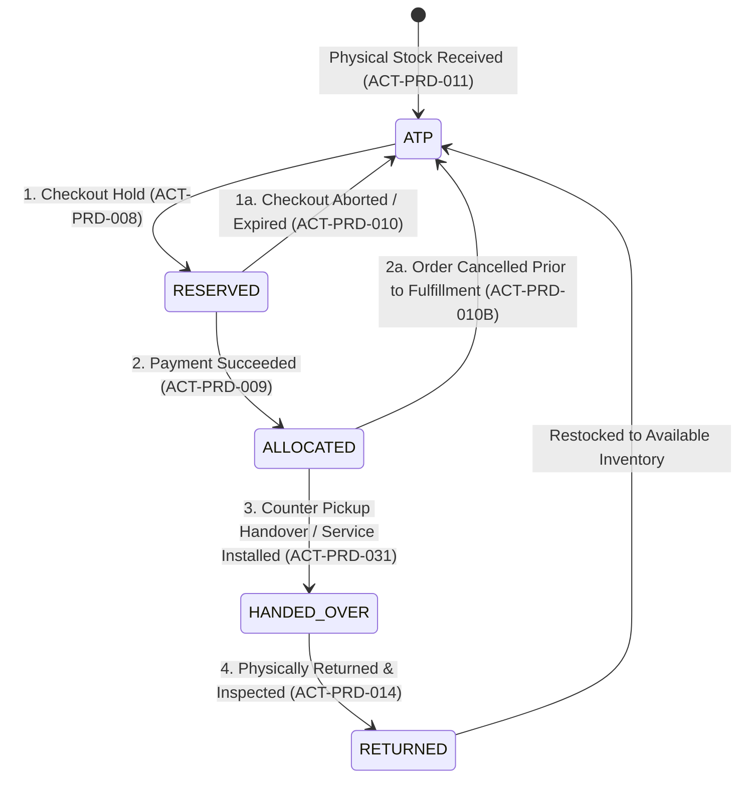

# Microservice Architecture Specification: `automotive-product`

> **Service Identity**: `automotive-product` (Port 8092)
> **Status**: AUTHORITATIVE IMPLEMENTATION SPECIFICATION (Phase 2F-B-R2)
> **Primary Authority**: Tire/Parts Catalog, Automotive Services, Base/Store Pricing Rules, Vehicle Fitment (YMMT) & Branch Inventory Accounting
> **Storage**: PostgreSQL (catalog, specifications, branch inventory ledger, reservations, stock movements)
> **Consolidated Modules**: 3 Substantive Modules
> **Total Activities Owned**: 31 Activities (`ACT-PRD-001` through `ACT-PRD-031`)
> **Total Unique HTTP Endpoints**: 28 Endpoints (27 HTTP routes + 1 background janitor operation)

---

## 1. Domain Boundary & Module Architecture

`automotive-product` is the authoritative source for all physical parts, global service definitions, vehicle fitment compatibility, and branch-level inventory balances.

```
automotive-product (Port 8092)
├── catalog/      # MODULE 1: Catalog & Services Module (12 activities: ACT-PRD-001, 002, 015, 016, 017, 020, 021, 022, 023, 027, 029, 030)
├── fitment/      # MODULE 2: Vehicle Fitment Module (4 activities: ACT-PRD-003, 004, 024, 026)
└── inventory/    # MODULE 3: Branch Inventory & Stock Allocation Module (15 activities: ACT-PRD-006..014, 018, 019, 025, 028, 031)
```

---

## 2. Business Entities & State Machine Transitions

### 2.1 Core Entities Owned (`P2-DEC-01`–`P2-DEC-05`)
1. `product_category` & `brand` (PostgreSQL): Extensible category lookup (`TIRE`, `WHEEL`, `BRAKE`, `WIPER`, plus future categories such as `WINDSHIELD` via `product_category` + `extra_specs_schema` / additive `<cat>_spec` without altering `physical_product`) and normalized `brand`.
2. `physical_product` (PostgreSQL): `id` (preserves legacy `product_skus.id` UUID), `sku_code`, `category_code`, `brand_id`, `name`, `price_cents` (single nationwide USD price; no store override), `is_active` (admin visibility flag; no archival state machine), `extra_specs JSONB`.
3. **Typed 1:1 Category Spec Tables** (PostgreSQL): `tire_spec`, `wiper_spec`, `wheel_spec`, `brake_spec` (extensible with additive `<cat>_spec` tables or `extra_specs_schema`-validated JSONB), enforced via composite `(physical_product_id, category_code)` FK.
4. `service` (PostgreSQL): `id`, `service_code` (distinct IDs per package, e.g. `INSTALL_1_WHEEL`, `INSTALL_2_WHEELS`, `INSTALL_4_WHEELS`), `name`, `wheel_count`, `estimated_duration_minutes`, `required_capability_code` (no default service price).
5. `store_service_price` (PostgreSQL): `(store_id, service_id)`, `price_cents` (store-specific USD service price; absent row = not sellable at that store; no default service price or fallback override; `store-management` owns facility capability).
6. `vehicle_configuration` & Category Fitment Evidence (PostgreSQL): Normalized YMMT + `tire_fitment_evidence`, `wiper_fitment_evidence`, `wheel_fitment_evidence`, `brake_fitment_evidence` with provenance (`source_provider`, `evidence_version`, `is_active`) returning `COMPATIBLE`, `INCOMPATIBLE`, or `UNKNOWN`.
7. `store_inventory` (PostgreSQL): `id`, `store_id`, `physical_product_id`, `quantity_on_hand`, `quantity_reserved`, `quantity_allocated` (physical goods only; never tracks services).
8. `stock_reservation` & `stock_movement` & `inventory_quarantine_stock` (PostgreSQL): Part 3/Part 8 stock hold, ledger, and quarantine tables.

### 2.2 Stock Reservation Lifecycle
```text
Stock Hold Lifecycle:
  [HELD] --(Payment Succeeded)--> [CONFIRMED_ALLOCATED] --(Handover/Install)--> [FULFILLED]
    |
    +--(Timeout / Janitor)------> [EXPIRED]
    +--(Checkout Cancelled)-----> [RELEASED]
```

---

## 3. Module Specifications & Business Activities

### 3.1 Module 1: Catalog & Services Module

| Activity ID | Activity Name | Method & Proposed URI | Visibility | Concurrency & Data Target | Target p95 Latency |
| :--- | :--- | :--- | :---: | :--- | :---: |
| **ACT-PRD-001** | Search Tire & Parts Catalog | `GET /api/v1/automotive/products/catalog/tires` | PUBLIC | Typed `tire_spec` B-Tree + `ATP > 0` branch filter | < 35 ms |
| **ACT-PRD-002** | Get Detailed Physical Product / Service Spec | `GET /api/v1/automotive/products/catalog/{id}` | PUBLIC | PK lookup on `physical_product` + typed spec + `extra_specs` | < 25 ms |
| **ACT-PRD-015** | Filter Catalog by Brand | `GET /api/v1/automotive/products/catalog/brands` | PUBLIC | Normalized `brand` lookup | < 30 ms |
| **ACT-PRD-016** | Filter Catalog by Dimensions / Category | `GET /api/v1/automotive/products/catalog/dimensions` | PUBLIC | Typed category spec indexes (e.g. `wiper_spec`, `wheel_spec`) | < 30 ms |
| **ACT-PRD-017** | Query Product Categories | `GET /api/v1/automotive/products/catalog/families` | PUBLIC | Extensible `product_category` lookup (`is_active = TRUE`) | < 25 ms |
| **ACT-PRD-020** | Ingest Physical Product & Typed Spec | `POST /api/v1/automotive/products/admin/catalog/skus` | ADMIN | Local TX; inserts `physical_product` + matching `<cat>_spec` | < 80 ms |
| **ACT-PRD-021** | Update Typed Spec Parameters | `PUT /api/v1/automotive/products/admin/catalog/skus/{id}/spec`| ADMIN | Optimistic `version` check (409 on stale); rejects category change | < 60 ms |
| **ACT-PRD-022** | Toggle Product Visibility Flag | `DELETE /api/v1/automotive/products/admin/catalog/skus/{id}` | ADMIN | Sets `is_active = FALSE` (no archival/discontinued state machine; `ON DELETE RESTRICT` blocks destructive delete) | < 50 ms |
| **ACT-PRD-023** | Batch Quote USD Prices (Physical & Service) | `POST /api/v1/automotive/products/catalog/prices:batch` | PUBLIC / INTERNAL| Global `physical_product.price_cents` + `store_service_price` | < 35 ms |
| **ACT-PRD-027** | Synchronize Vendor Feeds | `POST /api/v1/automotive/products/admin/catalog/vendor-sync` | ADMIN | Batch vendor catalog ingestion | < 250 ms |
| **ACT-PRD-029** | Define Global Automotive Service Variant | `POST /api/v1/automotive/products/admin/services` | ADMIN | Models distinct service variant (`wheel_count`, duration, capability) | < 50 ms |
| **ACT-PRD-030** | Configure Store Service USD Price | `PUT /api/v1/automotive/products/admin/stores/{storeId}/services/{serviceId}/price` | ADMIN | Upserts `store_service_price(store_id, service_id, price_cents)` only (no default service price, no fallback, no pricing history, no rule engine) | < 45 ms |

---

### 3.2 Module 2: Vehicle Fitment Module

| Activity ID | Activity Name | Method & Proposed URI | Visibility | Concurrency & Data Target | Target p95 Latency |
| :--- | :--- | :--- | :---: | :--- | :---: |
| **ACT-PRD-003** | Lookup Vehicle Fitment (YMMT) | `GET /api/v1/automotive/products/fitment/lookup` | PUBLIC | Index on `(year, make_id, model_id, trim)` | < 25 ms |
| **ACT-PRD-004** | Validate Tire Compatibility | `POST /api/v1/automotive/products/fitment/validate` | PUBLIC | Evaluates load index & diameter bounds | < 30 ms |
| **ACT-PRD-005** | Filter Tires by Dimensions | `GET /api/v1/automotive/products/catalog/tires/dimensions` | PUBLIC | Dimensional composite index (`width, ratio, rim`) | < 30 ms |
| **ACT-PRD-024** | Import OEM Vehicle Fitment Data | `POST /api/v1/automotive/products/admin/fitment/import` | ADMIN | Batch NHTSA vPIC fitment dataset | < 500 ms |
| **ACT-PRD-026** | Register Staggered Fitments | `POST /api/v1/automotive/products/admin/fitment/staggered` | ADMIN | Front/rear tire pairing rules | < 55 ms |

---

### 3.3 Module 3: Branch Inventory & Stock Allocation Module

| Activity ID | Activity Name | Method & Proposed URI | Visibility | Concurrency & Data Target | Target p95 Latency |
| :--- | :--- | :--- | :---: | :--- | :---: |
| **ACT-PRD-006** | Query Branch Stock Balances | `GET /api/v1/automotive/products/inventory/balances` | PUBLIC / INTERNAL| Read-committed ATP calculation | < 30 ms |
| **ACT-PRD-007** | Batch Query Multi-Store Stock | `POST /api/v1/automotive/products/inventory/balances:batch`| INTERNAL / SAGA | Batch IN query across stores | < 45 ms |
| **ACT-PRD-008** | Reserve Physical Stock | `POST /api/v1/automotive/products/inventory/reservations` | INTERNAL / SAGA | Conditional atomic update on `store_inventory`| < 35 ms |
| **ACT-PRD-009** | Confirm Stock Allocation | `POST /api/v1/automotive/products/inventory/reservations/{id}/confirm`| INTERNAL / SAGA | Moves `reserved` -> `allocated`; `on_hand` same| < 40 ms |
| **ACT-PRD-010** | Release / Compensate Stock Hold | `DELETE /api/v1/automotive/products/inventory/reservations/{id}`| INTERNAL / SAGA | Decrements `reserved` | < 35 ms |
| **ACT-PRD-011** | Ingest Warehouse Goods Receipt | `POST /api/v1/automotive/products/inventory/receipts` | STAFF | Increments `quantity_on_hand` | < 60 ms |
| **ACT-PRD-012** | Dispatch Inter-Branch Transfer | `POST /api/v1/automotive/products/inventory/transfers/dispatch` | STAFF | Decrements source `on_hand` | < 70 ms |
| **ACT-PRD-013** | Receive Inbound Inter-Branch Transfer | `POST /api/v1/automotive/products/inventory/transfers/receive` | STAFF | Increments dest `on_hand` | < 65 ms |
| **ACT-PRD-014** | Execute Physical Stock Adjustment | `POST /api/v1/automotive/products/inventory/adjustments` | STAFF / ADMIN | Audit record in `stock_movement` | < 55 ms |
| **ACT-PRD-018** | Query Inventory Movement Ledger | `GET /api/v1/automotive/products/inventory/movements` | STAFF / ADMIN | Date-range partitioned query | < 50 ms |
| **ACT-PRD-019** | Janitor Purge of Expired Holds | `NO HTTP ENDPOINT` (`ReservationJanitorJob`) | INTERNAL | Background janitor running every 60s | < 60s delay |
| **ACT-PRD-025** | Reconcile Inventory vs Ledger | `POST /api/v1/automotive/products/inventory/reconcile` | ADMIN | Periodic integrity audit | < 200 ms |
| **ACT-PRD-028** | Mark Damaged Stock | `POST /api/v1/automotive/products/inventory/damage` | STAFF | Decrements `on_hand`; writes scrap audit | < 45 ms |
| **ACT-PRD-031** | Record Physical Stock Handover | `POST /api/v1/automotive/products/inventory/fulfill-handover`| INTERNAL / STAFF | Decrements `quantity_allocated` AND `on_hand` | < 60 ms |

#### Part 2 Catalog, Pricing & Fitment API Examples (`P2-DEC-01`–`P2-DEC-05`)

1. **Typed Tire Search (`ACT-PRD-001`)**:
   - `GET /api/v1/automotive/products/catalog/tires?width_mm=215&season=ALL_SEASON&store_id=1a2b3c4d-5e6f-7a8b-9c0d-1e2f3a4b5c6d&page=0&size=20&sort=price_cents,asc`
   - Uses `idx_tire_spec_search (width_mm, season, rim_diameter_in)` + `store_inventory` (`ATP > 0`). Unstocked items at `store_id` are excluded; returns `400 Bad Request` on invalid filter enum/range.
2. **Typed Wiper 18-Inch Search (`ACT-PRD-016`)**:
   - `GET /api/v1/automotive/products/catalog/dimensions?category=WIPER&length_in=18.0&store_id=1a2b3c4d-5e6f-7a8b-9c0d-1e2f3a4b5c6d`
   - Uses `idx_wiper_spec_search (length_in, connector_type)` with no JSONB cast.
3. **Batch Typed USD Quote (`ACT-PRD-023`)**:
   - Request (`POST /api/v1/automotive/products/catalog/prices:batch`):
     ```json
     {
       "store_id": "1a2b3c4d-5e6f-7a8b-9c0d-1e2f3a4b5c6d",
       "lines": [
         { "item_type": "PHYSICAL_PRODUCT", "physical_product_id": "8a3e7b1a-4d2c-4b5a-9f8e-1b2c3d4e5f6a", "quantity": 4 },
         { "item_type": "SERVICE", "service_id": "a1b2c3d4-0004-4000-8000-000000000004", "quantity": 1 },
         { "item_type": "SERVICE", "service_id": "a1b2c3d4-0001-4000-8000-000000000001", "quantity": 1 }
       ]
     }
     ```
   - Response (`200 OK` — informational until authoritative Place Order/Pay revalidation; taxes/fees separated at checkout):
     ```json
     {
       "currency": "USD",
       "store_id": "1a2b3c4d-5e6f-7a8b-9c0d-1e2f3a4b5c6d",
       "lines": [
         { "item_type": "PHYSICAL_PRODUCT", "item_id": "8a3e7b1a-4d2c-4b5a-9f8e-1b2c3d4e5f6a", "sellable": true, "unit_price_cents": 14999, "line_subtotal_cents": 59996, "price_source": "GLOBAL_PHYSICAL_PRICE" },
         { "item_type": "SERVICE", "item_id": "a1b2c3d4-0004-4000-8000-000000000004", "service_code": "INSTALL_4_WHEELS", "wheel_count": 4, "sellable": true, "unit_price_cents": 8000, "line_subtotal_cents": 8000, "price_source": "STORE_SERVICE_PRICE" },
         { "item_type": "SERVICE", "item_id": "a1b2c3d4-0001-4000-8000-000000000001", "service_code": "INSTALL_1_WHEEL", "wheel_count": 1, "sellable": false, "reason": "NOT_OFFERED_AT_STORE" }
       ]
     }
     ```
   - *Pricing vs. Scheduling Boundary*: `automotive-product` returns USD prices only; `store-management` validates physical bay/equipment capability at booking (Part 5).
4. **Category-Aware Fitment Check (`ACT-PRD-004`)**:
   - `POST /api/v1/automotive/products/fitment/validate` checks `vehicle_configuration` + active category-specific evidence (`tire_fitment_evidence` checks dimension + `load_index >= min_load_index` + ordered `speed_rating` rank comparison where `H > T` + `FRONT`/`REAR`/`ALL` staggered axle rules; wiper/wheel/brake check their respective rules). The compatibility `result` enum strictly has **exactly three values**: `COMPATIBLE`, `INCOMPATIBLE`, or `UNKNOWN` (missing or conflicting evidence returns `result: "UNKNOWN"`, never silently `COMPATIBLE`; failed spec checks return `result: "INCOMPATIBLE"`):
     ```json
     {
       "vehicle_configuration_id": "5f6e7d8c-1234-4abc-9def-0123456789ab",
       "physical_product_id": "8a3e7b1a-4d2c-4b5a-9f8e-1b2c3d4e5f6a",
       "category_code": "TIRE",
       "axle_position": "FRONT",
       "fitment_required": true,
       "result": "COMPATIBLE",
       "reasons": ["Matches OEM 225/65R17, load_index 102 >= 100, speed_rating H (210 km/h) >= T (190 km/h)"],
       "evidence_source": "OEM_FITMENT_FEED",
       "evidence_version": "2026.11"
     }
     ```
   - **Non-Applicable Categories (`fitment_mode = NONE_REQUIRED`)**: Represented separately via `"fitment_required": false` and `"result": null` (never a fourth enum value), with `"reasons": ["CATEGORY_FITMENT_NOT_REQUIRED"]`:
     ```json
     {
       "vehicle_configuration_id": "5f6e7d8c-1234-4abc-9def-0123456789ab",
       "physical_product_id": "9b4f8c2b-5e3d-4c6b-8a9f-2c3d4e5f6a7b",
       "category_code": "ACCESSORY",
       "fitment_required": false,
       "result": null,
       "reasons": ["CATEGORY_FITMENT_NOT_REQUIRED"]
     }
     ```
   - Example `INCOMPATIBLE` / `UNKNOWN` outcomes:
     - Staggered vehicle with `axle_position: "ALL"` or missing evidence → `"fitment_required": true`, `result: "UNKNOWN"`, `reasons: ["AXLE_POSITION_REQUIRED_FOR_STAGGERED_FITMENT"]` or `["NO_FITMENT_EVIDENCE"]`.
     - Conflicting active evidence rows → `"fitment_required": true`, `result: "UNKNOWN"`, `reasons: ["CONFLICTING_FITMENT_EVIDENCE"]`.
     - Tire with `speed_rating = "S"` (180 km/h) vs `min_speed_rating = "T"` (190 km/h) → `"fitment_required": true`, `result: "INCOMPATIBLE"`.

#### Detailed Endpoint Specification: ACT-PRD-008 (Reserve Physical Stock)
- **HTTP Method & Path**: `POST /api/v1/automotive/products/inventory/reservations` (Visibility: INTERNAL)
- **Request Headers**: `Idempotency-Key: {uuid}`, `Authorization: Bearer {internal_token}`
- **Request Body**:
  ```json
  {
    "store_id": "1a2b3c4d-5e6f-7a8b-9c0d-1e2f3a4b5c6d",
    "sku_id": "8a3e7b1a-4d2c-4b5a-9f8e-1b2c3d4e5f6a",
    "quantity": 4,
    "ttl_minutes": 15,
    "order_id": "ord-20261123-0091"
  }
  ```
- **Response**: `201 Created`
  ```json
  {
    "reservation_id": "res-9988-7766-5544",
    "status": "HELD",
    "store_id": "1a2b3c4d-5e6f-7a8b-9c0d-1e2f3a4b5c6d",
    "sku_id": "8a3e7b1a-4d2c-4b5a-9f8e-1b2c3d4e5f6a",
    "quantity": 4,
    "expires_at": "2026-11-23T23:35:00Z"
  }
  ```
- **Concurrency Algorithm (Atomic Conditional Update)**:
  ```sql
  UPDATE store_inventory
  SET quantity_reserved = quantity_reserved + :req_qty
  WHERE store_id = :store_id
    AND sku_id = :sku_id
    AND (quantity_on_hand - quantity_reserved - quantity_allocated) >= :req_qty
  RETURNING id, quantity_on_hand, quantity_reserved, quantity_allocated;
  ```
### 3.4 Rigorous Inventory Commands & Lifecycle Transitions

To maintain strict physical accounting, financial auditability, and prevent blind counter decrements upon events, `automotive-product` exposes separate, conditionally verified commands for each distinct inventory lifecycle event:



1. **Release Active Checkout Reservation (`ACT-PRD-010`)**:
   - *Trigger*: Checkout saga compensation or expiration janitor (`ACT-PRD-019`).
   - *State Transition*: `quantity_reserved = quantity_reserved - :qty` (where `status = 'ACTIVE'`).
   - *Effect on On-Hand*: `quantity_on_hand` unchanged. Restores Available-to-Promise ($	ext{ATP}$).
2. **Cancel Confirmed Order Allocation (`ACT-PRD-010B` - Allocation Cancellation)**:
   - *Endpoint*: `POST /api/v1/automotive/products/inventory/allocations/{id}/cancel`
   - *Trigger*: Post-payment order cancellation (`ACT-OPS-007`).
   - *Preconditions*: Allocation must be in state `ALLOCATED_PENDING_FULFILLMENT`.
   - *State Transition*: `quantity_allocated = quantity_allocated - :qty` (where `id = :allocationId AND status = 'ALLOCATED'`).
   - *Effect on On-Hand*: `quantity_on_hand` unchanged. Restores $	ext{ATP}$. Emits `StockAllocationCancelledEvent`.
   - *Duplicate / Concurrent Handling*: If already fulfilled (`HANDED_OVER`), cancellation is rejected with HTTP 409 Conflict.
3. **Partial Order Fulfillment**:
   - Supports line-level fulfillment tracking: records `fulfilled_quantity` on allocation item. Decrements `quantity_allocated` and `quantity_on_hand` strictly by fulfilled quantity. Unfulfilled remainder stays allocated until subsequent fulfillment or explicit partial cancellation.
4. **Physical Handover / Installation (`ACT-PRD-031`)**:
   - *Trigger*: Customer carry-out PIN verification (`ACT-OPS-016`) or technician work order finalization (`ACT-OPS-014`).
   - *Preconditions*: Allocation status must be `ALLOCATED`.
   - *State Transition*: `quantity_on_hand = quantity_on_hand - :qty, quantity_allocated = quantity_allocated - :qty`.
   - *Effect on ATP*: $	ext{ATP}$ formula remains identical since both on-hand and allocated drop by the same quantity.
5. **Physical Goods Return, Inspection & Disposition (`ACT-PRD-014` & `ACT-PRD-028`)**:
   - *Strict Accounting Principle*: Physically returned items are NEVER automatically returned to sellable Available-to-Promise inventory.
   - *Mandatory Inspection & Quarantine*:
     - When tires are returned physically to a store counter, store staff issues `POST /api/v1/automotive/products/inventory/returns/intake`. Stock enters `RETURNED_QUARANTINE` status in `inventory_quarantine_item`. `quantity_on_hand` and Available-to-Promise ($	ext{ATP}$) remain unchanged.
     - Store manager or certified technician conducts physical inspection for tread wear (32nds inch gauge), bead tears, punctures, and mounting marks.
   - *Formal Disposition Outcomes*:
     - *Outcome A (Sellable - Full Restock)*: If unmounted and pristine, manager approves restock (`ACT-PRD-014`). Executes `quantity_on_hand = quantity_on_hand + :qty` with audit reason `RMA_RESTOCK_APPROVED`. Stock returns to $	ext{ATP}$.
     - *Outcome B (Damaged / Unsellable)*: If damaged or worn, item is written off via `ACT-PRD-028` (`Mark Damaged Stock`). Stock moves to salvage scrap inventory; never enters $	ext{ATP}$.
     - *Outcome C (Warranty / Factory Defect)*: Item logged into `warranty_dispute_log` for vendor credit claims against distributor/OEM.
     - *Outcome D (Service Rework / Dispute)*: Defective installation rework consumes warranty parts without charging customer; logged against original `work_order_id`.
6. **Accounting for Consumed Service Parts**:
   - Shop supplies (valve stems, wheel weights, oil) consumed during work orders are deducted directly from on-hand inventory via `ACT-PRD-031` linked to the `work_order_id`, recording permanent audit entries in `inventory_movement_ledger`.

---

## 4. Background Operations & Daemons
1. **`ReservationJanitorJob`** (`ACT-PRD-019`): Runs every 60 seconds; selects expired holds with `FOR UPDATE SKIP LOCKED`; releases `quantity_reserved`; marks reservations `EXPIRED`.
2. **`StockLedgerArchivalJob`**: Runs daily at 02:00 AM; archives movement ledger records older than 365 days into cold storage.
