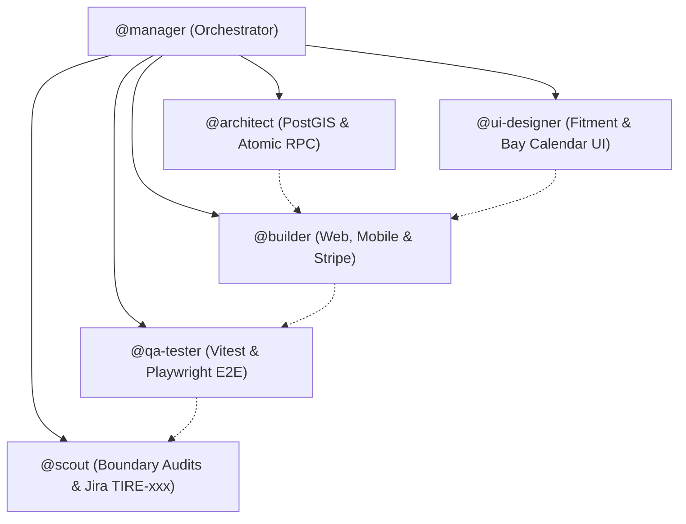

# ADR 001: Sprint 1 Implementation Scope & Architectural Decisions

- **Status**: Approved
- **Date**: 2026-11-08
- **Decider**: Project Lead & Antigravity Swarm (`@manager`, `@architect`, `@builder`, `@ui-designer`, `@qa-tester`, `@scout`)

---

## 1. Context & Business Scope

The objective is to implement the end-to-end commerce and booking platform for the Tire Store App across Web (`apps/web`), Mobile (`apps/mobile`), and Backend (`packages/db`, `packages/api-client`, `packages/types`, `packages/ui`).

---

## 2. Key Decisions

### A. Authentication & User Onboarding

- **Multi-Method Auth**: Supabase Auth configured for:
  1. Email/Password + Magic Link (Email OTP).
  2. Apple Sign-In (mandatory for iOS App Store compliance) and Google OAuth.
  3. SMS OTP verification.
  4. **Guest Checkout**: Customers can search, add tires, select installation bay slots, and complete Stripe checkout without upfront registration. An order is linked to their guest email/phone, and a password can be set post-purchase to claim their garage.

### B. Vehicle Fitment Engine

- **Initial Dataset**: Seed realistic fitment configurations for top high-volume makes (Toyota, Tesla, Honda, Ford, BMW, Chevrolet) covering model years 2018–2025.
- **NHTSA Sync**: Provide a seed script utilizing the free NHTSA vPIC API for VIN decoding and make/model validation.
- **Staggered Support**: Schema and UI natively support staggered wheel setups (different front and rear tire dimensions, e.g. Tesla Model 3 Performance, BMW M3).

### C. Service Bay Scheduling & Dynamic Duration Math

- **Dynamic Time Blocks**: Bay appointment duration is dynamically computed based on selected items and services:
  - Base tire installation (4 tires): **60 minutes**.
  - Base tire installation (2 tires): **35 minutes**.
  - Wheel alignment addition: **+30 minutes**.
  - TPMS sensor programming / balance: **+15 minutes**.
- **Conflict Prevention**: Supabase RPC enforces PostgreSQL `tstzrange` exclusion locks to eliminate double booking across physical service bays.

### D. First Implementation Milestone (Sprint 1 Vertical Slice)

A complete, functioning end-to-end user journey:

1. **Vehicle Fitment Selector**: `Year` ➔ `Make` ➔ `Model` ➔ `Trim` selector with garage save option.
2. **Filtered Tire Catalog**: ISR-powered catalog displaying compatible tires with specifications (season, load/speed, warranty, price).
3. **PostGIS Store Locator**: Browser/mobile geolocation querying physical service bays within radius with distance calculation.
4. **Bay Appointment Reservation**: Real-time calendar slot selector with dynamic service duration math.
5. **Stripe Atomic Checkout**: Stripe Elements / mobile Apple Pay executing atomic PostgreSQL RPC reserving the bay and creating the paid order.

---

## 3. Sub-Agent Responsibilities for Sprint 1

